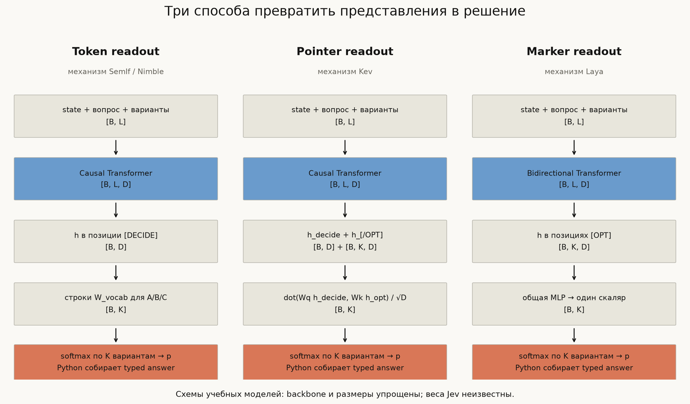

# Decision models с нуля

Учебная лаборатория открытых аналогов **Jev / System One** для человека, знакомого
с GPT, BERT и PyTorch. Прослеживаем путь от входных описаний классов до распределения
по ответам: тензоры, маски внимания, readout, обучение, калибровка.



В [nanoGPT](https://github.com/karpathy/nanoGPT) берём за образец компактные
`model.py` и `train.py`, в
[LLMs-from-scratch](https://github.com/rasbt/LLMs-from-scratch) — последовательность
«идея → промежуточные тензоры → исполняемый эксперимент». Код этой лаборатории
написан отдельно; это не копия учебных материалов этих авторов.

## Начать здесь

1. **[notebook.ipynb](notebook.ipynb)** — пройти вычисления по шагам.
2. **[tutorial.md](tutorial.md)** — архитектурный разбор с формулами и схемами.
3. **[model.py](model.py)** — прочитать три минимальные модели целиком.
4. **[sources.md](sources.md)** — перейти от учебных блоков к реальным исходникам.

Архитектура самого Jev закрыта. Мы воспроизводим отдельные открытые механизмы
**SemIf/Nimble, Kev и Laya**, а не скрытую модель TypeSafe. Синтетическая задача
здесь проверяет вычисления и обучаемость; её accuracy не сопоставима с NLP-бенчмарками.

## Запуск

Все команды — **из корня MLIB**. Python 3.11+; проверено на Python 3.12, CPU и Apple MPS.
Веса Hugging Face, API-ключи и GPU для учебного кода не нужны.

```bash
# Если .venv ещё нет:
uv venv --python 3.12 .venv

uv pip install --python .venv/bin/python -r tracks/decision-models/requirements.txt

# Формы тензоров, маски, эквивалентность cache/full forward; случайные веса.
.venv/bin/python tracks/decision-models/inspect_model.py

# Обучить одну модель, откалибровать, сохранить веса и отчёт.
.venv/bin/python tracks/decision-models/train.py --model pointer

# Посмотреть настоящее предсказание обученной учебной модели.
.venv/bin/python tracks/decision-models/inspect_model.py \
  --checkpoint tracks/decision-models/out/pointer-ce.pt
```

Если `uv` не установлен, создать окружение можно через `python3.12 -m venv .venv`,
а зависимости установить через `.venv/bin/python -m pip install -r ...`.
В Jupyter/VS Code выберите Python из `.venv`; откройте `notebook.ipynb` и выполните
Run All. Notebook содержит короткое обучение на 16 примерах; полный прогон — в CLI.

В первой code cell notebook автоматически выбирает `mps` (Metal) на совместимом
Mac, иначе `cpu`. Можно явно задать `device = torch.device("mps")` или `"cpu"`.
После смены выполните **Restart Kernel → Run All**, чтобы модели и batch оказались
на одном устройстве. Ядро Python и устройство PyTorch — разные настройки.

```bash
# Полный эксперимент: 3 readout на одной задаче, одинаковые seed и бюджет шагов.
.venv/bin/python tracks/decision-models/train.py --model all --steps 2000

# Обучение на Apple GPU через Metal.
.venv/bin/python tracks/decision-models/train.py --model pointer --device mps

# Отдельный Laya-inspired policy-gradient эксперимент. Не RLCD TypeSafe.
.venv/bin/python tracks/decision-models/train.py --model marker --objective rlcd --steps 300

# Архитектурные и численные проверки.
.venv/bin/python -m unittest discover -s tracks/decision-models/tests -v

# Пересоздать диаграммы. Без флага используются сохранённые результаты.
.venv/bin/python tracks/decision-models/generate_visuals.py

# Обновить диаграммы и сохранённые результаты своим полным прогоном.
.venv/bin/python tracks/decision-models/generate_visuals.py \
  --results tracks/decision-models/out
```

`--steps 50` — быстрый smoke run, не достаточное обучение.
CLI по умолчанию работает на CPU с одним потоком; устройство меняется через
`--device mps` или `--device cuda`. Сохранённые графики в `assets/` получены на CPU;
вывод notebook отражает устройство его последнего запуска. Скорость зависит от
устройства; численная идентичность разных backend не предполагается.

## Оригинальные реализации

```bash
.venv/bin/python tracks/decision-models/fetch_references.py
```

Команда загружает **исходники**, не веса и не зависимости. Каждый checkout находится
на конкретном SHA из [upstreams.json](upstreams.json). Повторный запуск проверяет
версию и чистоту checkout; чужие локальные изменения не сбрасывает.

| Папка после загрузки | Проект | Что читать первым |
|---|---|---|
| `references/semif/` | [SemIf](https://github.com/TheoLeeCJ/SemIf-OpenJev) | `src/semif_phase1/direct.py` |
| `references/kev/` | [Kev](https://github.com/jaredpalmer/kev) | `kev/model.py` → `PointerHead` |
| `references/laya/` | [Laya](https://github.com/NandhaKishorM/laya) | `laya/common.py` → `DecisionModel` |
| `references/nimble/` | [Nimble](https://github.com/bespokelabsai/nimble) | `nimble/scoring/parallel_scorer.py` |

`references/` исключён из git MLIB: upstream хранится отдельно со своей историей
и лицензиями, а воспроизводимые ссылки — в manifest. Здесь не запускается код
из загруженных репозиториев. Подробная карта чтения — [sources.md](sources.md).

## Что находится в папке

```text
model.py               attention, Transformer, token/pointer/marker readout
data.py                задача, word-level vocabulary, split по состояниям
train.py               AdamW, CE / учебный RLCD, calibration, test, checkpoints
calibration.py         temperature scaling, NLL, Brier, ECE, proper rewards
typed.py               распределение → Choice / Score / Noul
inspect_model.py       формы, packed vs separate, immutable shared KV-prefix
notebook.ipynb         пошаговый исполняемый разбор на русском
build_notebook.py      текстовый источник notebook
tutorial.md            архитектура и ограничения учебных упрощений
sources.md             чтение зафиксированного upstream-кода и публикации
fetch_references.py    загрузка исходников по commit SHA
upstreams.json         версии и сведения о лицензиях
generate_visuals.py    воспроизводимые схемы и графики
assets/                PNG + JSON с измерениями и параметрами прогона
tests/                 проверки математических и архитектурных инвариантов
references/            локальные upstream-checkouts, gitignored
out/                   локальные веса и отчёты, gitignored
```

## Границы эксперимента

Мы обучаем **все** параметры маленького Transformer с нуля. У него абсолютные
position embeddings, **4 головы, 2 блока и ширина 64** по умолчанию — параметры
видны в `Config`. Нет tokenizer BPE, pretrained language
knowledge, LoRA, RoPE, Gated DeltaNet, flash attention и serving-фреймворка.
Сопоставление с реальными моделями делается на уровне механизмов, не числа слоёв.

Классы динамические внутри маленького словаря цветов. Это не демонстрация понимания
невиданных естественно-языковых классов. `typed.py` иллюстрирует форматы ответов;
модели обучаются только categorical choice, без отдельного ordinal/Noul датасета.

Сохранённые графики подписаны как схемы или измерения. Для train/calibration/test
разделены полные состояния; test не используется для подбора температуры.
Оценки по 500 вопросам с повторяющимися состояниями не дают 500 независимых
наблюдений на уровне состояний и не устанавливают OOD-качество.

Двухслойный backbone хорошо переобучается на нескольких примерах, но полный
учебный прогон показывает ограниченное обобщение. Это отправная точка для
экспериментов, не воспроизведение качества открытых checkpoint на pretrained LLM.
Настройки проверялись в ходе разработки; сохранённый test — учебная диагностика,
а не независимое подтверждение превосходства одного readout над другим.
