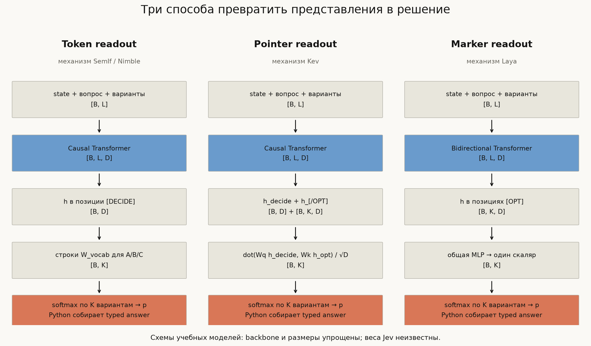
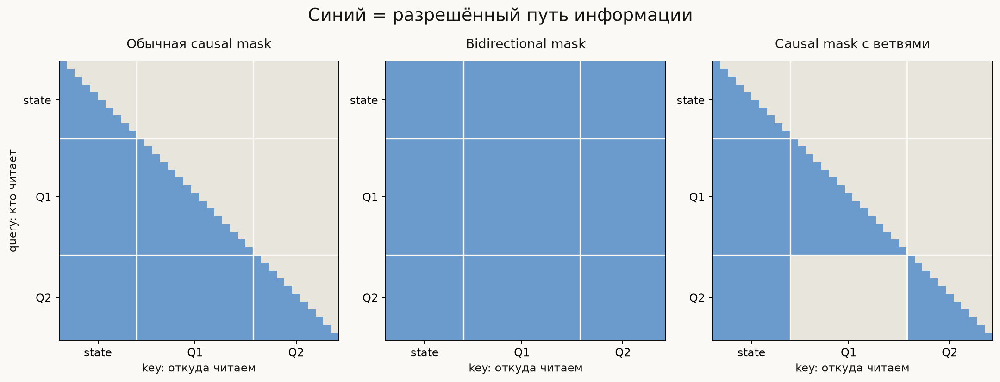
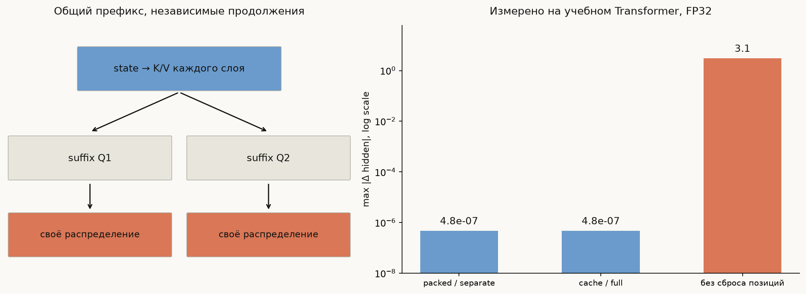
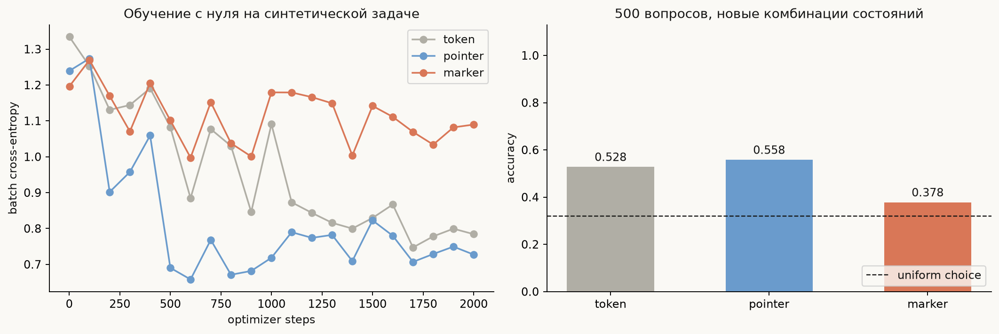
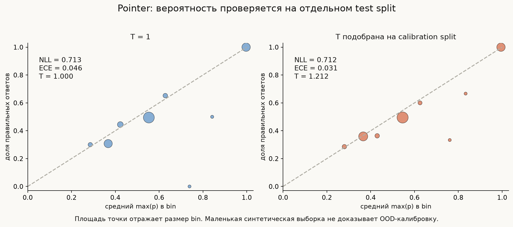

# Как устроены открытые decision models

Отправная точка — знакомый классификатор. BERT преобразует последовательность в
hidden states, а небольшая голова превращает один из них в логиты. В Jev-подобной
постановке **описания классов сами являются частью входа**. Голова оценивает варианты
текущего запроса. Это можно реализовать поверх causal decoder или bidirectional
encoder; три конкретных способа находятся в [model.py](model.py).

## 1. Один запрос, три независимых инженерных вопроса

```text
state:      alice → red, bob → blue
question:   какой цвет у bob?
options:    A → green, B → blue, C → red
target:     индекс B
```

Первый вопрос — **что вычисляется**: распределение
$p_\theta(i\mid x,q,d_1,\ldots,d_K)$ по предложенным описаниям $d_i$.
Второй — **как исполняется**: каждый вопрос отдельным forward, batch вопросов,
упакованные ветви или продолжения общего cache.
Третий — **как обучается**: CE, soft targets, policy gradient, post-hoc calibration.

Ни один из этих выборов не определяет два остальных. Например, causal backbone
не требует цикла генерации, а softmax не гарантирует калибровку. Сходный API может
быть реализован разными сочетаниями этих механизмов.

В [data.py](data.py) конечный мир состоит из $5^4=625$ состояний. Для каждого запроса
случайны человек, число вариантов (2–5) и их порядок. Правильный цвет всегда входит
в список, поэтому задача **не обучает отказу**, отсутствию ответа или open-set detection.
Обучающие состояния, calibration и test разделены: 400 / 100 / 125.

## 2. Общий вычислительный скелет



| Величина | Размер | Смысл |
|---|---|---|
| `tokens` | `[B, L]` | известные входные token IDs |
| `hidden` | `[B, L, D]` | contextual representations |
| `Q`, `K`, `V` | `[B, H, L, D/H]` | проекции одного attention-слоя |
| `allow` | `[B, 1, L, L]` | разрешённые query→key пути |
| `starts`, `ends` | `[B, K]` | позиции маркеров вариантов |
| `decision` | `[B]` | позиция для readout всего вопроса |
| `logits`, `option_mask` | `[B, K]` | оценки и существующие варианты |

`B` — batch; `L` — токены; `H` — attention heads; `D` — hidden width;
`K` — число вариантов, дополненное padding до максимума в batch.

Backbone в учебном коде состоит из token/position embeddings, двух pre-norm
transformer-блоков и финальной LayerNorm. Attention реализован явно:

$$
A=\operatorname{softmax}\left(QK^T/\sqrt{d_h}+M\right),\qquad O=AV,
$$

где $M$ равна нулю для разрешённых связей и $-\infty$ для запрещённых. В коде
используется boolean `allow`, а `masked_fill` создаёт ту же операцию. Далее идут
output projection, residual, LayerNorm, MLP и ещё один residual.

Для padded **ключей** внимание запрещено. Padded **query** может читать допустимые
ключи: его результат всё равно не участвует в readout. Полностью запрещённая строка
создала бы неопределённый `softmax(-inf, ..., -inf)`.

## 3. Token readout: выбрать строки словарной головы

`TokenReadout.forward` получает $h_d$ в позиции `[DECIDE]`. Каждому варианту
назначен однотокенный код: A, B, C и т.д. Из матрицы $W_{vocab}$ выбираются только
строки этих кодов:

$$z_i=W_{v_i}h_d,\qquad p_i=\operatorname{softmax}(z/T)_i.$$

Полная словарная проекция и последующий slice математически эквивалентны проекции
сразу в выбранные строки. Notebook и тест сравнивают оба вычисления.

В SemIf уже есть pretrained LM head. Наши embeddings и LM head первоначально
случайны и обучаются на маленькой задаче. Поэтому совпадает **readout-механизм**,
а не zero-shot способность модели. У Nimble между pretrained базой и таким
readout добавляется специализированное обучение.

`softmax` только по A/B/C условно исключает все другие vocabulary tokens. Если модель
считает предпочтительным «не знаю», но соответствующего варианта нет, renormalization
всё равно даст распределение с суммой 1. Правильность этого распределения проверяется
данными, а не самим фактом нормировки.

В реальном tokenizer недостаточно проверить, что `A` отдельно — один токен:
необходимо ещё проверить границу `prompt + A`. Эту проверку можно найти в SemIf
`encode_prompt`. Наш word-level словарь специально устраняет BPE-сложности.

## 4. Pointer readout: сопоставить решение с вариантами

`PointerReadout.forward` использует два вида представлений: $h_d$ для решения и
$h_i$ в конце каждого варианта. Две линейные проекции дают:

$$z_i=\frac{(W_qh_d)^T(W_kh_i)}{\sqrt D}.$$

Это небольшая attention-подобная операция **над вариантами**, после полного
backbone. Она не является ещё одним attention-слоем над всеми входными токенами.
Вектор `query` имеет размер `[B,1,D]`, варианты — `[B,K,D]`, broadcasting и сумма
по последней оси дают `[B,K]`.

В causal модели токен перед текстом варианта ещё не видел этот текст. Поэтому
readout берётся в `[/OPT]`, после описания. Именно закрывающие маркеры использует
и зафиксированный Kev. Смена семантического набора вариантов не требует новой
матрицы с фиксированными бизнес-классами.

Варианты внутри вопроса здесь могут читать предыдущие варианты. Поэтому
**изоляция вопросов не означает инвариантности к порядку вариантов**. Случайная
перестановка при обучении помогает, но не создаёт точной математической гарантии.

## 5. Marker readout: оценить contextual anchor

`MarkerReadout` использует bidirectional backbone и начало каждого варианта:

$$z_i=\operatorname{MLP}(h_{\text{[OPT]}_i}).$$

Каждый anchor уже видел инструкцию, документ и все варианты. Одна и та же MLP
применяется к каждому $h_i$: растёт число маркеров, но не число параметров головы.
В настоящей Laya эти позиции обозначаются `[MASK]`; MLM-реконструкции слова здесь нет.

Наша модель не воспроизводит ModernBERT. В Laya есть отдельный pretrained encoder,
добавочные transformer-слои, embedding типа вопроса и act/escalate head.
Упрощения вынесены в [sources.md](sources.md), чтобы не приписывать учебную схему
настоящему checkpoint.

## 6. Параллелизм, изоляция и cache



Обычная causal mask разрешает позиции читать все прошлые токены. Если просто
склеить `state + Q1 + Q2`, то Q2 читает Q1. Для независимых вопросов задаём
`segment_id`: 0 — state, 1 — Q1, 2 — Q2. Тогда связь разрешена, если:

$$j\le i\quad\land\quad (s_j=0\ \lor\ s_j=s_i).$$

Токены state не получают информацию из вопросов. Любой вопрос видит общий state
и свою ветку. Каждой ветке назначаем позиции $S,S+1,\ldots$, где $S$ — длина state.
Позиции физически следующей ветки **не** продолжают счётчик предыдущей.



В `isolation_demo` сравниваются hidden states:

1. два полных независимых forward;
2. один packed forward с branch mask и сбросом позиций;
3. prefill state один раз и два forward по suffix с общими per-layer K/V.

Также изменяется Q1 и проверяется неизменность Q2, затем наоборот. Cache проверяется
на отсутствие мутаций. Контрольный ошибочный прогон без сброса позиций даёт иной
результат. Все числа на графике считаются этим кодом; допуск теста — $2\cdot10^{-5}$.

Упаковка здесь использует **плотную** attention-матрицу. Булева маска запрещает
связи, но не пропускает соответствующие matmul FLOPs. Поэтому packed forward не
следует автоматически объявлять оптимальным serving-путём. Реальное cache reuse
устраняет повторное вычисление state; вопросы всё ещё должны читать его K/V.

Для encoder с совместным bidirectional attention представления state зависят
от вопроса. Переиспользовать их между произвольными вопросами тем же способом
нельзя. Laya обрабатывает отдельные question/state-последовательности в batch.
У гибридных Qwen в Kev есть рекуррентные слои: одной attention mask недостаточно
для изоляции их состояния; upstream использует отдельные строки и свой cache.

## 7. Обучение и честная оценка маленькой модели

`train.py` обучает весь backbone через AdamW. Для CE loss:

$$\mathcal L=-\log p_\theta(y\mid x,q,C).$$

Label — индекс правильного варианта после перестановки. Padded варианты получают
логит $-\infty$. После последнего optimizer step выполняются три отдельные операции:
сбор calibration logits, подбор общей температуры, оценка на test.



Данные синтетические, словарь и правило общие между split; test проверяет новые
**комбинации** состояний, а не новые языки или постановки задач. Кривые — sparse
измерения batch loss, а не сглаженная validation loss. Общий бюджет и один seed
не делают этот прогон сравнительным исследованием архитектур: головам могут
требоваться разные initialization, learning rate и число шагов.

Полные параметры и метрики находятся в
[training_experiment.json](assets/training_experiment.json). Checkpoints лежат
локально в `out/` и не входят в git. При коротком прогоне точность может оставаться
низкой: способность выучить 16 примеров из notebook не равна generalization.

## 8. Proper scores и учебный policy gradient

В `calibration.py` reward оценивает сообщённое распределение, а не только sampled
категорию. Для target distribution $t$:

$$R(p,t)=\sum_i t_i\log p_i+0.5\frac{t^Tp}{\|p\|_2}.$$

Для ordinal-примера добавляется штраф по разнице CDF (ranked probability score).
Обычный CE уже является отрицательным log score. Использование RL — отдельный
выбор оптимизатора, не необходимое условие «честных вероятностей».

`rlcd_loss` добавляет центрированный Gaussian noise к логитам и получает группу
распределений. Считаются rewards, leave-one-out baseline и score-function gradient:

$$\mathcal L_{PG}=-\frac1G\sum_g (R_g-b_g)\log\pi_\theta(u_g).$$

В `log_policy` sampled $u_g$ отсоединён от графа, а mean logits — нет. Уровень шума
здесь фиксирован; CE добавляется с весом 1.0. Это **учебный вариант по мотивам
открытого Laya notebook**, с указанными отличиями baseline; не рецепт TypeSafe.
Правильность формулы proper score не гарантирует, что конечная модель обучилась
или будет откалибрована на другом домене.

## 9. Калибровка и типизированный результат

$$p_i(T)=\operatorname{softmax}(z/T)_i,\qquad T>0.$$

Общая температура сохраняет порядок логитов, но меняет распределение. В учебном
коде ищем $T$ по сетке `[0.1, 10]`, включая 1, минимизируя calibration NLL. Это
прозрачный bounded search, а не утверждение, что такая сетка оптимальна всегда.



На test печатаются accuracy, NLL, Brier (сумма квадратов по классам, затем среднее)
и top-label ECE с 10 bins. Размер bins важен: несколько точек около диагонали
не доказывают устойчивой калибровки. Подбор $T$ на calibration может улучшить или
ухудшить test NLL; график показывает фактический результат.

`typed.py` преобразует уже готовое $p$:

- Choice: индекс максимума → исходное имя варианта;
- Noul: $p_{true}$, при явно зафиксированном порядке `[false, true]`;
- Score: $\sum_i i\,p_i$ для словесно заданных уровней;
- Concentration: $1-H(p)/\log K$, характеристика формы распределения.

Concentration не является оценкой correctness и не повторяет confidence Jev.
Например, уверенное неправильное распределение имеет высокую concentration.
Среднее Score тоже теряет информацию: распределения `(0,1,0)` и `(0.5,0,0.5)`
имеют одинаковое ожидание 1 при разной неопределённости.

## 10. Следующие эксперименты

Изменяйте по одному механизму и сначала формулируйте проверяемое ожидание:

1. Замените option-end на option-start в causal pointer. Что успело прочитать $h_i$?
2. Уберите branch mask или сброс position IDs. Какая проверка эквивалентности падает?
3. Переставьте варианты и сопоставьте вероятности по **описаниям**, не индексам.
4. Увеличьте число людей или поменяйте порядок полей в state. Это тест переноса правила.
5. Сравните CE и policy-gradient + CE при равном числе backbone updates и нескольких seeds.
6. Подберите T на одном распределении и проверьте на другом; разделите падение accuracy и calibration.

После этого переходите к [карте upstream-кода](sources.md): она указывает, где
каждый учебный блок превращается в механизм настоящей открытой модели.
