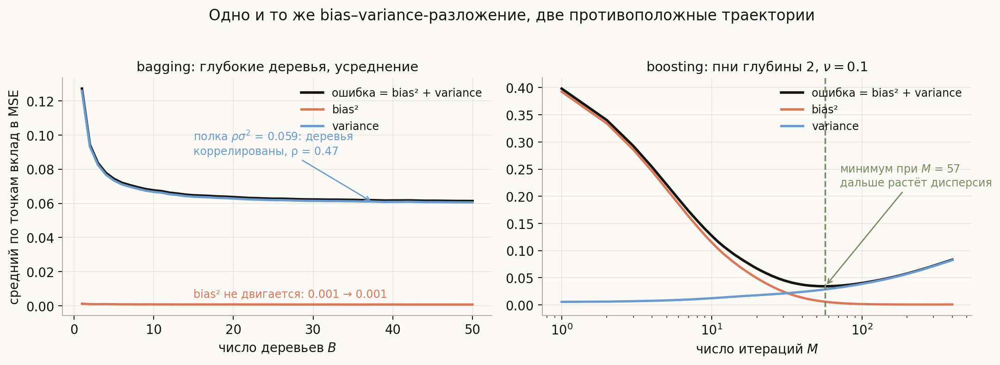
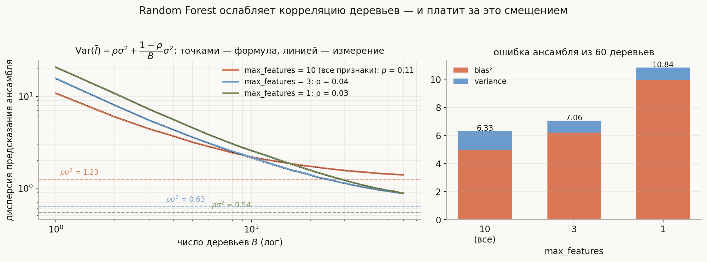
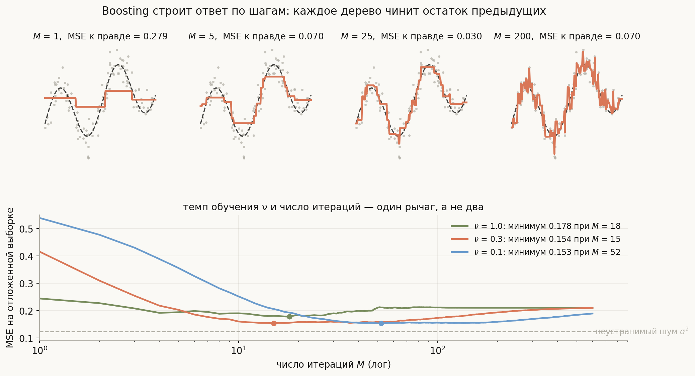
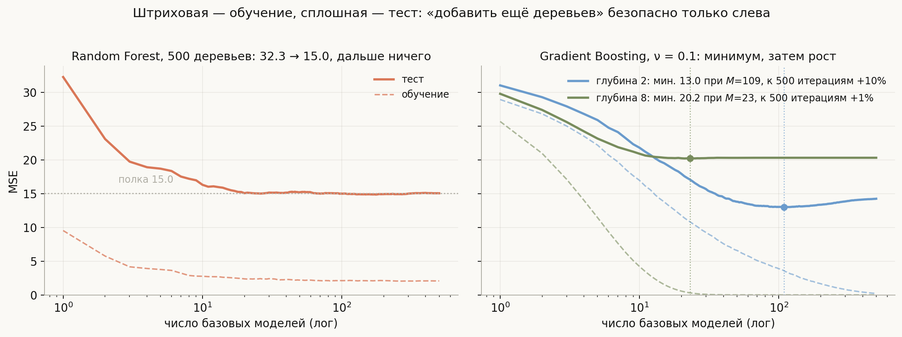

# Bagging и Boosting

**Вопрос (EN)**: What are the fundamental differences between bagging and boosting? How are they used in deep learning?

Стандартный ответ известен всем: «бэггинг обучает модели параллельно и снижает дисперсию, бустинг — последовательно и снижает смещение». Это правда, и на этом ответ обычно заканчивается — а дальше начинаются вопросы, на которых он рассыпается. Почему тогда лес из тысячи деревьев не сходится к нулевой ошибке, если дисперсия падает как $1/B$? Почему в бустинге деревья обязаны быть *слабыми*, хотя мы вроде бы боремся со смещением? Почему добавить деревьев в Random Forest всегда безопасно, а в градиентный бустинг — нет? И почему в глубоком обучении прижился только один из двух методов?

Разница глубже, чем «параллельно против последовательно». Бэггинг — это **метод Монте-Карло**: он усредняет независимые реализации неустойчивого алгоритма и тем самым убивает случайность обучения. Бустинг — это **градиентный спуск в пространстве функций**: он последовательно минимизирует эмпирический риск, добавляя по одному шагу. Первый — способ стабилизировать уже достаточно гибкую модель, второй — способ **построить** гибкую модель из негибких. Из этой пары определений выводится всё остальное, включая ответ про глубокое обучение.

## План

1. Один ансамбль, два разных дефицита
2. Bagging: усреднение и предел, который ставит корреляция
3. Boosting: градиентный спуск в пространстве функций
4. Прямое сравнение
5. Где привычная формула «variance против bias» врёт
6. Практика: что выбирать и что крутить
7. В глубоком обучении
8. Что спрашивают на собеседовании
9. Типичные ошибки
10. Итог

---

## 1. Один ансамбль, два разных дефицита

Обе схемы решают одну задачу — построить хорошее $f(x)$ из набора слабых кусочков — но лечат разные болезни. Язык, на котором эти болезни различают, — разложение ошибки. Для квадратичной потери, если данные $D$ случайны, а $y = f(x) + \varepsilon$ с $\mathbb{E}\varepsilon = 0$, $\operatorname{Var}\varepsilon = \sigma_\varepsilon^2$:

$$\mathbb{E}_D\big[(y - \hat f_D(x))^2\big] = \underbrace{\sigma_\varepsilon^2}_{\text{шум}} + \underbrace{\big(\mathbb{E}_D \hat f_D(x) - f(x)\big)^2}_{\text{bias}^2} + \underbrace{\operatorname{Var}_D \hat f_D(x)}_{\text{variance}}.$$

Шум не трогает никто. Остаются два слагаемых, и **каждое семейство ансамблей бьёт ровно по одному из них**:

- **Глубокое решающее дерево** почти не смещено (оно способно приблизить любую кусочно-постоянную функцию), но чудовищно неустойчиво: сдвиньте один объект в обучающей выборке — и разбиение в корне может смениться, а с ним и всё дерево. Это чистая дисперсия. Лекарство — **усреднение**.
- **Пень** (дерево глубины 1–2) устойчив как камень: на любой выборке из того же распределения он даст примерно одно и то же. Зато он не в состоянии выразить нужную функцию — это чистое смещение. Лекарство — **сложение многих пней**, каждый из которых доделывает то, что не смогли предыдущие.

Проверим это измерением, а не на словах. Одномерная задача $f(x) = \sin 4x + x/2$ на $[0, 3]$, шум $\sigma_\varepsilon = 0.35$, обучающая выборка из 120 точек, и **120 независимых обучающих выборок**, по которым честно считаются $\mathbb{E}_D$ и $\operatorname{Var}_D$ в каждой точке сетки:

Слева бэггинг глубоких деревьев: bias² стоит на месте (0.001 при $B = 1$ и 0.001 при $B = 50$ — усреднение вообще его не касается), а дисперсия падает с 0.126 до 0.061. Справа бустинг пней глубины 2 с темпом $\nu = 0.1$: bias² обваливается с 0.393 до 0.001, а дисперсия растёт с 0.006 до 0.082. Кривые буквально зеркальны — и обратите внимание, что **у бустинга суммарная ошибка имеет минимум** (0.034 при $M = 57$), после которого растёт; у бэггинга такого минимума нет.

Отсюда и правило выбора базовой модели, которое кажется парадоксальным:

> В бэггинге базовая модель должна быть **переобученной** (глубокое дерево без ограничений), в бустинге — **недообученной** (пень, глубина 2–6). Каждый метод исправляет ровно тот дефект, который вы ему оставили; лечить нечего, если его нет.

## 2. Bagging: усреднение и предел, который ставит корреляция

**Bagging** = **B**ootstrap **Agg**regat**ing** (Breiman, 1996). Из выборки размера $n$ берут $B$ бутстрэп-выборок — по $n$ объектов **с возвращением**, — на каждой обучают свою модель и усредняют предсказания (в классификации — голосуют или усредняют вероятности).

Первый вопрос — почему вообще нужен бутстрэп, а не просто $B$ моделей на одних и тех же данных. Ответ: детерминированный алгоритм на одних данных даст $B$ одинаковых деревьев, и усреднять будет нечего. Бутстрэп — это **источник разнообразия**. Заодно он даёт бесплатную оценку качества: вероятность, что конкретный объект не попал в конкретную бутстрэп-выборку, равна

$$\left(1 - \frac{1}{n}\right)^{n} \xrightarrow[n \to \infty]{} e^{-1} \approx 0.368,$$

то есть каждое дерево не видит примерно **36.8%** объектов и может быть на них проверено. Усреднение таких проверок — **out-of-bag оценка**, почти бесплатная замена кросс-валидации. Оборотная сторона: каждое дерево учится на ~63.2% уникальных объектов, поэтому по отдельности оно чуть хуже дерева на полных данных — небольшая плата смещением за разнообразие.

Теперь главная формула темы. Пусть $B$ моделей одинаково распределены, каждая имеет дисперсию $\sigma^2$, а любые две скоррелированы с коэффициентом $\rho$. Тогда

$$\operatorname{Var}\left(\frac{1}{B}\sum_{b=1}^{B} \hat f_b(x)\right) = \rho\,\sigma^2 + \frac{1 - \rho}{B}\,\sigma^2.$$

Второе слагаемое честно уходит в ноль с ростом $B$. Первое **не уходит никуда**. Сколько деревьев ни добавляй, дисперсия ансамбля упирается в полку $\rho\sigma^2$ — и именно поэтому Random Forest не сводится к «бэггингу деревьев».

Это видно и на левой панели предыдущей картинки: дисперсия бэггинга остановилась на 0.061, что даёт $\rho \approx 0.47$ — бутстрэп-деревья на одной задаче похожи почти наполовину. Отсюда идея **Random Forest** (Breiman, 2001): к бутстрэпу добавляется случайность **в каждом разбиении** — кандидатами берутся только `max_features` случайных признаков. Деревья перестают наперегонки использовать один и тот же сильнейший признак, $\rho$ падает, полка опускается.

Слева — прогон на `make_friedman1` (10 признаков, из них 5 информативных, $n = 200$, 80 независимых выборок, $B = 60$): точками нанесена формула, линией — измеренная дисперсия ансамбля, и они совпадают с точностью до 2% от $\sigma^2$. При `max_features=10` (все признаки) $\rho = 0.11$ и полка стоит на 1.23; при `max_features=3` $\rho$ падает до 0.04, а полка — до 0.63. Вдвое ниже предел — ровно то, ради чего Random Forest и придуман.

Но правая панель показывает счёт, который за это выставляют. Декорреляция достигается **ослаблением каждого дерева**: если сильнейший признак не попал в случайный набор кандидатов, дерево вынуждено делиться по худшему. Дисперсия ансамбля падает (1.38 → 0.86), а смещение растёт (4.95 → 6.20), и на этой задаче суммарная ошибка **ухудшается**: 6.33 → 7.06 → 10.84 при `max_features` = 10, 3 и 1. Информативных признаков всего пять из десяти, и урезание кандидатов слишком часто оставляет дерево наедине с шумовыми.

> Мораль, которую редко проговаривают: `max_features` — это не «чем меньше, тем лучше», а **регулятор на кривой bias–variance**. Дефолты sklearn это и отражают: для классификации `sqrt(p)` (там дисперсия обычно больнее), для регрессии — все признаки. Крутить его надо по валидации, а не по фольклору.

Крайняя точка этой линии — **Extremely Randomized Trees**: случайны не только признаки-кандидаты, но и сами пороги разбиения, а бутстрэп по умолчанию выключен. Корреляция ещё ниже, смещение ещё выше, обучение заметно быстрее (не надо перебирать пороги).

## 3. Boosting: градиентный спуск в пространстве функций

Бустинг строит **аддитивную модель** пошагово:

$$F_M(x) = F_0(x) + \nu\sum_{m=1}^{M} \gamma_m h_m(x),$$

где $h_m$ — очередная базовая модель, $\nu \in (0, 1]$ — темп обучения (shrinkage). Ключ — как выбирается $h_m$.

**Градиентный бустинг** (Friedman, 1999) отвечает так: мы минимизируем эмпирический риск $\sum_i L(y_i, F(x_i))$ **по функции** $F$, и на каждом шаге делаем шаг в сторону антиградиента. Градиент риска по значениям функции в точках выборки — это вектор

$$r_i^{(m)} = -\left[\frac{\partial L(y_i, F(x_i))}{\partial F(x_i)}\right]_{F = F_{m-1}},$$

Так называемые **псевдоостатки**. Проблема в том, что этот вектор задан только в точках обучающей выборки, а нам нужна функция, определённая везде. Решение: обучить базовую модель приближать псевдоостатки по MSE — то есть **спроецировать антиградиент на пространство деревьев**:

$$h_m = \arg\min_{h \in \mathcal{H}} \sum_{i=1}^{n} \big(r_i^{(m)} - h(x_i)\big)^2.$$

Дальше — обычный шаг спуска с темпом $\nu$. Для квадратичной потери $L = \tfrac12 (y - F)^2$ псевдоостатки равны обычным остаткам $y_i - F_{m-1}(x_i)$, и алгоритм превращается в «каждое следующее дерево доучивает то, что предыдущие недосказали». Для логистической потери $r_i = y_i - p_i$ — разница между меткой и текущей вероятностью. Именно эта конструкция позволяет бустить **любую дифференцируемую потерю**: MAE, Huber, pinball для квантильной регрессии, ранжирующие потери.

Верхний ряд — тот же одномерный пример: после одного дерева модель — это две ступеньки (MSE к истинной функции 0.279), после пяти проступает форма синуса (0.070), после 25 приближение уже точное (0.030), а к 200 итерациям ступеньки начинают ловить шум и ошибка снова растёт (0.070).

Нижняя панель — про темп обучения. $\nu$ и $M$ **не два независимых рычага, а один**: чем меньше шаг, тем больше шагов нужно, и произведение примерно постоянно. При $\nu = 1.0$ минимум достигается за 18 итераций и равен 0.178; при $\nu = 0.1$ — за 52 итерации, но он ниже: 0.153. Маленький шаг лучше не потому, что «медленнее — надёжнее», а потому, что мелкие шаги дают более гладкую траекторию в пространстве функций: модель не перепрыгивает минимум и успевает остановиться ближе к нему. Отсюда стандартный рецепт — брать $\nu$ поменьше (0.01–0.1) и подбирать $M$ ранней остановкой по валидации.

**AdaBoost** (Freund & Schapire, 1997) исторически появился раньше и выглядит иначе: он не считает никаких градиентов, а **перевзвешивает объекты**. Каждый следующий классификатор учится на выборке, где веса ошибочно классифицированных объектов увеличены:

$$\alpha_m = \frac12 \ln\frac{1 - \mathrm{err}_m}{\mathrm{err}_m}, \qquad w_i \leftarrow w_i \exp\big(-\alpha_m y_i h_m(x_i)\big), \quad y_i \in \{-1, +1\}.$$

Классический результат (Friedman, Hastie, Tibshirani, 2000) состоит в том, что это **тот же самый алгоритм**: AdaBoost — это пошаговая аддитивная подгонка с экспоненциальной потерей $L(y, F) = e^{-yF}$. Знать это полезно не ради истории, а ради следствия: экспонента растёт неограниченно при отрицательном отступе, поэтому один неверно размеченный объект получает астрономически большой вес. В прогоне из [`notebook.ipynb`](notebook.ipynb) достаточно перевернуть метку **одного** объекта из 300, чтобы за 150 итераций он собрал на себя 16.5% всей массы весов — в 49 раз больше среднего. Логистическая потеря растёт при отрицательном отступе линейно и такого не допускает; по этой причине современные библиотеки бустят logloss по умолчанию, хотя на итоговой точности разница между двумя потерями оказывается куда меньше, чем принято считать (см. раздел 5).

Третий слой — **вторая производная**. XGBoost раскладывает потерю до второго порядка,

$$\sum_i \Big[g_i\,h(x_i) + \tfrac12 h_i\,h(x_i)^2\Big] + \Omega(h), \qquad \Omega(h) = \gamma T + \tfrac{\lambda}{2}\sum_j w_j^2,$$

и из этого выражения оптимальный вес листа выписывается в явном виде: $w_j^* = -G_j/(H_j + \lambda)$, где $G_j, H_j$ — суммы первых и вторых производных по объектам листа. Получается ньютоновский шаг вместо простого градиентного плюс встроенная $L_2$-регуляризация листьев — отсюда и скорость сходимости, и устойчивость.

## 4. Прямое сравнение

| | **Bagging** | **Boosting** |
|---|---|---|
| Что строится | среднее независимых моделей | сумма зависимых поправок |
| Обучение | параллельно, модели независимы | строго последовательно |
| Источник разнообразия | бутстрэп + случайные признаки | остатки/веса предыдущих шагов |
| Базовая модель | сильная: глубокие деревья | слабая: пни, глубина 2–6 |
| Что снижает в первую очередь | variance | bias |
| Формальная идея | Монте-Карло усреднение | градиентный спуск в пространстве функций |
| Больше базовых моделей | безопасно, выходит на полку | до минимума полезно, дальше вредно |
| Ключевые гиперпараметры | `max_features`, глубина/лист | $\nu$, $M$, глубина, `subsample`, $\lambda$ |
| Чувствительность к шуму в метках | низкая | высокая (особенно AdaBoost) |
| Параллелизм на инференсе | полный | только внутри одного дерева |
| Настройка | почти не требуется | требует ранней остановки |
| Типичное качество на табличных данных | хорошее из коробки | лучшее при аккуратной настройке |
| Оценка качества «даром» | OOB | нет (нужна валидация) |

## 5. Где привычная формула «variance против bias» врёт

**Бэггинг не снижает дисперсию до нуля.** Формула $\rho\sigma^2 + (1-\rho)\sigma^2/B$ — не придирка, а объяснение, почему `n_estimators=10000` не даёт ничего сверх `n_estimators=300`. Расти качеству дальше некуда: остаточная дисперсия задаётся **корреляцией** деревьев, а её меняют только `max_features`, глубина и способ построения, но не количество.

**Бустинг снижает не только смещение.** На поздних итерациях у него растёт дисперсия — это и видно на правой панели первой картинки. То есть $M$ — полноценный параметр сложности модели, и оптимальное его значение конечно.

Тот же `make_friedman1`, но с шумом $\sigma_\varepsilon = 3$ и всего 200 объектами обучения — режим, где переобучиться легко. Слева Random Forest: одно дерево даёт MSE 32.3, ансамбль сходится к 15.0 и дальше **не двигается** (формальный минимум 14.86 приходится на 175 деревьев, но отличается от финальных 15.05 на процент — это шум усреднения, а не переобучение), при обучающей ошибке 2.07. Справа градиентный бустинг с $\nu = 0.1$: деревья глубины 2 доходят до 13.0 на 109-й итерации — **лучше леса**, — а к 500-й итерации откатываются до 14.2 (+10%). Тот же бустинг с деревьями глубины 8 не выигрывает ничего: минимум 20.2 уже на 23-й итерации, обучающая ошибка практически ноль.

Из этого прогона следуют три вещи, которые стоит проговорить вслух на собеседовании:

1. **Хорошо настроенный бустинг обыгрывает лес** (13.0 против 14.9), но только если остановиться вовремя. Без ранней остановки он к пятисотой итерации отдаёт весь выигрыш.
2. **Переобучение бустинга по $M$ — медленное**, а не обвальное: shrinkage сглаживает траекторию, и +10% за четырёхкратное превышение $M$ — типичная картина. «Бустинг взрывается от лишних деревьев» — преувеличение; правильная формулировка: «у него есть оптимум, а у леса нет».
3. **Глубокие деревья ломают бустинг.** Не потому, что переобучение наступает быстрее по $M$, а потому, что уровень ошибки хуже везде: сильная базовая модель съедает остаток целиком вместе с шумом, и складывать дальше нечего. Бустинг требует слабых учеников не по традиции, а по конструкции.

**И шум в метках бьёт по ним по-разному.** Бэггинг усредняет — ошибочно размеченный объект попадает примерно в 63% деревьев и там растворяется. Бустинг, наоборот, **ищет** объекты, на которых ошибается, и на неисправимом объекте наращивает вес до упора.

Проверка в [`notebook.ipynb`](notebook.ipynb) на задаче с 20 признаками: если переворачивать долю меток в обучении, оставляя тест чистым, то при 30% испорченных меток лес теряет **8.9 п.п.** точности, а бустинг — **16–17 п.п.**, вдвое больше. А вот ожидаемого разрыва *между потерями* не видно: логистическая теряет 17.2 п.п., экспоненциальная — 16.2 п.п., то есть при аккуратном темпе обучения и мелких деревьях выбор потери решает куда меньше, чем выбор схемы ансамблирования. Ломается не конкретная функция потерь, а сама идея «искать объекты, на которых мы ошибаемся»: под шумом эти объекты в основном неисправимы. Экспоненциальная потеря видна там, где на неё и надо смотреть, — в весах отдельных объектов, а не в итоговой accuracy.

## 6. Практика: что выбирать и что крутить

**Random Forest** берут, когда нужен разумный результат без настройки: он терпит мусорные признаки, не требует масштабирования, даёт OOB-оценку и параллелится линейно. Правила простые: `n_estimators` — сколько позволяет бюджет (больше не вредит, только считает дольше); `max_features` — по валидации; ограничение листа (`min_samples_leaf`) — если данных мало или шум сильный.

**Градиентный бустинг** берут, когда нужна максимальная точность на табличных данных. Порядок настройки: зафиксировать небольшой $\nu$ (0.05–0.1), подобрать $M$ **ранней остановкой** по валидации, затем крутить сложность дерева (`max_depth` / `num_leaves`, минимальный вес листа), затем регуляризацию ($\lambda$, `subsample`, `colsample`).

Отдельно стоит заметить, что два семейства не изолированы: **стохастический градиентный бустинг** (Friedman, 1999) строит каждое дерево на случайной подвыборке без возвращения — то есть кладёт бэггинг **внутрь** бустинга, и это одновременно ускоряет обучение и заметно улучшает обобщение. Точно так же `colsample_bytree` — это идея Random Forest, перенесённая в бустинг.

Что стоит знать про три главные реализации:

- **XGBoost** — регуляризованная цель со вторыми производными, level-wise рост деревьев, sparsity-aware сплиты (пропуски получают выученное направление по умолчанию).
- **LightGBM** — гистограммное разбиение (признаки бинуются) и leaf-wise рост: дерево растёт в сторону наибольшего выигрыша, а не ровными уровнями. Быстрее и точнее на больших данных, но легче переобучается — глубину и `num_leaves` приходится ограничивать.
- **CatBoost** — **ordered boosting** и упорядоченные счётчики категорий. Обе техники решают одну проблему: если счётчик по целевой переменной или остаток считать по всей выборке, объект «подглядывает» в собственный таргет, и на обучении всё прекрасно, а на тесте нет. CatBoost считает статистики по «прошлому» в случайной перестановке — это его главный содержательный вклад, а не только удобная работа с категориями.

А ещё бустинг **не всегда уместен**: он последователен, поэтому обучение плохо параллелится по деревьям; его инференс — это цепочка; он ощутимо чувствительнее к грязным меткам. Если данных мало и они шумные, а времени на настройку нет — лес честно выигрывает.

## 7. В глубоком обучении

Вопрос из книги заканчивается словами «how used in deep learning», и правильный ответ асимметричен: **идея бэггинга прижилась, идея бустинга — почти нет.**

**Ансамблирование сетей — это бэггинг по духу, но без бутстрэпа.** Deep ensembles (Lakshminarayanan et al., 2017) — просто $B$ одинаковых архитектур, обученных с разной случайной инициализацией и разным порядком батчей; предсказания усредняются. Источник разнообразия здесь не в подвыборке данных, а в **невыпуклости задачи**: SGD из разных начальных точек приходит в разные минимумы, дающие разные ошибки. Более того, авторы прямо проверяли бутстрэп и обнаружили, что он **вредит**: сеть и так голодна до данных, а бутстрэп-выборка отбирает у неё 37% уникальных объектов. Это ровно то место, где формула $\rho\sigma^2 + (1-\rho)\sigma^2/B$ работает в обе стороны — снижать $\rho$ за счёт $\sigma^2$ выгодно не всегда.

Deep ensembles остаются самым сильным простым бейзлайном для **оценки неопределённости**: разброс предсказаний ансамбля коррелирует с тем, где модель не знает ответа, — и на сдвиге распределения они бьют байесовские аппроксимации. Цена — $B$ обучений и $B$ прогонов.

Дешёвые суррогаты того же:

- **Dropout** — неявный ансамбль экспоненциально большого числа подсетей с общими весами; на инференсе масштабирование весов приближает усреднение по ним. Оставленный включённым на инференсе (**MC-dropout**), он даёт грубую оценку неопределённости за $k$ прогонов.
- **Snapshot ensembles** и **чекпойнт-ансамбли** — циклический learning rate, сохранение модели в конце каждого цикла (в точке минимума шага), усреднение предсказаний снапшотов. Одно обучение вместо $B$.
- **SWA / EMA** — усреднение **весов**, а не предсказаний. Важно не путать: это работает только внутри одного бассейна минимума и по механизму ближе к сглаживанию траектории оптимизации, чем к ансамблю. Усреднение предсказаний работает всегда, усреднение весов — нет.
- **TTA** — усреднение по аугментациям одного и того же входа: тот же приём усреднения, но разнообразие берётся из данных, а не из модели.

**Почему бустинга в глубоком обучении почти нет.** Причин три, и все они прямо следуют из раздела 1. Первая: бустингу нужны **слабые** ученики, а нейросеть — модель с низким смещением и высокой дисперсией, то есть ровно тот случай, где рычаг бустинга не за что тянуть. Вторая: обучение строго последовательно, и $M$ сетей — это $M$ полных обучений, тогда как ансамбль из $B$ сетей обучается параллельно. Третья: сама сеть уже обучается градиентным спуском — добавлять внешний градиентный спуск по функциям поверх внутреннего можно, но проще увеличить сеть.

Исключения существуют и их полезно назвать:

- **Каскады** — прямые потомки бустинга. Классика компьютерного зрения, детектор Виолы–Джонса, это буквально AdaBoost над Хаар-признаками, выстроенный в каскад отсекающих стадий; современный отголосок — Cascade R-CNN с последовательным уточнением боксов.
- **Перевзвешивание сложных примеров** — идейный родственник AdaBoost: hard example mining и **focal loss** уменьшают вклад лёгких объектов и поднимают вклад тяжёлых, только внутри одной модели, а не между моделями.
- **GrowNet** и подобные — честный градиентный бустинг над маленькими MLP; ниша, но работает.
- **Гибрид на табличных данных** — самое частое практическое пересечение: сеть или предобученная модель даёт эмбеддинги, а поверх них учится градиентный бустинг. И наоборот: на табличных задачах бустинг деревьев до сих пор регулярно обыгрывает нейросети (Grinsztajn et al., 2022), потому что деревья не боятся неинформативных признаков и не требуют гладкости.

Есть и красивая параллель в обратную сторону: остаточные блоки ResNet складывают поправки в аддитивную сумму $x_{l+1} = x_l + h_l(x_l)$ — по форме это пошаговая аддитивная модель. Но обучаются блоки **совместно**, а не пошагово, так что называть ResNet бустингом нельзя; известная работа Veit et al. (2016) трактует его скорее как неявный **ансамбль** путей разной глубины — то есть, если уж выбирать сторону, ближе к бэггингу.

## 8. Что спрашивают на собеседовании

**В чём фундаментальная разница?** Бэггинг усредняет независимо обученные модели и снижает дисперсию; бустинг последовательно складывает поправки к остаткам и снижает смещение. Формально: Монте-Карло усреднение против градиентного спуска в пространстве функций.

**Почему в бэггинге деревья глубокие, а в бустинге мелкие?** Каждый метод лечит свой дефект. Усреднение убирает дисперсию, поэтому базовой модели её надо иметь (глубокое дерево). Сложение поправок убирает смещение, поэтому его надо оставить (пень); сильный базовый ученик съест остаток вместе с шумом и складывать станет нечего.

**Почему лес перестаёт улучшаться после нескольких сотен деревьев?** $\operatorname{Var} = \rho\sigma^2 + (1-\rho)\sigma^2/B$: второе слагаемое уходит в ноль, первое — нет. Полка задана корреляцией деревьев, а её снижают `max_features`, а не количество.

**Зачем Random Forest случайные признаки, если бутстрэп уже есть?** Бутстрэп-деревья коррелированы (в моём прогоне $\rho \approx 0.47$), потому что все хватаются за один сильнейший признак. Случайный набор кандидатов рвёт эту связь. Плата — рост смещения, поэтому `max_features` подбирают, а не минимизируют.

**Что такое out-of-bag и откуда 0.632?** Вероятность не попасть в бутстрэп-выборку — $(1-1/n)^n \to e^{-1} \approx 0.368$; значит, каждое дерево можно проверить на своих 36.8% невидимых объектов, а усреднение таких проверок заменяет кросс-валидацию.

**Что именно приближает очередное дерево в градиентном бустинге?** Антиградиент функции потерь по предсказаниям на обучающих объектах (псевдоостатки), спроецированный на пространство деревьев подгонкой по MSE. Для квадратичной потери это обычные остатки, для логистической — $y_i - p_i$.

**Как связаны learning rate и число деревьев?** Обратно: это один рычаг. Меньший $\nu$ требует большего $M$ и обычно даёт лучший минимум; $M$ подбирают ранней остановкой, а не сеткой.

**Может ли бустинг переобучиться? А бэггинг?** Бустинг — да, по $M$ (и по глубине): тестовая ошибка проходит минимум и растёт. Бэггинг по числу моделей — нет: кривая монотонно выходит на полку. Переобучиться бэггинг может только через саму базовую модель, но добавление деревьев этого не усугубляет.

**Что чувствительнее к выбросам и шуму в метках?** Бустинг — он по построению концентрируется на объектах с большой ошибкой, а при испорченной разметке они неисправимы: в моём прогоне при 30% перевёрнутых меток лес теряет 8.9 п.п. точности, бустинг — около 17 п.п. Экспоненциальная потеря вдобавок даёт одному объекту неограниченно растущий вес (16.5% всей массы на одном объекте из 300), хотя на итоговой точности разрыв с логистической потерей может быть невелик.

**Как всё это применяется в глубоком обучении?** Бэггинг — да, в виде deep ensembles (разнообразие из инициализации, а не из бутстрэпа — бутстрэп там вредит), snapshot-ансамблей, dropout, TTA. Бустинг — почти нет: сети не слабые ученики, а последовательное обучение $M$ сетей слишком дорого; исключения — каскады детекторов, focal loss как родственник перевзвешивания и бустинг поверх эмбеддингов.

**Bagging или boosting для табличной задачи?** Если нужен быстрый надёжный бейзлайн и данных немного — лес. Если есть валидация, время на настройку и нужен максимум качества — бустинг (LightGBM/CatBoost/XGBoost), обязательно с ранней остановкой.

## 9. Типичные ошибки

- **Считать, что «бустинг не переобучается».** Миф родом из ранних статей про AdaBoost и растущий отступ. На шумных данных тестовая ошибка проходит минимум и растёт; $M$ — параметр сложности, ранняя остановка обязательна.
- **Считать, что дисперсия бэггинга падает как $\sigma^2/B$.** Так было бы при независимых моделях. Деревья скоррелированы, и полка $\rho\sigma^2$ никуда не девается: 10 000 деревьев не лучше 300.
- **Крутить `max_features` вниз «для декорреляции».** Декорреляция покупается смещением. В прогоне выше `max_features=1` дал самую низкую корреляцию — и худшую ошибку из трёх (10.84 против 6.33).
- **Ставить в бустинг глубокие деревья.** Это ломает саму конструкцию: сильный ученик забирает остаток целиком. Глубина 2–6 — не суеверие, а условие работы метода.
- **Настраивать $\nu$ и $M$ независимо.** Они связаны обратно; правильный протокол — фиксировать небольшой $\nu$ и искать $M$ ранней остановкой.
- **Путать усреднение весов с усреднением предсказаний.** SWA/EMA усредняют веса и работают только внутри одного бассейна; ансамбль усредняет предсказания и работает всегда. Усреднить веса двух независимо обученных сетей нельзя — получится мусор.
- **Тащить бутстрэп в ансамбль нейросетей.** Для сетей потеря 37% уникальных данных дороже, чем выигрыш от декорреляции; разнообразия от случайной инициализации достаточно.
- **Верить OOB-оценке при зависимых наблюдениях.** OOB — это разновидность случайного разбиения, и на временных рядах или сгруппированных данных она так же оптимистична, как обычная случайная кросс-валидация.
- **Сравнивать лес и бустинг «из коробки».** Лес почти не зависит от настройки, бустинг — сильно. Сравнение без подбора $\nu$, $M$ и глубины ничего не измеряет.

## 10. Итог

Бэггинг и бустинг отличаются не расписанием обучения, а тем, какой член разложения ошибки они атакуют, и это определяет всё остальное. Бэггинг усредняет независимо обученные сильные модели: смещение не меняется, дисперсия падает до предела $\rho\sigma^2$, заданного корреляцией моделей, — поэтому Random Forest добавляет к бутстрэпу случайный выбор признаков, покупая снижение $\rho$ ценой роста смещения, и поэтому же лишние деревья в лесу безвредны, но и бесполезны после нескольких сотен. Бустинг — это пошаговый градиентный спуск в пространстве функций: каждое дерево приближает антиградиент потери по текущим предсказаниям, поэтому базовые модели обязаны быть слабыми, темп $\nu$ и число шагов $M$ образуют один рычаг, а тестовая ошибка проходит минимум и затем медленно растёт, что требует ранней остановки. Отсюда и практический выбор: лес — надёжный бейзлайн без настройки и с бесплатной OOB-оценкой, бустинг — лучший результат на табличных данных при аккуратной валидации, но вдвое большая просадка при шуме в метках, потому что он по построению цепляется за объекты, на которых ошибается. В глубоком обучении прижилась только первая идея: deep ensembles, snapshot-ансамбли, dropout и TTA — это всё усреднение, причём разнообразие берут из случайной инициализации, а не из бутстрэпа, который сетям только вредит; бустинг же остался в каскадах детекторов, в перевзвешивании сложных примеров и в связке «эмбеддинги плюс градиентный бустинг» на табличных задачах.

## Что рядом

- [`notebook.ipynb`](notebook.ipynb) — бутстрэп и 0.632 численно, OOB против теста на шести разбиениях, измерение bias/variance, проверка формулы $\rho\sigma^2 + (1-\rho)\sigma^2/B$, градиентный бустинг с нуля против sklearn, AdaBoost с нуля и взрыв весов на одной испорченной метке, устойчивость к шуму: лес против бустинга и logloss против экспоненты
- [`generate_visuals.py`](generate_visuals.py) — код всех диаграмм; bias и variance считаются Монте-Карло по независимым выборкам, корреляция деревьев измеряется и сверяется с формулой
- [Почему ансамблирование улучшает качество](../../../ml/basics/Ensembling.md) — общий вопрос про ансамбли
- [SVM и Gradient Boosting](../svm-and-gradient-boosting/lesson.md) — соседний вопрос главы 8.1
- [Классификация и регрессия](../../../ml/basics/classification-vs-regression/lesson.md) — про то, как функция потерь задаёт задачу; здесь она задаёт направление спуска

---
*Источник вопроса: [Introduction to Machine Learning Interviews](https://huyenchip.com/ml-interviews-book/)*
