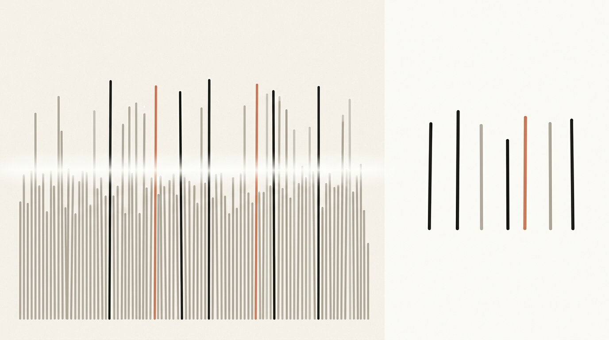
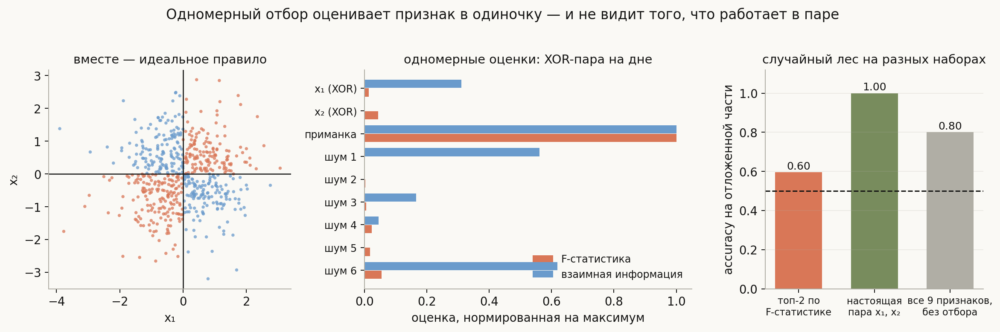
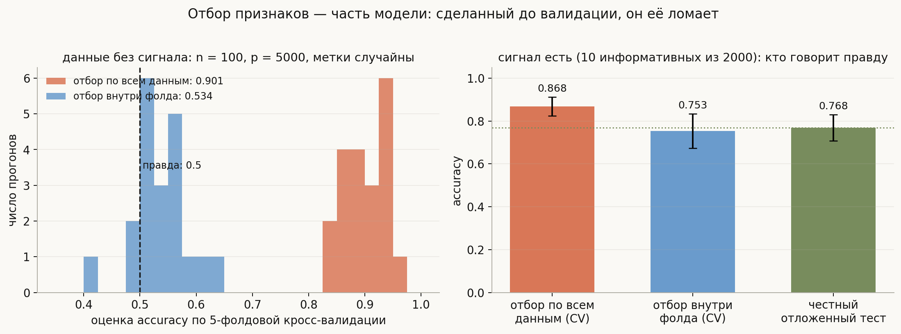
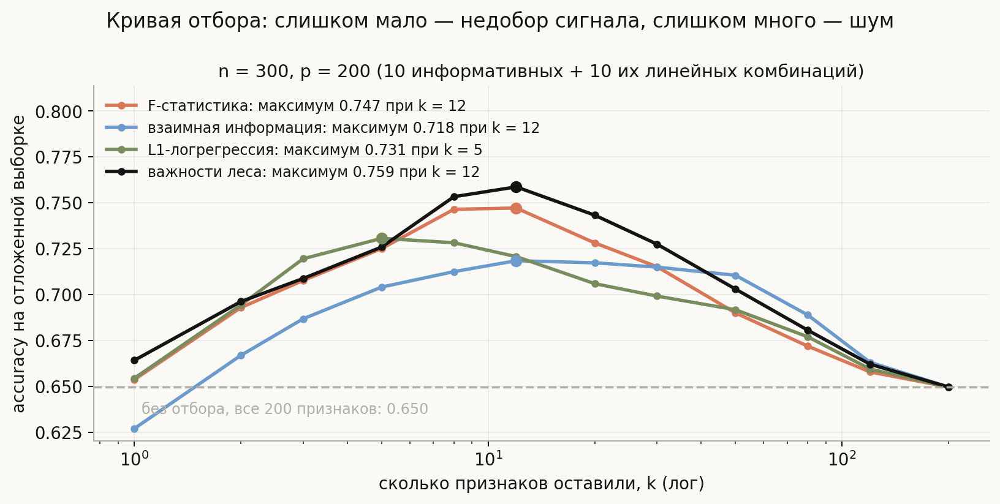
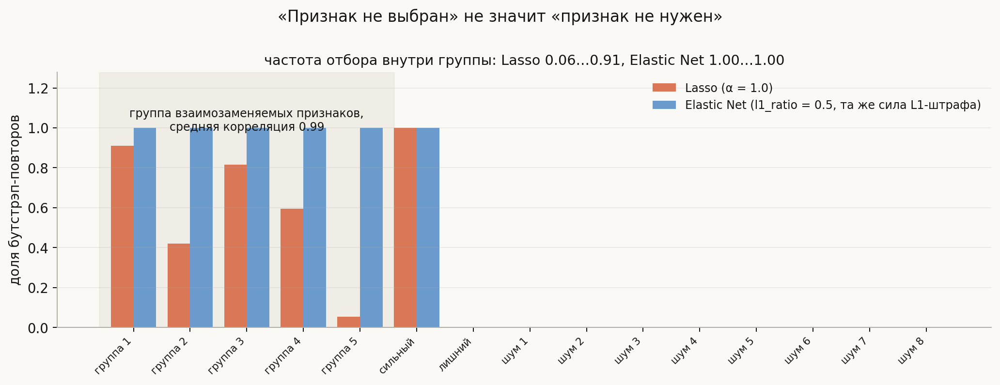
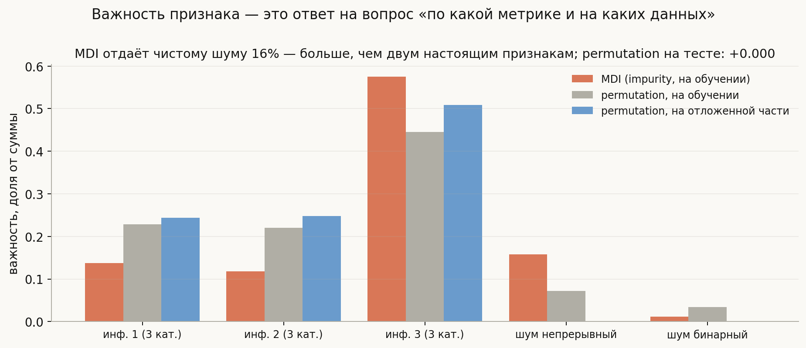

# Выбор признаков (Feature Selection)

**Вопрос (EN)**: Why do we need feature selection? What are the algorithms? What are their pros and cons?



Ответ, который слышат на собеседованиях чаще всего, состоит из двух списков: «зачем» — меньше переобучения, быстрее обучение, проще интерпретировать; «как» — filter, wrapper, embedded. Оба списка верны и оба бесполезны, потому что не отвечают на вопросы, которые возникают, как только вы садитесь это делать. Отбор действительно поднимет качество — или только скорость? Признак с нулевой корреляцией — бесполезен или незаменим? Если Lasso выбросил признак, значит ли это, что признак не нужен? Почему модель после отбора показала на кросс-валидации 0.90, а в проде — 0.50?

Полезнее держать в голове одну мысль: **отбор признаков — это оценивание, а не фильтрация**. Вы оцениваете по конечной выборке, какие переменные несут сигнал, и любая такая оценка шумна, смещена и зависит от того, вместе с чем признак рассматривался. Отсюда всё остальное: почему одномерные критерии слепы к взаимодействиям, почему отбор обязан жить внутри кросс-валидации, почему «признак не выбран» и «признак не нужен» — разные утверждения, и почему важности признаков нельзя читать как физические константы.

## План

1. Зачем отбирать признаки — и когда не стоит
2. Три семейства методов
3. Слепая зона одномерного отбора
4. Главная ошибка: отбор до валидации
5. Сколько признаков оставлять
6. Коррелированные признаки и устойчивость отбора
7. Важности признаков: что именно они меряют
8. Практический протокол
9. Что спрашивают на собеседовании
10. Типичные ошибки
11. Итог

---

## 1. Зачем отбирать признаки — и когда не стоит

Честный список причин выглядит не так, как школьный. По убыванию практической ценности:

1. **Стоимость.** Каждый признак в проде — это код, который его считает, источник данных, который может отвалиться, и задержка на инференсе. Модель на 20 признаках вместо 2000 дешевле не в обучении, а в эксплуатации: меньше поверхность отказа, меньше мониторинга, меньше дрейфа.
2. **$p \gg n$.** Когда признаков больше, чем объектов (геномика, спектры, счётчики по категориям), без отбора или сильной регуляризации задача просто не определена: найдётся идеальное разделение на чистом шуме.
3. **Интерпретируемость и требования.** Регуляторные ограничения, запрет на использование персональных данных, необходимость объяснить решение — здесь короткий список признаков не улучшение, а требование.
4. **Качество.** И только тут — точность. Причём выигрыш есть далеко не всегда.

Последний пункт стоит проговорить отдельно, потому что он противоречит фольклору. Современные модели уже умеют игнорировать мусор: L2-регуляризация сжимает бесполезные коэффициенты, градиентный бустинг просто не делает по ним разбиений. На плотных задачах с $n \gg p$ отбор часто не даёт **ничего** по метрике, и это нормальный результат, а не признак неудачи. Выигрыш в качестве появляется там, где шума много относительно данных: при $p \gg n$, при слабом сигнале, у моделей без встроенной регуляризации (kNN, наивный байес, линейная регрессия без штрафа) и у метрик расстояния, которые в высокой размерности разваливаются от лишних осей.

Отдельно стоит помнить, чего отбор **не** делает: он не чинит утечку целевой переменной, не заменяет работу над качеством данных и не превращает плохую разметку в хорошую. Признак, который «слишком хорошо работает», надо не отбирать, а проверять на утечку.

## 2. Три семейства методов

Классификация из учебника — по тому, **как метод узнаёт о полезности признака**.

**Filter (одномерные фильтры).** Каждый признак оценивается отдельно, без модели: корреляция Пирсона, $\chi^2$, ANOVA F-статистика, взаимная информация, тесты на различие распределений. Плюсы: считается за один проход, масштабируется на сотни тысяч признаков, не зависит от модели, легко объясняется. Минус ровно один, но фатальный: признак оценивается **в одиночку** — об этом весь следующий раздел.

Полезно различать внутри семейства **линейные** и **нелинейные** критерии. Корреляция ловит только монотонную линейную связь: у пары $x \sim U[-1,1]$, $y = x^2$ корреляция равна нулю при полной детерминированности. Взаимная информация $I(X; Y) = \iint p(x,y)\log\frac{p(x,y)}{p(x)p(y)}$ ловит любую зависимость, но платит за это дисперсией оценки. Причём мешает не средний уровень, а хвост: в прогоне из [`notebook.ipynb`](notebook.ipynb) медиана оценки у чистого шума близка к нулю при любом $n$, но **максимум** по 300 шумовым признакам падает с 0.114 при $n = 200$ до 0.015 при $n = 8000$. Ранжируете вы именно по верхушке — значит, на маленькой выборке в топ регулярно попадает шум.

**Wrapper (обёртки).** Признаки оцениваются по качеству модели, обученной на подмножестве: жадный forward/backward отбор, RFE (рекурсивное исключение по весам), полный перебор для маленьких $p$. Плюсы: учитывает и модель, и — в отличие от фильтра — контекст уже отобранных признаков. Минусы: дорого ($O(p^2)$ обучений у жадных схем) и **само склонно к переобучению**: вы много раз смотрите на валидацию и выбираете лучший результат, а лучший из многих шумных результатов смещён вверх, поэтому обёртки требуют вложенной валидации. И ещё одно ограничение, о котором обычно молчат: жадная обёртка добавляет по **одному** признаку за шаг, поэтому чистое взаимодействие она находит не лучше фильтра (проверка в разделе 3).

**Embedded (встроенные).** Отбор — побочный продукт обучения: $L_1$-регуляризация (Lasso) зануляет коэффициенты, деревья и их ансамбли дают важности, у бустинга есть частота использования признака в разбиениях. Плюсы: один прогон, учитывается взаимодействие с самой моделью. Минусы: результат привязан к конкретной модели и её гиперпараметрам, а у $L_1$ есть неприятная особенность на коррелированных признаках (раздел 6).

Практически граница между семействами размыта: `SelectFromModel` поверх Lasso — это embedded, использованный как filter; RFE поверх линейной модели — wrapper, использующий embedded-оценку. Важнее не название, а два вопроса: **видит ли метод взаимодействия** и **сколько раз он смотрит на данные**.

## 3. Слепая зона одномерного отбора

Ключевое различение, которое хорошо звучит на собеседовании: **релевантность признака и его полезность — не одно и то же**. Признак может быть бесполезен в одиночку и незаменим в паре; может быть сильно связан с целью и при этом не добавлять ничего сверх уже отобранных.

Крайний случай — XOR. Возьмём $x_1, x_2 \sim \mathcal{N}(0,1)$ и $y = [x_1 > 0] \oplus [x_2 > 0]$. Каждый признак **по отдельности** независим от $y$: зная только $x_1$, вы не знаете о $y$ ничего. Вместе они дают идеальное правило.



Прогон на 600 объектах: девять признаков — XOR-пара, «приманка» (слабый признак, честно связанный с целью в одиночку) и шесть чистых шумов. F-статистика у XOR-пары — 1.4 и 4.4, у приманки — **100.8**, то есть в двадцать раз больше. Взаимная информация ведёт себя не лучше: 0.014 и 0.000 против 0.044, и часть шумовых признаков получает оценки выше, чем настоящие — это та самая дисперсия MI-оценки на конечной выборке.

Итог для практики виден в правой панели. Если оставить топ-2 по F-статистике, случайный лес даёт **0.60** (в этот топ попали приманка и один из шумов). На настоящей паре $x_1, x_2$ — **1.00**. А на всех девяти признаках без всякого отбора — **0.80**. То есть одномерный отбор здесь **хуже, чем полное его отсутствие**: он не просто не помог, он выбросил ровно то, на чём держится задача.

Соблазнительно решить, что лечение — обёртка: она же смотрит на качество модели, а не на одномерную статистику. Но жадный forward-отбор здесь спотыкается ровно так же, и это стоит проверить (прогон в [`notebook.ipynb`](notebook.ipynb), качество — 5-фолдовая кросс-валидация случайного леса):

| процедура | что отобрано | CV |
|---|---|---|
| одномерный фильтр, топ-2 | приманка, шум 6 | 0.595 |
| жадная обёртка (forward) | шум 6, приманка, x₂ | 0.643 |
| полный перебор пар | **x₁, x₂** | **0.992** |
| без отбора, все девять | — | 0.868 |

Причина та же самая: жадный шаг оценивает прирост **от одного признака**, а у $x_1$ в одиночку прироста нет — ни первым шагом, ни вторым. Взаимодействие видно только при одновременном добавлении пары, то есть перебором пар (уже $O(p^2)$ обучений) или моделью, которая смотрит на все признаки сразу. Отсюда честный практический вывод: против взаимодействий надёжнее всего работает не хитрый отбор, а **отсутствие отбора** плюс модель, умеющая взаимодействия.

XOR — искусственный пример, но механизм ежедневный: «отношение суммы к среднему за месяц» бесполезно, пока нет второго из двух признаков; интеракция «регион × тип клиента» не видна ни в регионе, ни в типе по отдельности. Зеркальная проблема — **избыточность**: одномерный отбор возьмёт десять почти одинаковых признаков, потому что оценивает каждый отдельно и не знает, что девятый ничего не добавляет к первому. Отсюда семейство критериев mRMR (maximum relevance — minimum redundancy) и жадные схемы, которые на каждом шаге считают прирост поверх уже выбранного.

> Формулировка для собеседования: одномерный фильтр отвечает на вопрос «связан ли признак с целью», а нужен ответ на вопрос «добавляет ли признак что-то к тем, что уже есть». Это разные вопросы, и второй не сводится к первому.

## 4. Главная ошибка: отбор до валидации

Это самая частая и самая дорогая ошибка во всей теме, и её любят спрашивать. Формулировка: **отбор признаков — часть обучения модели**, и если он видел валидационные данные, оценка качества сломана. В ESL этому посвящён отдельный раздел («The Wrong Way to Do Cross-validation»), и воспроизвести эффект стоит один раз в жизни, чтобы запомнить навсегда.

Возьмём данные, в которых **сигнала нет вообще**: $n = 100$ объектов, $p = 5000$ независимых нормальных признаков, метки — честная монетка. Правильный ответ для любой модели здесь — accuracy 0.5.



Слева — две процедуры, по 20 прогонов каждая. **Неправильная**: отобрать 100 признаков с максимальной по модулю корреляцией с $y$ **по всем данным**, а потом честно прогнать 5-фолдовую кросс-валидацию на этих 100 признаках. Средняя оценка — **0.901**. Модель «нашла» структуру там, где её нет. **Правильная**: заново отбирать признаки внутри каждого фолда, только по обучающей части — **0.534**, то есть 0.5 с точностью до шума.

Механизм простой: при $p = 5000$ и $n = 100$ обязательно найдутся признаки, которые случайно коррелируют с метками **на этой конкретной выборке**. Отобрав их по всем данным, вы протащили информацию о валидационных метках в отбор. Дальше кросс-валидация честно меряет качество — но модели, которая уже подсмотрела ответы.

Правая панель показывает, что эффект не исчезает, когда сигнал есть. На задаче с 10 информативными признаками из 2000: отбор по всем данным даёт оценку **0.868**, отбор внутри фолда — **0.753**, а честная проверка на отложенной выборке — **0.768**. Вложенная процедура попадает в правду, наивная завышает на десять пунктов. Именно так рождается классический разрыв «на кросс-валидации было хорошо, в проде плохо».

Практический вывод в одну строку: **всё, что смотрит на $y$, должно жить внутри `Pipeline`**.

```python
from sklearn.pipeline import Pipeline
from sklearn.feature_selection import SelectKBest, f_classif

pipe = Pipeline([
    ("scale", StandardScaler()),
    ("select", SelectKBest(f_classif, k=20)),   # переобучается заново на каждом фолде
    ("model", LogisticRegression()),
])
cross_val_score(pipe, X, y, cv=5)               # только так оценка честная
```

Тот же аргумент относится к масштабированию, к подбору порога, к кодированию категорий счётчиками по таргету и к выбору самого $k$: если $k$ подбирается по той же кросс-валидации, которой вы потом отчитываетесь, нужна вложенная схема — внешний цикл для оценки, внутренний для подбора.

## 5. Сколько признаков оставлять

Число отобранных признаков — обычный гиперпараметр сложности, и ведёт себя он как все такие параметры: у качества есть максимум.



Задача: $n = 300$, $p = 200$, из них 10 информативных и 10 их линейных комбинаций, остальные — шум; отбор делается на обучающей части, качество меряется на отложенной, всё усреднено по 12 прогонам. Логистическая регрессия на **всех** 200 признаках даёт 0.650. Любой из четырёх способов ранжирования, обрезанный в правильном месте, даёт заметно больше: важности случайного леса — 0.759 при $k = 12$, F-статистика — 0.747 при $k = 12$, $L_1$-логрегрессия — 0.731 при $k = 5$, взаимная информация — 0.718 при $k = 12$.

Из картинки видно три вещи. Во-первых, **выигрыш реален**, когда шума много: +11 пунктов к варианту без отбора. Во-вторых, кривая **тупая около максимума**: между $k = 8$ и $k = 30$ разница невелика, так что искать «идеальное» $k$ бессмысленно — достаточно попасть в правильный порядок величины. В-третьих, все четыре кривые сходятся в одну точку при $k = p$: отобрать все признаки — это и есть отсутствие отбора, полезное напоминание, что метод ранжирования влияет только на то, что вы отрезаете.

Многомерные критерии (важности леса, $L_1$) на этой задаче обходят одномерные — ожидаемо, потому что среди признаков есть линейные комбинации, и одномерный критерий берёт их все подряд. Разрыв, впрочем, невелик: 0.759 против 0.747. Это тоже типично — выбор *способа* ранжирования обычно решает меньше, чем выбор *числа* признаков и корректность процедуры.

## 6. Коррелированные признаки и устойчивость отбора

Дублирующие и почти дублирующие признаки — норма для реальных данных: рост в сантиметрах и в дюймах, сумма и логарифм суммы, десять счётчиков по пересекающимся окнам. Что с ними делает $L_1$?

Ответ неприятный: **выбирает произвольного представителя группы**. Если пять признаков почти одинаковы, а нужен вклад одного, Lasso поставит ненулевой коэффициент кому-то одному (или размажет по нескольким), причём кому именно — определяется случайностями выборки.



Эксперимент: группа из пяти признаков со средней взаимной корреляцией 0.99 и одинаковым истинным вкладом, один сильный одиночный признак, один лишний и восемь шумовых; 200 бутстрэп-повторов, в каждом отбор заново. Lasso отбирает членов группы с частотами от **0.06 до 0.91** — то есть один и тот же по смыслу признак попадает в модель то почти всегда, то почти никогда, в зависимости от того, какая выборка досталась. Elastic Net с той же силой $L_1$-штрафа плюс $L_2$-часть берёт **все пять в 100% повторов**: $L_2$ разбивает вырожденность и заставляет группу входить целиком (grouping effect).

Отсюда три практических следствия:

- **«Признак не выбран» ≠ «признак не нужен».** Из отчёта «Lasso оставил 12 признаков из 500» нельзя делать содержательных выводов о предметной области, если признаки коррелированы.
- **Устойчивость надо мерить.** Простейший способ и есть картинка выше: прогнать отбор на бутстрэп-повторах и посмотреть на частоты. Формализация этого приёма — **stability selection**: оставляем признаки, попадающие в модель чаще заданного порога на подвыборках.
- **Для интерпретации лучше группы, чем отдельные признаки.** Кластеризуем признаки по корреляции (или по расстоянию Спирмена), берём по представителю от кластера или суммируем важности внутри кластера.

Отдельно про удаление коррелированных «для чистоты»: убирать признак только за то, что он коррелирует с другим, для качества предсказания обычно не нужно — мультиколлинеарность портит **интерпретацию коэффициентов** (они становятся неустойчивыми и с непредсказуемыми знаками), а не предсказания регуляризованной модели. VIF и отсев по корреляции уместны, когда вам нужны сами коэффициенты, а не прогноз.

## 7. Важности признаков: что именно они меряют

Раз половина методов отбора опирается на важности, стоит знать, как они врут.

**MDI (impurity importance)** — сумма уменьшений критерия по всем разбиениям, где признак использовался. Считается бесплатно при обучении и имеет два известных смещения: в пользу признаков с **большим числом возможных порогов** (непрерывные, высококардинальные категории) и в пользу того, что произошло **на обучающей выборке**.



Проверка: три информативных признака, огрублённых до трёх категорий каждый (как обычные табличные признаки), плюс непрерывный шум и бинарный шум. Случайный лес обучен, важности посчитаны тремя способами. MDI отдаёт **чистому непрерывному шуму 16%** важности — больше, чем каждому из двух настоящих признаков (13.8% и 11.8%). Причина проста: у непрерывного шума в каждом узле сотни возможных порогов, среди которых найдётся случайно удачный, а у трёхкатегориального признака их два.

**Permutation importance** — падение качества при перемешивании столбца. На отложенной части она даёт шуму ровно **0.000**, а информативным признакам — честные 0.157, 0.159, 0.327. Но и она обманывает, если считать её на обучающих данных: там шум получает 0.058, потому что переобученный лес действительно использует его для запоминания.

Что стоит помнить про важности вообще:

- **Считать на отложенных данных.** Важность на обучении меряет «на что модель опиралась, чтобы запомнить», а не «что помогает предсказывать».
- **Коррелированные признаки делят важность.** Перемешали один — модель компенсирует по его двойнику, и оба выглядят неважными. Лечится группировкой признаков или перемешиванием кластера целиком.
- **Важность зависит от модели.** Это свойство пары «модель + данные», а не самого признака. Другая модель — другие важности; ни одна из них не является причинной.
- **SHAP** решает часть проблем (аддитивная декомпозиция каждого предсказания, согласованность), но тоже опирается на модель и страдает от коррелированных признаков, потому что подразумевает вмешательство в маргинальное распределение.
- **Самый честный, но и самый дорогой критерий** — drop-column: переобучить модель без признака и сравнить качество. $p + 1$ обучений, зато меряет ровно то, что нужно.

## 8. Практический протокол

Порядок, который редко бывает неправильным:

1. **Убрать мёртвое, ничего не оценивая по $y$.** Константы и почти константы, полные дубли столбцов, признаки с недопустимой долей пропусков, признаки, недоступные на инференсе, признаки с утечкой. Это не отбор, а гигиена — здесь смотреть на таргет не нужно, поэтому и утечки нет.
2. **Решить, нужен ли отбор вообще.** Если $n \gg p$ и модель — бустинг, начните с базовой линии без отбора и сравнивайте с ней. Часто на этом можно закончить.
3. **Грубый одномерный экран — только при огромном $p$.** Сбить 200 000 признаков до 5 000 фильтром дёшево; но помните, что взаимодействия вы уже могли потерять, поэтому режьте с большим запасом.
4. **Основной отбор — многомерный и внутри пайплайна.** `SelectFromModel` поверх $L_1$ или бустинга, RFE, важности на отложенной части. Всё — как шаг `Pipeline`, чтобы кросс-валидация оставалась честной.
5. **Проверить устойчивость на бутстрэпе**, если результат отбора будут читать люди, а не только модель.
6. **Отчитаться по вложенной схеме.** Финальная оценка — на данных, которых не видел ни отбор, ни подбор $k$.

Отдельная тонкость: если признаков десятки тысяч и все шаги дороги, полезно помнить, что **отбор — не единственный ответ на большую размерность**. Регуляризация решает ту же задачу мягко (сжимает вместо выбрасывания), а снижение размерности (PCA, автоэнкодеры) — иначе: строит новые оси вместо выбора старых. Разница принципиальная: после отбора у вас остаются исходные, интерпретируемые признаки и не нужно считать выброшенные; после PCA нужны **все** исходные признаки, чтобы построить компоненты, и интерпретируемость теряется. Поэтому «сократить стоимость сбора данных» — задача для отбора, а не для PCA.

## 9. Что спрашивают на собеседовании

**Зачем нужен отбор признаков?** Стоимость и надёжность прода, работа при $p \gg n$, интерпретируемость и требования регулятора — и только потом качество. У регуляризованных моделей и бустинга выигрыш по метрике часто нулевой, и это нормальный результат.

**Какие есть семейства методов и чем они отличаются?** Filter (одномерные критерии, дёшево, слепы к взаимодействиям), wrapper (перебор подмножеств по качеству модели, дорого и само переобучается; жадные схемы тоже не берут чистое взаимодействие — прирост считается по одному признаку за шаг), embedded ($L_1$, важности деревьев — бесплатно вместе с обучением, но привязано к модели). Разделяющие вопросы: видит ли метод взаимодействия и сколько раз он смотрит на данные.

**Может ли признак с нулевой корреляцией быть полезным?** Да, и это главный аргумент против одномерных фильтров. XOR: каждый из двух признаков независим от цели, вместе они дают идеальное правило. В моём прогоне топ-2 по F-статистике дал accuracy 0.60, настоящая пара — 1.00, а вообще без отбора — 0.80.

**Чем взаимная информация лучше корреляции и чем хуже?** Ловит любые зависимости, а не только линейно-монотонные ($y = x^2$ даёт нулевую корреляцию). Хуже тем, что её оценка на конечной выборке шумная и смещённая, поэтому ранжирование по MI неустойчиво.

**Как правильно валидировать модель с отбором признаков?** Отбор — часть обучения: он должен переобучаться внутри каждого фолда (`Pipeline`), а не один раз по всем данным. Иначе оценка завышена: на чистом шуме ($n = 100$, $p = 5000$) наивная схема даёт 0.90 вместо 0.5.

**Почему Lasso — плохой инструмент интерпретации при коррелированных признаках?** Он выбирает произвольного представителя группы. На бутстрэпе частоты отбора внутри группы с корреляцией 0.99 разошлись от 0.06 до 0.91; Elastic Net при той же силе $L_1$ берёт всю группу в 100% повторов.

**Почему нельзя верить `feature_importances_` из коробки?** Это MDI: она смещена в пользу признаков с большим числом порогов и считается на обучающих данных. В моём прогоне чистый непрерывный шум получил 16% важности — больше, чем настоящие признаки. Permutation importance на отложенной части дала ему 0.000.

**Сколько признаков оставлять?** Это гиперпараметр; кривая качества имеет максимум и туповата около него. Подбирается кросс-валидацией — обязательно вложенной, если этой же кросс-валидацией вы отчитываетесь.

**Отбор признаков или снижение размерности?** Отбор оставляет исходные признаки (интерпретируемо, дешевле собирать и считать), PCA строит новые оси и требует **все** исходные признаки на инференсе. Если цель — сократить стоимость сбора данных или объяснить модель, PCA не подходит.

**Что делать при $p \gg n$?** Сильная регуляризация как базовая линия, грубый фильтр с большим запасом для сокращения размерности, затем многомерный отбор внутри вложенной валидации, обязательная проверка устойчивости. И скепсис: при $p = 5000$, $n = 100$ идеальное разделение находится на чистом шуме.

## 10. Типичные ошибки

- **Отбирать признаки до разбиения на фолды.** Самая дорогая ошибка темы: на данных без сигнала это даёт accuracy 0.90 вместо 0.5. Лечится тем, что отбор становится шагом `Pipeline`.
- **Подбирать $k$ по той же кросс-валидации, которой отчитываетесь.** Тот же механизм в мягкой форме: лучший из многих шумных результатов смещён вверх. Нужна вложенная схема.
- **Верить одномерным фильтрам как истине.** Они не видят взаимодействий и не замечают избыточности: возьмут десять копий одного признака и выбросят пару, которая работает только вместе.
- **Считать корреляцию мерой зависимости.** Ноль корреляции означает отсутствие *линейной* связи, и только. Для нелинейной проверяйте MI или качество модели на одном признаке.
- **Читать `feature_importances_` как рейтинг полезности.** MDI смещена в пользу непрерывных и высококардинальных признаков и считается на обучении. Для выводов — permutation importance на отложенной части или drop-column.
- **Считать, что невыбранный признак не нужен.** При коррелированных признаках выбор представителя группы случаен; проверяйте частоту отбора на бутстрэпе, прежде чем делать содержательные выводы.
- **Отбирать признаки ради качества там, где его не будет.** У бустинга при $n \gg p$ отбор чаще всего не меняет метрику. Если цель — стоимость инференса, так и формулируйте, и меряйте стоимость, а не только accuracy.
- **Ронять признаки за мультиколлинеарность в предсказательной задаче.** Она вредит устойчивости коэффициентов, а не прогнозу регуляризованной модели. VIF нужен, когда вы интерпретируете коэффициенты.
- **Путать отбор с PCA.** После PCA нужны все исходные признаки; экономии на сборе данных не будет, интерпретируемость потеряется.
- **Отбирать признаки один раз и навсегда.** Данные дрейфуют, источники отваливаются, распределения меняются. Набор признаков — такая же часть модели, как веса, и переобучать его надо вместе с ней.

## 11. Итог

Отбор признаков — это не фильтрация мусора, а оценивание по конечной выборке, и все его подводные камни следуют из этого. Одномерные фильтры дёшевы и масштабируемы, но оценивают признак в одиночку: они слепы к взаимодействиям (XOR-пара получает F-статистику в двадцать раз меньше бесполезной приманки, и отбор по ним оказывается хуже, чем его отсутствие — 0.60 против 0.80) и к избыточности. Обёртки учитывают контекст уже отобранного, но дороги, переобучаются сами и на чистом взаимодействии спотыкаются не хуже фильтра, потому что идут по одному признаку за шаг. Встроенные методы бесплатны, но привязаны к модели, а $L_1$ на коррелированных признаках выбирает произвольного представителя группы — частоты отбора на бутстрэпе разошлись от 0.06 до 0.91 там, где Elastic Net брал всю группу всегда. Число оставляемых признаков — обычный гиперпараметр с максимумом на кривой качества (0.759 при $k = 12$ против 0.650 без отбора на задаче с $p = 200$, $n = 300$), и кривая около максимума пологая. Важности, на которые опирается половина методов, меряют не то, что кажется: MDI отдала чистому шуму 16% против 0.000 у permutation importance на отложенной части. И главное правило, которое стоит всех остальных: отбор — часть обучения модели, он обязан переобучаться внутри каждого фолда, иначе кросс-валидация покажет 0.90 на данных, где нет ничего, кроме шума.

## Что рядом

- [`notebook.ipynb`](notebook.ipynb) — утечка при отборе на данных без сигнала, корреляция против взаимной информации на нелинейных связях, XOR и mRMR-жадность, MDI против permutation importance, stability selection на бутстрэпе, честный `Pipeline` против наивной схемы
- [`generate_visuals.py`](generate_visuals.py) — код всех диаграмм; утечка меряется на данных без сигнала, важности и частоты отбора считаются прогоном, а не берутся из головы
- [L1-регуляризация](../../../ml/basics/L1%20Regularization.md) и [L2-регуляризация](../../../ml/basics/L2%20Regularization.md) — почему $L_1$ зануляет, а $L_2$ только сжимает
- [Bagging и Boosting](../bagging-vs-boosting/lesson.md) — откуда берутся важности деревьев и почему `max_features` тоже своего рода отбор
- [Классификация и регрессия](../../../ml/basics/classification-vs-regression/lesson.md) — про то, как функция потерь задаёт задачу

---
*Источник вопроса: [Introduction to Machine Learning Interviews](https://huyenchip.com/ml-interviews-book/)*
