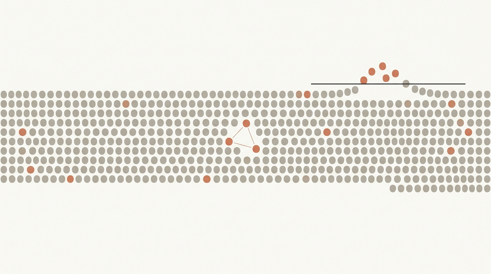
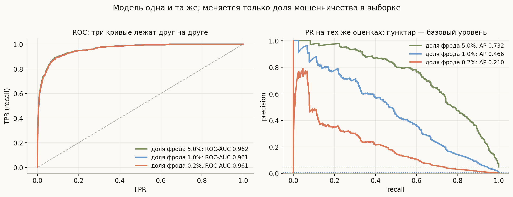
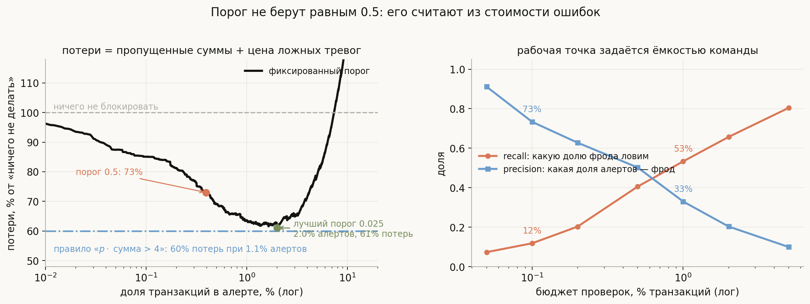
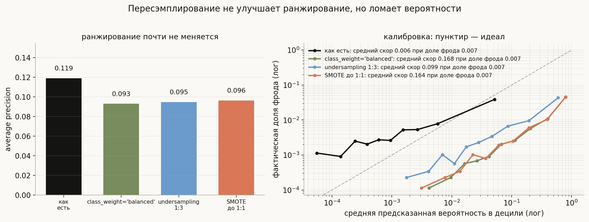
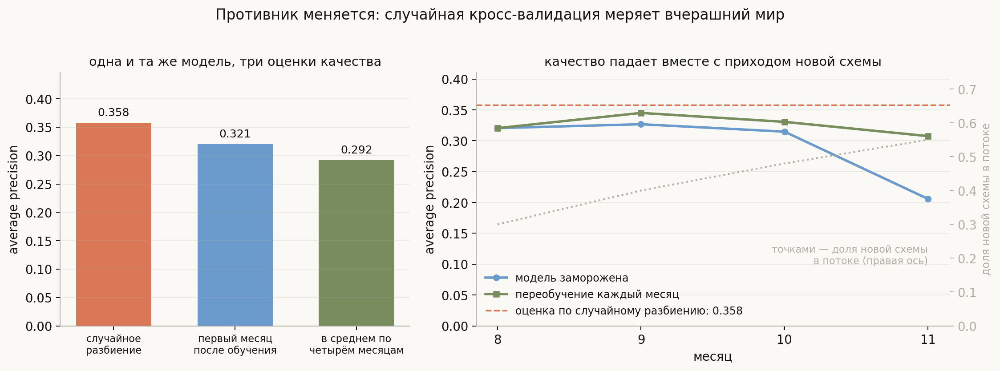
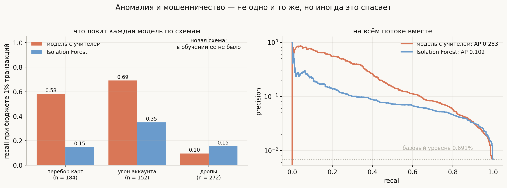

# Детекция мошенничества: из чего собирать прототип

**Вопрос (EN)**: What algorithms would you use when developing the prototype of a fraud detection model?

На этот вопрос легко ответить списком: логистическая регрессия, случайный лес, градиентный бустинг, изоляционный лес. Список правильный, занимает тридцать секунд — и после него интервьюер задаёт настоящие вопросы. Как вы поймёте, что модель хорошая, если 99.5% ответов «не фрод» даёт accuracy 0.995? Какой порог поставите? Почему нельзя разбить выборку случайно? Что будете делать с тем, что метки о мошенничестве приходят через два месяца? И почему модель, отлично работавшая в марте, в июне ловит вдвое меньше?

Полезно принять сразу: **выбор алгоритма здесь — самое малозначимое из решений**. Градиентный бустинг на табличных агрегатах будет рабочей лошадкой почти наверняка, и спорить тут не о чем. Всё остальное — метрика, порог, разбиение, признаки, переобучение — определяется четырьмя особенностями задачи, которых нет в учебной бинарной классификации: события **редки**, ошибки стоят **разного и непостоянного**, данные порождает **противник**, а метки приходят **поздно и не про всех**. Дальше — про то, что каждая из этих особенностей ломает и чем это чинится.

Все числа ниже посчитаны на симулированном потоке транзакций (код — в [`generate_visuals.py`](generate_visuals.py)): открытые датасеты по фроду либо анонимизированы до неузнаваемости, либо не содержат времени и сумм, без которых половину этих выводов проверить невозможно.

## План

1. Четыре особенности, ломающие обычный пайплайн
2. Признаки: агрегаты и корректность по времени
3. Метрики: почему ROC-AUC врёт
4. Порог — решение о деньгах, а не о классе
5. Дисбаланс: что действительно помогает
6. Валидация: время, а не случайность
7. Алгоритмы: что брать в прототип и в каком порядке
8. Аномалии: где они уместны, а где нет
9. Связи и графы
10. Что ломается в проде
11. Что спрашивают на собеседовании
12. Типичные ошибки
13. Итог

---

## 1. Четыре особенности, ломающие обычный пайплайн

**Редкость.** Доля мошеннических транзакций — от 0.05% до 1%; в моём симуляторе 0.7%. Отсюда сразу: accuracy бессмысленна (константный ответ даёт 99.3%), ROC-AUC вводит в заблуждение (раздел 3), а обучающих примеров положительного класса мало даже при сотнях миллионов строк.

**Асимметрия и непостоянство цены ошибки.** Ложная тревога — это отказ честному клиенту: трение, звонок в поддержку, иногда уход к конкуренту. Пропуск — это сумма транзакции плюс чарджбэк, штрафы платёжной системы и репутация. Величины **разного порядка**, и, что важнее, цена пропуска **зависит от транзакции**: пропустить перевод на 300 рублей и на 300 тысяч — разные события. Значит, оптимальное решение не может быть «порогом 0.5» и вообще не обязано быть одним порогом (раздел 4).

**Противник.** Данные порождает не природа, а люди, которые изучают вашу защиту и адаптируются. Это не сезонный дрейф, а **адверсариальный**: как только вы закрыли схему, пробуют следующую. Модель, обученная на прошлом квартале, устаревает не «когда-нибудь», а по расписанию противника (раздел 6).

**Метки поздние, неполные и шумные.** Чарджбэк приходит через 30–120 дней — значит, свежие данные размечены лишь частично (**label maturity**). Про заблокированные транзакции вы **никогда не узнаете**, были ли они мошенническими: решение модели уничтожает свою же метку (**selective labels**). А часть спорных операций — не фрод, а «дружественный фрод» или забывчивость клиента (раздел 10).

Ни одна из четырёх не решается выбором алгоритма — и в этом суть ответа на вопрос.

## 2. Признаки: агрегаты и корректность по времени

Голая транзакция — сумма, время, MCC, страна — предсказывает плохо: подозрительна не транзакция сама по себе, а **её отклонение от поведения этого клиента и этой сущности**. Поэтому основной труд в прототипе уходит не на модель, а на агрегаты.

Что считают на практике:

- **Скорость (velocity)** по сущности за окно: сколько транзакций с этой карты/устройства/IP за 1 час, 24 часа, 7 дней; сколько разных получателей; сколько отказов эмитента подряд. Перебор карт видно именно так.
- **Отклонение от собственной нормы**: сумма к медиане клиента за 90 дней, час суток к его обычному распределению, новый ли получатель, новое ли устройство.
- **Географию и физику**: смена страны за время, за которое физически невозможно переместиться («geo-velocity»), несовпадение страны карты, эмитента и IP.
- **Связи**: сколько аккаунтов делят это устройство, сколько карт привязано к одному получателю (раздел 9).

Две ловушки, о которых спрашивают отдельно.

**Point-in-time корректность.** Агрегат «число транзакций за час» обязан считаться **по данным строго до момента этой транзакции**. Стоит посчитать его в окне «вокруг» — и в признак попадает будущее: у мошеннической транзакции соседями окажутся другие транзакции той же атаки, случившиеся позже.

Насколько это дорого, видно в [`notebook.ipynb`](notebook.ipynb) на потоке, где атака — серия транзакций подряд. Причинный агрегат (только прошлое) даёт AP 0.88. Агрегат в окне ±1 час даёт AP **1.000** — идеальное качество, которое очень хочется показать команде. А затем модель выкатывают, будущего на инференсе нет, тот же агрегат считается причинно, и AP оказывается **0.638**. То есть утечка не просто завысила оценку: она дала модель **хуже честной** (0.638 против 0.883), потому что модель научилась опираться на признак, которого в проде не существует. Это та же болезнь, что [отбор признаков до валидации](../feature-selection/lesson.md), только спрятанная глубже — в фиче, а не в процедуре.

**Признаки, недоступные в момент решения.** Результат ручной проверки, статус чарджбэка, флаг «клиент подал спор» — всё это появляется **после**. В обучающей таблице они лежат в тех же строках и дают фантастическое качество; в проде их нет.

## 3. Метрики: почему ROC-AUC врёт

Первая метрика, которую называют, — ROC-AUC. И она здесь опасна, потому что **не зависит от доли положительного класса**. TPR считается внутри положительных, FPR — внутри отрицательных; изменение пропорции не двигает ни ту, ни другую.

Слева — три ROC-кривые для **одной и той же модели** на выборках с долей фрода 5%, 1% и 0.2%: они лежат друг на друге, ROC-AUC 0.962, 0.961, 0.961. Справа — PR-кривые на тех же самых оценках: AP падает 0.732 → 0.466 → 0.210. Ни модель, ни её оценки не изменились — изменилась только редкость события.

Арифметика за этим простая. Precision выражается через TPR, FPR и долю фрода $\pi$:

$$\text{precision} = \frac{\text{TPR}\cdot\pi}{\text{TPR}\cdot\pi + \text{FPR}\cdot(1-\pi)}.$$

Подставьте «отличные» цифры: TPR $= 0.8$, FPR $= 0.01$. При $\pi = 5\%$ precision равна 0.81 — прекрасно. При $\pi = 0.2\%$ та же модель даёт **0.14**: на каждую пойманную мошенническую транзакцию приходится шесть заблокированных честных. Вот почему «FPR всего 1%» в этой задаче — не достижение, а приговор: 1% от миллиона честных транзакций это десять тысяч разъярённых клиентов в день.

Что мерить вместо:

- **PR-AUC / average precision** — чувствительна к редкости, но сравнивать её между выборками с разной долей фрода нельзя (в моём прогоне отношение AP к базовому уровню растёт 15× → 47× → 105× при падающей AP — обе величины «правильные», просто отвечают на разные вопросы).
- **precision@k и recall@k при фиксированном бюджете алертов** — самая честная операционная метрика: команда проверяет $k$ транзакций в день, и вопрос ровно в том, сколько фрода попадёт в эти $k$.
- **Денежные метрики**: доля предотвращённых потерь, recall, взвешенный по сумме (поймать одну транзакцию на миллион важнее, чем сто по сотне), и итоговый P&L с учётом цены ложных тревог.

## 4. Порог — решение о деньгах, а не о классе

Модель выдаёт $p$; решение принимает бизнес. Правильная постановка — минимизация ожидаемых потерь. Если ложная тревога стоит $C_{FP}$, а пропуск — $C_{FN}$, то блокировать выгодно при

$$p \cdot C_{FN} > (1-p) \cdot C_{FP} \quad\Longleftrightarrow\quad p > \frac{C_{FP}}{C_{FP} + C_{FN}},$$

то есть порог считается из стоимостей, а не берётся равным 0.5 (0.5 — это частный случай при $C_{FP} = C_{FN}$, чего в фроде не бывает никогда). Но в реальности $C_{FN}$ — это сумма транзакции, разная в каждой строке, и тогда правило превращается в **произведение**: блокировать, если $p \cdot \text{сумма} > C_{FP}$.

Прогон на 90 тысячах транзакций, где пропущенный фрод стоит свою сумму, а ложная тревога — фиксированные 4 у. е. (за 100% взяты потери при полном бездействии):

| политика | потери | доля алертов |
|---|---|---|
| ничего не блокировать | 100% | 0% |
| порог 0.5 | 73% | 0.39% |
| лучший фиксированный порог (0.025) | 61% | 2.00% |
| **правило $p \cdot \text{сумма} > 4$** | **60%** | **1.10%** |

Порог 0.5 не катастрофа, но оставляет на столе больше десяти процентов потерь. Лучший фиксированный порог оказывается в двадцать раз ниже — 0.025, и это типично: чем дороже пропуск относительно ложной тревоги, тем ниже порог. А правило с учётом суммы даёт те же потери, что лучший фиксированный порог, **при вдвое меньшем числе алертов** (1.10% против 2.00%) — потому что оно не тратит проверки на дешёвые транзакции с высоким скором. При равном числе алертов фиксированный порог проигрывает ему по потерям.

Отсюда важное следствие: если решение принимается по произведению $p \cdot \text{сумма}$, то $p$ обязан быть **вероятностью**, а не абстрактным «скором». Модель нужно калибровать — и это одна из причин не делать то, о чём следующий раздел.

Правая панель — та же задача с другой стороны. У команды разбора конечная ёмкость, и рабочая точка выбирается по ней: при бюджете 0.1% транзакций precision 73%, но recall всего 12%; при бюджете 1% recall уже 53%, но precision падает до 33%. Это и есть настоящий разговор с бизнесом — не «какая у модели AUC», а «сколько мошенничества мы поймаем, если посадим на разбор трёх человек, и сколько — если пятерых».

## 5. Дисбаланс: что действительно помогает

Стандартный рефлекс — «классы несбалансированы, надо сделать SMOTE». Проверим, что это даёт. Логистическая регрессия на одних и тех же данных, четыре варианта: как есть, `class_weight='balanced'`, undersampling до 1:3 и SMOTE до 1:1.

| вариант | AP | recall@0.5% | Brier | средний скор |
|---|---|---|---|---|
| как есть | **0.119** | **0.179** | **0.0066** | 0.0064 |
| `class_weight='balanced'` | 0.093 | 0.123 | 0.0857 | 0.168 |
| undersampling 1:3 | 0.095 | 0.140 | 0.0449 | 0.099 |
| SMOTE до 1:1 | 0.096 | 0.132 | 0.0848 | 0.164 |

Фактическая доля фрода в тесте — 0.0066. Модель «как есть» даёт средний скор 0.0064, то есть **сама по себе откалибрована**. Все три «лекарства от дисбаланса» задирают средний скор в 15–25 раз, ухудшают Brier на порядок и при этом **не улучшают ранжирование** — AP и recall при фиксированном бюджете у них не выше, а ниже.

Почему так. Ранжирование зависит от порядка объектов, а не от абсолютных значений; пересэмплирование меняет в основном сдвиг (intercept) — то есть **шкалу вероятностей**, а не порядок. Оно как бы «уже выбрало за вас порог», причём выбрало вслепую, без стоимостей из раздела 4. Правильный порядок действий обратный: учить на исходном распределении, получить честные вероятности и выбрать порог по деньгам.

Когда пересэмплирование всё же оправданно:

- **Undersampling ради вычислений**: 300 миллионов строк не нужны целиком, чтобы выучить границу; берут все положительные и 1–5% отрицательных. Тогда обязательна **обратная коррекция сдвига**: если негативы прорежены в $r$ раз, то $\text{odds}_{\text{true}} = \text{odds}_{\text{model}} / r$, иначе вероятности завышены ровно в это число раз (проверка — в [`notebook.ipynb`](notebook.ipynb)).
- **Веса классов** — иногда помогают оптимизации, когда положительных совсем мало и градиент их «не замечает». Но это гиперпараметр, который надо валидировать, а не рефлекс.
- **SMOTE** — плохо приспособлен к фроду: он интерполирует между мошенническими транзакциями, а середина между двумя разными схемами атаки — не транзакция, а фантом. Плюс на категориальных признаках интерполяция бессмысленна.

## 6. Валидация: время, а не случайность

Случайное разбиение в этой задаче неверно по двум причинам сразу: агрегаты по сущности связывают соседние во времени строки (та же карта, тот же день), а распределение атак меняется, и случайная выборка перемешивает будущее с прошлым.

Поток из 12 месяцев; в первых месяцах работают две схемы, с шестого начинает расти третья, которой в обучении почти не было. Модель обучена на месяцах 0–7.

- Оценка **по случайному разбиению внутри обучающего периода**: AP = 0.358.
- **Первый месяц после обучения**: 0.321.
- Дальше: 0.327, 0.315 и **0.206** в последнем месяце, когда новая схема занимает больше половины потока.

Случайное разбиение завышает даже относительно ближайшего будущего, но главная беда не в этом, а в том, что оно в принципе не показывает **тренд**. Правая панель добавляет вторую линию: если каждый месяц переобучать модель на всей доступной истории, качество держится на 0.308–0.345 вместо падения до 0.206. Ответ на вопрос «как часто переобучать» получается измерением, а не из головы: смотрите, за сколько недель кривая проседает до неприемлемого уровня.

Как делают правильно:

- **Out-of-time split**: обучение — прошлое, валидация — следующий отрезок, тест — ещё следующий; или скользящая схема walk-forward.
- **Зазор (embargo) между train и test** — на длину задержки меток: если чарджбэк приходит за 60 дней, последние 60 дней размечены не полностью, и включать их в тест как «чистые нули» нельзя.
- **Стратификация по сущностям**, а не только по времени: одна карта не должна оказаться и в train, и в test, иначе модель «узнаёт» клиента.

## 7. Алгоритмы: что брать в прототип и в каком порядке

Наконец собственно вопрос. Порядок, в котором стоит идти, — от дешёвого и понятного к дорогому.

**0. Правила.** В любой компании уже работает движок правил («более 5 транзакций за 10 минут», «страна не совпала и сумма выше X»). Он и есть базовая линия: прототип обязан её побить по деньгам, а не по AUC. Заодно правила — источник признаков и safety net для случаев, где модель не имеет права ошибаться.

**1. Логистическая регрессия на агрегатах.** Дёшева, мгновенна на инференсе, даёт калиброванные вероятности (см. раздел 5) и объяснимые коэффициенты — важно и для регулятора, и для оператора. Хороший бейзлайн, который на неплохих признаках проигрывает бустингу немного. В моём прогоне она даёт AP 0.119 против 0.283 у бустинга — разрыв велик именно потому, что схемы атак задаются взаимодействиями признаков, а не линейной комбинацией.

**2. Градиентный бустинг** — LightGBM, XGBoost, CatBoost. Практически всегда лучший результат на табличных данных, терпит пропуски и мусорные признаки, даёт важности. CatBoost отдельно удобен категориями (страна, MCC, тип устройства, банк-эмитент): его упорядоченные счётчики целевой переменной решают ровно ту проблему утечки, о которой раздел 2. Детали механики — в теме [Bagging и Boosting](../bagging-vs-boosting/lesson.md).

**3. Случайный лес** — быстрый второй бейзлайн: почти не требует настройки и устойчив, но на фроде обычно уступает бустингу.

**4. Изоляционный лес / автоэнкодер** — не как основная модель, а как дополнение (раздел 8).

**5. Графовые признаки** — часто дают больше, чем смена алгоритма (раздел 9).

**6. Модели последовательностей** (RNN, трансформер по истории аккаунта) — когда есть длинные истории и ресурсы; в прототипе почти никогда.

Практический ответ на собеседовании звучит примерно так: **правила как базовая линия, логистическая регрессия на агрегатах как интерпретируемый бейзлайн, градиентный бустинг как основная модель, изоляционный лес как отдельный канал для новых схем — и сравнение всех по денежной метрике при фиксированном бюджете проверок.**

## 8. Аномалии: где они уместны, а где нет

Соблазн понятен: фрод редок, аномалии редки — значит, ищем аномалии. Но **аномалия и мошенничество не совпадают**. Огромная покупка перед отпуском — аномалия и не фрод; аккуратная транзакция на 2000 рублей с угнанного аккаунта — фрод и не аномалия. Пока есть метки, модель с учителем учит именно то, что нужно, а детектор аномалий — «необычность вообще».

Проверка: модель с учителем обучена на месяцах, где были только две схемы; Isolation Forest обучен на легитимных транзакциях того же периода. Обе проверяются на будущем, где появилась третья схема. Recall при бюджете проверок 1% транзакций:

| схема | модель с учителем | Isolation Forest |
|---|---|---|
| перебор карт (известна) | **0.58** | 0.15 |
| угон аккаунта (известна) | **0.69** | 0.35 |
| дропы (новая, в обучении её не было) | 0.10 | **0.15** |

На всём потоке AP 0.283 против 0.102 — модель с учителем выигрывает почти втрое. Но на новой схеме она проваливается (0.10), и там детектор аномалий действительно оказывается лучше. Правда, честно говоря — **лучше в полтора раза при абсолютном значении 0.15**: он ловит седьмую часть новой атаки, а не спасает положение.

Отсюда трезвая роль unsupervised-методов: **холодный старт** (пока меток нет вообще), **канарейка** на новые схемы (всплеск аномалий — повод посмотреть руками) и **генератор кандидатов** на ручную разметку, которая потом пойдёт в обучение основной модели. Заменять ими supervised-модель, когда метки есть, — ошибка.

## 9. Связи и графы

Мошенничество редко бывает одиночным: за атакой стоят кольца, дропы, фермы устройств. Поэтому огромный сигнал живёт не в транзакции, а в **связях** — общие устройства, IP, адреса доставки, номера телефонов, получатели переводов.

Минимум, который окупается в прототипе, — не GNN, а простые признаки на графе связей: размер связной компоненты, в которую входит аккаунт; сколько аккаунтов делят это устройство; доля подтверждённого фрода среди соседей первого и второго порядка; возраст компоненты. Считаются они обычным обходом связных компонент, ложатся в тот же бустинг обычными числами и часто дают больше, чем любая смена модели. Формально это работа с матрицей смежности — см. соседнюю тему [Graphs and Adjacency Matrices](../Graphs%20and%20Adjacency%20Matrices.md).

Графовые нейросети имеет смысл обсуждать, когда простые агрегаты по соседям исчерпаны и есть инженерная возможность считать их онлайн.

## 10. Что ломается в проде

**Обратная связь и selective labels.** Заблокированная транзакция не даёт метки: вы никогда не узнаете, была ли она мошеннической. Модель обучается на данных, которые сама же и отфильтровала, и постепенно перестаёт видеть то, что научилась блокировать. Лечения два: держать **контрольную группу** — случайно пропускать небольшую долю алертов, принимая контролируемый убыток ради честных данных, — и использовать не только чарджбэки, но и разметку операторов разбора.

**Задержка меток.** Между транзакцией и чарджбэком проходят недели. Значит: свежие данные нельзя считать чистыми нулями; метрики за последний месяц ещё «не созрели»; переобучение работает с историей, отстающей на срок созревания. Полезны прокси-метки (жалоба клиента, отмена, ручное подтверждение оператором), которые приходят быстрее.

**Latency и консистентность признаков.** Решение принимается за десятки миллисекунд, а значит, тяжёлые агрегаты считаются заранее в потоковом хранилище. Отсюда классический баг: офлайн-признак посчитан по историческим таблицам одним кодом, онлайн — другим, и распределения расходятся (**train/serve skew**). Feature store с одинаковой логикой для обучения и инференса — не роскошь, а условие работоспособности.

**Мониторинг.** Смотреть надо не только на качество (которое станет известно через месяц), но и на быстрые индикаторы: доля алертов, распределение скора, PSI по ключевым признакам, precision по уже разобранным алертам, доля срабатываний по каждому правилу. Резкий скачок доли алертов — обычно не новая атака, а сломавшийся признак.

**Объяснимость.** Оператору нужно понимать, почему транзакция в алерте (SHAP или правила поверх модели), клиенту — почему ему отказали, а в ряде юрисдикций отказ требует формулируемой причины. Для AML-задач (отмывание) требования ещё строже: там результат — расследование и отчётность, а не мгновенная блокировка.

## 11. Что спрашивают на собеседовании

**С каких алгоритмов начнёте прототип?** Правила как базовая линия, логистическая регрессия на агрегатах как интерпретируемый бейзлайн, градиентный бустинг как основная модель; изоляционный лес — отдельным каналом для новых схем. Сравнение — по деньгам при фиксированном бюджете проверок, а не по AUC.

**Почему accuracy и ROC-AUC здесь плохи?** Accuracy при доле фрода 0.7% даёт 99.3% за ответ «никогда»; ROC-AUC не зависит от доли класса — в моём прогоне она равна 0.96 при 5%, 1% и 0.2% фрода, тогда как AP на тех же оценках падает с 0.73 до 0.21. Мерить надо PR-AUC, precision/recall при бюджете алертов и денежные метрики.

**Почему FPR 1% — это плохо?** Потому что precision $= \text{TPR}\cdot\pi / (\text{TPR}\cdot\pi + \text{FPR}\cdot(1-\pi))$: при $\pi = 0.2\%$ и TPR 0.8 это даёт precision 0.14 — шесть заблокированных честных клиентов на одного пойманного мошенника.

**Как выбрать порог?** Из стоимостей: $p^* = C_{FP}/(C_{FP}+C_{FN})$ при постоянных ценах. Но цена пропуска — это сумма транзакции, поэтому правильнее правило $p \cdot \text{сумма} > C_{FP}$: в моём прогоне оно даёт те же потери, что лучший фиксированный порог, при вдвое меньшем числе алертов. На практике порог ещё и ограничен ёмкостью команды разбора.

**Нужен ли SMOTE?** Обычно нет. В прогоне выше пересэмплирование не улучшило ни AP, ни recall при фиксированном бюджете, зато испортило калибровку на порядок (Brier 0.0066 → 0.085, средний скор 0.006 → 0.17). Дисбаланс лечится порогом и метрикой, а не подделкой распределения. Undersampling оправдан ради скорости — с обязательной коррекцией сдвига.

**Как разбивать данные на train/test?** Строго по времени, с зазором на задержку меток и без утечки одной сущности в обе части. Случайное разбиение врёт вдвойне: агрегаты связывают соседние строки, а атаки меняются.

**Что такое point-in-time корректность?** Агрегаты (velocity, счётчики) должны считаться только по данным до момента транзакции. Иначе в признак попадает будущее — соседние транзакции той же атаки. В моём прогоне окно «вокруг» вместо «до» дало офлайн AP 1.000, а на инференсе, где будущего нет, — 0.638; честная модель на причинном агрегате давала 0.883. Утечка не просто завышает оценку, она портит саму модель.

**Как часто переобучать модель?** Измерением: строим кривую качества по месяцам после обучения и смотрим, за сколько она проседает до неприемлемого. В моём прогоне замороженная модель за четыре месяца потеряла 36% AP, ежемесячное переобучение удержало качество.

**Поможет ли Isolation Forest?** Как основная модель — нет: на известных схемах он проигрывает supervised втрое. Как канал для новых схем — да: на схеме, которой не было в обучении, он поймал 15% против 10% у supervised-модели. Аномалия и фрод — не синонимы.

**Что делать с тем, что заблокированные транзакции не дают меток?** Держать контрольную группу — случайно пропускать малую долю алертов, — использовать разметку операторов и прокси-метки. Иначе модель обучается на данных, отфильтрованных ею самой.

**Какие признаки самые сильные?** Не сырые поля транзакции, а агрегаты: velocity по карте/устройству/IP в окнах, отклонение от собственной нормы клиента, geo-velocity и признаки связей (сколько аккаунтов на устройстве, доля фрода среди соседей по графу).

## 12. Типичные ошибки

- **Отчитываться по accuracy или ROC-AUC.** Первая бессмысленна при редком классе, вторая слепа к его доле. Нужны PR-AUC, precision/recall при бюджете алертов и деньги.
- **Брать порог 0.5.** Это неявное утверждение, что ложная тревога и пропуск стоят одинаково. Порог считают из стоимостей, а лучше — принимают решение по $p \cdot \text{сумма}$.
- **Считать агрегаты в окне «вокруг» вместо «до».** Утечка будущего в признак: соседние транзакции той же атаки случились позже. Офлайн это выглядит как AP 1.000, в проде оборачивается 0.638 — хуже, чем у честной модели. Ловится только дисциплиной point-in-time.
- **Разбивать выборку случайно.** Смешивает будущее с прошлым и разносит связанные строки по обеим частям. Только out-of-time, с зазором на созревание меток.
- **Делать SMOTE рефлекторно.** Ранжирование не улучшается, калибровка ломается, а вместе с ней и любое решение, основанное на вероятности.
- **Смотреть на важности признаков вместо денег.** Признак может быть важным и бесполезным в проде: он либо недоступен в момент решения, либо считается онлайн иначе, чем офлайн.
- **Принимать аномалию за мошенничество.** Большинство аномалий — честные, но необычные клиенты; большинство мошеннических транзакций старается выглядеть обычно.
- **Забывать про обратную связь.** Без контрольной группы модель со временем слепнет к тому, что успешно блокирует, и метрики выглядят всё лучше при ухудшающейся защите.
- **Оценивать модель без учёта ёмкости разбора.** Recall 90% бесполезен, если алертов в двадцать раз больше, чем команда способна проверить.
- **Замораживать модель.** Противник адаптируется; расписание переобучения и мониторинг дрейфа — часть системы, а не «улучшение на потом».

## 13. Итог

Вопрос звучит как «какие алгоритмы», но алгоритм здесь — наименее нагруженное решение: градиентный бустинг на агрегатах поверх правил и логистической регрессии закрывает большую часть задачи. Всё существенное определяется четырьмя особенностями. Редкость события делает accuracy бессмысленной, а ROC-AUC — обманчивой: одна и та же модель даёт ROC-AUC 0.96 при доле фрода 5%, 1% и 0.2%, тогда как AP на тех же оценках падает с 0.73 до 0.21, а precision при FPR 1% и TPR 0.8 составляет 14%. Асимметрия и непостоянство цены ошибки превращают классификацию в задачу о деньгах: порог считается из стоимостей, а лучшее решение вообще не порог, а правило $p \cdot \text{сумма} > C_{FP}$, дающее те же потери при вдвое меньшем числе алертов — и именно поэтому вероятность должна быть калиброванной, а пересэмплирование, ломающее калибровку на порядок и не улучшающее ранжирование, не нужно. Противник делает данные нестационарными: случайное разбиение меряет вчерашний мир, а замороженная модель за четыре месяца теряет треть качества там, где ежемесячное переобучение его удерживает. Отдельная и самая дорогая ловушка — агрегаты, посчитанные без оглядки на время: окно «вокруг» вместо «до» показывает офлайн AP 1.000 и оборачивается 0.638 на инференсе, то есть моделью хуже честной. Наконец, поздние и неполные метки требуют зазора в валидации, прокси-меток и контрольной группы, без которой система перестаёт видеть то, что научилась блокировать. Детекторы аномалий в этой картине занимают узкую, но настоящую нишу — холодный старт и новые схемы, где supervised-модель слепа, — а графовые признаки по общим устройствам и получателям часто дают больше, чем любая замена алгоритма.

## Что рядом

- [`notebook.ipynb`](notebook.ipynb) — симулятор потока, precision через формулу и через прогон (совпадают до третьего знака), четыре политики блокировки по деньгам, undersampling с обратной коррекцией сдвига, утечка через агрегат с будущим (AP 1.000 офлайн против 0.638 в проде), walk-forward валидация
- [`generate_visuals.py`](generate_visuals.py) — код всех диаграмм; ROC/PR считаются на одних и тех же оценках модели, потери — на настоящих суммах, дрейф — на потоке с меняющейся смесью схем
- [Bagging и Boosting](../bagging-vs-boosting/lesson.md) — как устроена основная рабочая модель этой задачи
- [Выбор признаков](../feature-selection/lesson.md) — про утечку через процедуру и про то, что важность ≠ полезность
- [Классификация и регрессия](../../../ml/basics/classification-vs-regression/lesson.md) — про то, как функция потерь задаёт задачу; здесь её задаёт матрица стоимостей
- [Graphs and Adjacency Matrices](../Graphs%20and%20Adjacency%20Matrices.md) — язык для признаков по связям

---
*Источник вопроса: [Introduction to Machine Learning Interviews](https://huyenchip.com/ml-interviews-book/)*
