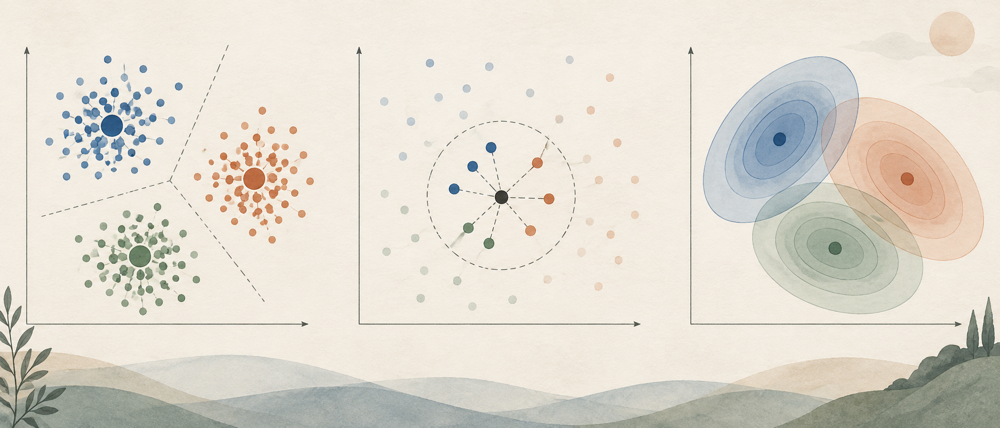
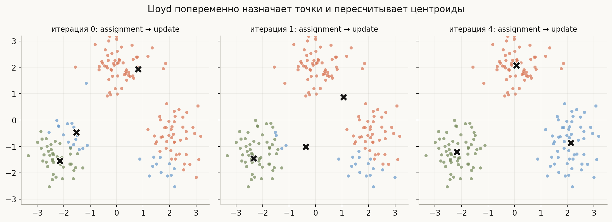
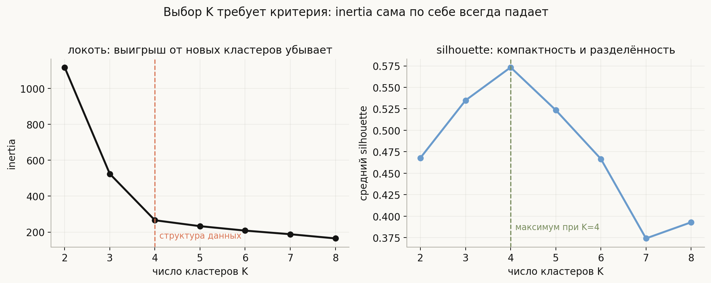
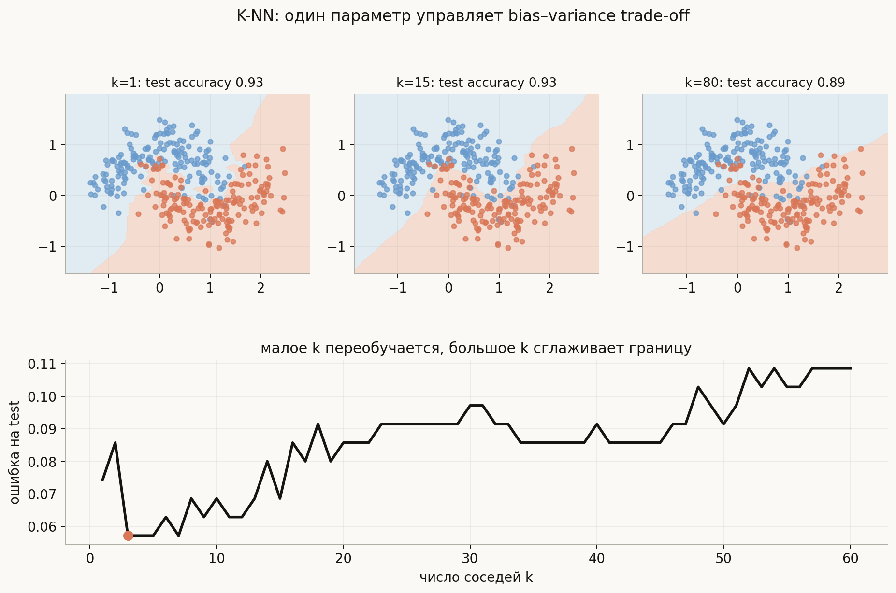
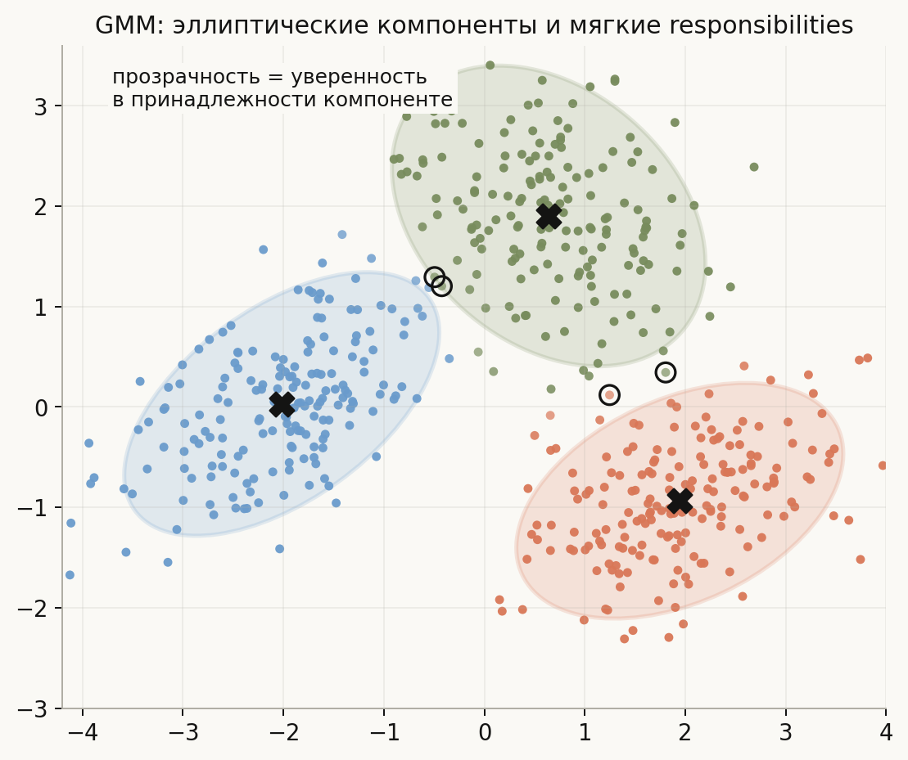

# K-means, K-NN и GMM

**Вопросы (EN)**: How to choose k for k-means? Evaluate k-means with/without labels? Compare k-means and GMM? How to choose k for k-NN? Impact of k on bias-variance?

K-means, K-NN и GMM часто стоят рядом в списке вопросов, потому что все три метода используют расстояния и геометрию объектов. Но задачи у них разные. **K-means** без учителя делит данные на жёсткие группы вокруг центроидов. **K-NN** с учителем классифицирует новый объект по ближайшим размеченным соседям. **GMM** описывает данные как смесь вероятностных распределений и выдаёт мягкие принадлежности к компонентам. Обозначение параметра в источниках меняется: оно может означать число кластеров в K-means и GMM или число соседей в K-NN.

В этой лекции одна линия проходит через все три метода: сначала нужно определить, что считается «близким», затем понять, какую функцию качества оптимизирует алгоритм, и только после этого выбирать параметр. Для ясности здесь $K$ — число кластеров или компонент, а $k$ — число соседей в K-NN; в источниках оба параметра иногда пишут одной буквой. Код в [`notebook.ipynb`](notebook.ipynb), а диаграммы воспроизводятся скриптом [`generate_visuals.py`](generate_visuals.py).

## План

1. Одна геометрия, три разные задачи
2. K-means: центроиды и алгоритм Lloyd
3. Как выбрать число кластеров и оценить кластеризацию
4. K-NN: локальное правило и параметр $k$
5. GMM: вероятностные кластеры и EM
6. K-means и GMM: что между ними общего и разного
7. Практический протокол и типичные ограничения
8. Что спрашивают на собеседовании
9. Типичные ошибки
10. Итог

---

## 1. Одна геометрия, три разные задачи

Пусть объект — это вектор признаков $x \in \mathbb{R}^d$. Во всех трёх методах появляется расстояние, но ответ на вопрос «какие точки близки?» используется по-разному:

| Метод | Есть целевая переменная? | Что означает параметр | Что строится | Ответ метода |
|---|---:|---:|---|---|
| K-means | нет | $K$ — число кластеров | центроиды и жёсткое разбиение | номер кластера |
| K-NN | да | $k$ — число соседей | ничего заранее, модель ленивая | класс или число |
| GMM | нет | $K$ — число компонент | веса, средние и ковариации | вероятности компонент и плотность |

Для этих методов выбор метрики и масштаба — часть постановки задачи. Если один признак измеряется в рублях, а другой — в годах, евклидова метрика будет почти полностью определяться рублями. Поэтому перед K-means, K-NN и часто GMM числовые признаки стандартизируют или используют осмысленную предметную метрику. Масштабирование нужно выполнять внутри `Pipeline`, если качество оценивается кросс-валидацией.

Эти методы также отвечают на разные вопросы:

- кластеризация спрашивает: «какая скрытая структура есть в самих $X$?»;
- K-NN спрашивает: «какие размеченные объекты похожи на новый $x$?»;
- GMM спрашивает: «из какой компоненты и с какой вероятностью мог появиться $x$?».

Поэтому хороший тестовый accuracy K-NN не оценивает качество кластеров, а высокий silhouette не доказывает, что кластеры полезны для бизнес-задачи.

## 2. K-means: центроиды и алгоритм Lloyd

### Целевая функция

K-means ищет $K$ центроидов $\mu_1,\ldots,\mu_K$ и присваивает каждый объект одному из них. Его целевая функция — сумма квадратов расстояний внутри кластеров:

$$
\min_{c_1,\ldots,c_n,\,\mu_1,\ldots,\mu_K}
\sum_{i=1}^{n}\left\|x_i-\mu_{c_i}\right\|_2^2,
\qquad c_i\in\{1,\ldots,K\}.
$$

Если разбиение $c_i$ уже известно, лучший центроид кластера — обычное среднее:

$$
\mu_k=\frac{1}{n_k}\sum_{i:c_i=k}x_i.
$$

Именно поэтому метод называется **k-means**: центр каждой группы — mean, среднее.

### Алгоритм Lloyd

На практике обычно используют итерации Lloyd:

1. выбрать начальные центроиды;
2. **assignment step**: присвоить $x_i$ ближайшему центроиду,
   $c_i\leftarrow\arg\min_k\|x_i-\mu_k\|^2$;
3. **update step**: пересчитать каждый центроид как среднее назначенных объектов;
4. повторять шаги 2–3 до стабилизации меток или малого изменения inertia.

Каждая итерация не увеличивает сумму квадратов: assignment выбирает лучший кластер при фиксированных центроидах, а update выбирает лучшее среднее при фиксированных назначениях. Но это не глобальная гарантия. Функция не выпукла одновременно по меткам и центроидам, поэтому разные начальные центры могут привести к разным локальным минимумам.

`k-means++` выбирает первый центр случайно, а следующие — с вероятностями, пропорциональными квадрату расстояния до ближайшего уже выбранного центра. Поэтому начальные центроиды обычно оказываются разбросаны по данным. В `scikit-learn` параметр `n_init` запускает алгоритм несколько раз и оставляет решение с наименьшей inertia. Один запуск с плохой инициализацией — частая причина странного результата.

### Что предполагает K-means

K-means естественно подходит для компактных примерно сферических кластеров похожего масштаба. Он режет пространство по ближайшему центроиду, поэтому границы — гиперплоскости Вороного. Из этого следуют ограничения:

- вытянутые или изогнутые кластеры могут быть разделены плохо;
- большой кластер может «перетянуть» центроид маленького;
- выбросы сильно двигают среднее;
- евклидово расстояние требует масштабирования и осмысленных координат.

На картинке `kmeans_lloyd.png` центроиды сначала стоят неудачно, а затем перемещаются к центрам плотных облаков. Это не иллюстрация «истинных» классов: K-means видит только координаты и минимизирует свою функцию.

## 3. Как выбрать число кластеров и оценить кластеризацию

### Inertia и метод локтя

Для каждого $K$ можно посчитать

$$
\operatorname{inertia}(K)=\sum_i\|x_i-\mu_{c_i}\|^2.
$$

Для оптимального решения inertia не возрастает при увеличении $K$: при $K=n$ каждый объект можно сделать отдельным кластером и получить ноль. В отдельных случайных запусках локальный минимум может нарушить эту картину, поэтому используют несколько инициализаций. Выбирать минимальную inertia недостаточно: строят график inertia против $K$ и ищут точку, после которой добавление кластеров даёт заметно меньший выигрыш. Это **метод локтя** — полезная эвристика, но не теорема.

### Silhouette

Для объекта $i$ обозначим через $a_i$ среднее расстояние до остальных объектов своего кластера, а через $b_i$ — минимальное среднее расстояние до другого кластера. Тогда

$$
s_i=\frac{b_i-a_i}{\max(a_i,b_i)}\in[-1,1].
$$

Большое значение означает, что объект близок к своему кластеру и далёк от соседнего. Средний silhouette можно сравнивать для разных $K$, но он тоже оптимизирует геометрическую компактность, а не обязательно полезность сегментов.

Дополнительные критерии:

- **Gap statistic** сравнивает observed dispersion с ожидаемой dispersion у случайного reference-распределения;
- **стабильность** проверяет, сохраняются ли кластеры при bootstrap-подвыборках и небольших изменениях данных;
- **доменные ограничения** отвечают на вопрос, можно ли реально использовать 2, 4 или 12 сегментов;
- **downstream-метрика** проверяет, помогают ли кластеры прогнозу, рекомендациям или операционному решению.

### Если метки есть и если их нет

Без истинных меток используют внутренние метрики: silhouette, Davies–Bouldin, Calinski–Harabasz, inertia. Они оценивают геометрию и не знают, что именно было важно в предметной задаче.

Если истинные метки есть, используют внешние метрики:

- **ARI** (Adjusted Rand Index) сравнивает пары объектов и корректирует случайное совпадение;
- **NMI** (Normalized Mutual Information) измеряет информацию между кластерными и истинными метками;
- **homogeneity/completeness** проверяют чистоту кластеров и полноту групп.

Обычный F1 требует сначала сопоставить номера кластеров с классами: кластер `0` и класс `1` — это просто имена. Поэтому ARI и NMI обычно безопаснее для прямого сравнения кластеризации с разметкой.

Правильная оценка должна отвечать цели. Если кластеры нужны для описания клиентов, важны стабильность и интерпретируемость сегментов. Если они используются как признаки для предсказания, сравнивать нужно честный downstream-пайплайн, где масштабирование и кластеризация обучаются только на train-fold.

## 4. K-NN: локальное правило и параметр $k$

K-NN — supervised-метод без отдельной фазы обучения. Он сохраняет обучающие объекты, а для нового $x$ находит $k$ ближайших по выбранной метрике:

$$
\hat y(x)=\operatorname{mode}\{y_j \mid j\in\mathcal N_k(x)\}
$$

для классификации. Для регрессии вместо mode берут среднее значений соседей:

$$
\hat y(x)=\frac{1}{k}\sum_{j\in\mathcal N_k(x)}y_j.
$$

Можно дать ближним соседям больший вес, например

$$
\hat y(x)=\frac{\sum_{j\in\mathcal N_k(x)}w_jy_j}{\sum_{j\in\mathcal N_k(x)}w_j},
\qquad w_j=\frac{1}{d(x,x_j)+\varepsilon}.
$$

При $k=1$ граница очень гибкая: ближайший шумный объект может полностью изменить ответ. При большом $k$ локальные детали усредняются, граница становится гладкой, но маленький класс может быть подавлен большинством.

Это классический bias–variance trade-off:

- малое $k$: низкий bias, высокая variance, риск переобучения;
- большое $k$: высокий bias, низкая variance, риск недообучения;
- оптимальное $k$ выбирают кросс-валидацией, а $\sqrt{n}$ — только грубая стартовая эвристика.

K-NN чувствителен к масштабу признаков. `StandardScaler` должен находиться внутри `Pipeline` перед K-NN: если сначала масштабировать весь датасет, а затем проводить кросс-валидацию, валидационные фолды участвуют в оценке параметров масштабирования. Кроме того, без масштабирования метрика будет определяться признаками с крупными единицами измерения.

У K-NN почти нет стоимости обучения, но есть стоимость запроса: наивный поиск требует сравнить новый объект со всеми $n$ объектами и занимает примерно $O(nd)$. KD-tree и ball tree помогают в умеренной размерности, но при больших $d$ страдают от проклятия размерности: расстояния становятся похожими, а индексы теряют преимущество. Для разреженного текста чаще выбирают линейные модели, а не K-NN.

## 5. GMM: вероятностные кластеры и EM

### Модель смеси

Gaussian Mixture Model предполагает, что объект получен из одной из $K$ скрытых компонент:

$$
p(x)=\sum_{k=1}^{K}\pi_k\,\mathcal N(x\mid\mu_k,\Sigma_k),
\qquad \pi_k\ge0,
\qquad \sum_k\pi_k=1.
$$

Здесь $\pi_k$ — вес компоненты, $\mu_k$ — её среднее, $\Sigma_k$ — ковариация. В отличие от K-means, компоненту можно выбрать не жёстко. Для объекта $x_i$ GMM возвращает responsibility:

$$
r_{ik}=P(z_i=k\mid x_i)
=\frac{\pi_k\mathcal N(x_i\mid\mu_k,\Sigma_k)}
{\sum_{\ell}\pi_\ell\mathcal N(x_i\mid\mu_\ell,\Sigma_\ell)}.
$$

Если объект лежит между двумя облаками, его принадлежность может быть, например, $(0.55,0.42,0.03)$, а не одним номером кластера.

### EM-алгоритм

Параметры смеси обычно оценивают методом максимального правдоподобия через **Expectation–Maximization**:

1. **E-step:** зафиксировать $\pi_k,\mu_k,\Sigma_k$ и посчитать $r_{ik}$;
2. **M-step:** пересчитать параметры по soft-весам:

$$
N_k=\sum_i r_{ik},
\qquad
\pi_k=\frac{N_k}{n},
\qquad
\mu_k=\frac{1}{N_k}\sum_i r_{ik}x_i,
$$

$$
\Sigma_k=\frac{1}{N_k}\sum_i r_{ik}(x_i-\mu_k)(x_i-\mu_k)^\mathsf T;
$$

3. повторять до стабилизации log-likelihood или параметров.

EM не уменьшает правдоподобие и обычно сходится к локальному максимуму. Поэтому, как и K-means, GMM стоит запускать с несколькими инициализациями. У полной ковариации есть дополнительный риск: компоненте выгодно сжать $\Sigma_k$ вокруг одной точки, поэтому на практике нужна регуляризация ковариаций (`reg_covar`).

### Как выбирать $K$ в GMM

Для GMM inertia не является естественной целевой функцией. Сравнивают log-likelihood на отложенных данных или информационные критерии:

$$
\mathrm{AIC}=2p-2\log L,
\qquad
\mathrm{BIC}=p\log n-2\log L,
$$

где $p$ — число оцениваемых параметров, а $L$ — likelihood. BIC сильнее штрафует сложные модели и часто используется как стартовый критерий; затем проверяют устойчивость и смысл компонент.

Тип `covariance_type` — часть модели:

- `spherical`: одна дисперсия на компоненту;
- `diag`: независимые признаки, своя дисперсия по каждой оси;
- `tied`: одна общая полная ковариация;
- `full`: отдельная полная ковариация каждой компоненты.

Чем гибче ковариации, тем больше параметров и тем выше риск переобучения.

## 6. K-means и GMM: что между ними общего и разного

K-means и GMM оба выполняют кластеризацию, но оптимизируют разные объекты:

| Свойство | K-means | GMM |
|---|---|---|
| Принадлежность | жёсткая: один кластер | мягкая: вероятности $r_{ik}$ |
| Геометрия | области Вороного вокруг центроидов | эллипсоиды, заданные ковариациями |
| Цель | сумма квадратов расстояний | likelihood смеси |
| Размеры кластеров | не моделируются явно | входят через $\pi_k$ и $\Sigma_k$ |
| Выход | метка кластера | метка, probabilities, density, likelihood |
| Стоимость | обычно проще и быстрее | больше параметров и локальных максимумов |

Есть и точная связь. Если в GMM зафиксировать одинаковые сферические ковариации и одинаковые веса компонент, а затем рассматривать малую дисперсию, наиболее вероятная компонента выбирается по ближайшему среднему. В этом пределе soft assignment превращается в assignment K-means. Поэтому K-means можно понимать как жёсткое геометрическое приближение специального GMM, но обычный GMM значительно богаче.

Практический выбор:

- компактные сегменты, нужна простая и быстрая метка → K-means;
- важны перекрытия, эллиптическая форма или вероятность принадлежности → GMM;
- есть метки и нужен ответ для нового объекта → K-NN или другой supervised-метод, а не кластеризация.

## 7. Практический протокол и типичные ограничения

### K-means или GMM

1. определить, что означает «похожесть» и какие признаки доступны в момент использования;
2. разделить train и test, если кластеры будут использоваться в прогнозе;
3. масштабировать признаки внутри pipeline;
4. перебрать разумный диапазон $K$ и несколько инициализаций;
5. сравнить inertia/silhouette или BIC/held-out likelihood;
6. проверить стабильность кластеров и их интерпретируемость;
7. только после этого использовать cluster label или probabilities как признаки.

### K-NN

1. определить метрику и обработать пропуски/категории;
2. поставить масштабирование в pipeline;
3. подобрать $k$, `weights` и, при необходимости, метрику по внутренней кросс-валидации;
4. оценить чувствительность к шуму и к выбору разбиения;
5. измерить стоимость inference при реальном размере базы.

### Где методы ломаются

- расстояние в высоком измерении становится малоинформативным;
- категориальный код нельзя бездумно трактовать как числовую координату;
- выбросы двигают центроиды и ковариации;
- K-means предполагает геометрию, которую данные могут не поддерживать;
- GMM может найти математически правдоподобные, но бизнес-бессмысленные компоненты;
- K-NN хранит всю обучающую выборку и медленно отвечает на большие базы;
- метрики кластеризации не заменяют проверку того, что сегменты полезны пользователю.

## 8. Что спрашивают на собеседовании

**Как выбрать $K$ в K-means?** Перебрать диапазон, посмотреть elbow и silhouette, проверить стабильность при разных инициализациях и подвыборках, а затем сверить с предметной задачей. Теоретически inertia уменьшается при увеличении $K$, поэтому минимальная inertia не является критерием выбора.

**Как оценить кластеризацию с метками и без меток?** Без меток — silhouette, Davies–Bouldin, Calinski–Harabasz, stability и downstream-метрика. С метками — ARI, NMI, homogeneity/completeness; номера кластеров нельзя сравнивать напрямую с номерами классов.

**Почему K-means зависит от масштаба?** Он минимизирует сумму квадратов евклидовых расстояний. Признак с большими единицами доминирует в норме, поэтому числовые признаки обычно стандартизируют.

**Чем K-means отличается от GMM?** K-means даёт жёсткое разбиение по ближайшему центроиду. GMM оценивает плотность смеси, допускает эллиптические компоненты и возвращает вероятности принадлежности.

**Что делает EM в GMM?** E-step считает вероятности скрытых компонент для объектов, M-step пересчитывает веса, средние и ковариации по этим soft-весам. Итерации повышают likelihood до локального максимума.

**Как выбрать $K$ в GMM?** Сравнить BIC/AIC и held-out log-likelihood, затем проверить стабильность и смысл компонент. BIC штрафует число параметров и обычно более консервативен.

**Как $k$ влияет на K-NN?** Малое $k$ даёт низкий bias и высокую variance; большое $k$ — высокий bias и низкую variance. Выбор делают кросс-валидацией после масштабирования.

**Почему K-NN называют lazy learner?** Он почти ничего не оценивает на этапе fit и переносит основную работу на prediction: поиск соседей и агрегацию их меток.

**Почему K-means не подходит для полумесяцев?** Его кластеры задаются ближайшими центроидами и имеют выпуклые области Вороного. Изогнутые или вложенные формы нарушают эту геометрию; нужны другие признаки или другой алгоритм.

**Можно ли использовать кластерные метки как признаки?** Да, но кластеризацию нужно обучать внутри каждого train-fold. Иначе валидационные данные участвуют в построении признака, а качество оказывается завышенным.

## 9. Типичные ошибки

- выбирать K-means по минимальной inertia без штрафа за число кластеров;
- считать номер кластера осмысленным числом и сравнивать его с классом без перестановочной инвариантности;
- забывать масштабирование перед K-means, GMM и K-NN;
- использовать `k ≈ √n` как закон вместо кросс-валидации;
- путать число кластеров $K$ с числом соседей $k$;
- утверждать, что GMM всегда находит «истинные» классы — он описывает выбранную вероятностную модель;
- запускать GMM с одной инициализацией и игнорировать локальные максимумы;
- считать silhouette доказательством бизнес-полезности сегментации;
- строить кластеры до разбиения train/test и получать утечку;
- применять K-NN к высокоразмерным данным, не проверив информативность расстояний и стоимость поиска.

## 10. Итог

K-means, K-NN и GMM используют геометрию, но решают разные задачи: кластеризацию без учителя, локальное предсказание с учителем и вероятностное моделирование плотности. K-means минимизирует сумму квадратов расстояний до центроидов и решается итерациями Lloyd, поэтому чувствителен к масштабу, инициализации, выбросам и форме кластеров. Для его оценки без меток используют inertia вместе с silhouette, stability и предметной проверкой; с метками — ARI и NMI. K-NN почти ничего не обучает заранее, зато переносит стоимость на запрос и управляет bias–variance через число соседей $k$. GMM описывает смесь гауссиан, через EM получает мягкие принадлежности и может моделировать эллиптические компоненты; $K$ выбирают с помощью BIC/AIC, held-out likelihood и устойчивости. Во всех трёх методах расстояние и масштаб признаков — часть модели, а любой preprocessing и кластеризацию нужно включать внутрь честной валидации.

## Что рядом

- [`notebook.ipynb`](notebook.ipynb) — K-means с нуля и inertia, выбор $K$, K-NN с кросс-валидацией, EM и responsibilities GMM
- [`generate_visuals.py`](generate_visuals.py) — воспроизводимые диаграммы алгоритма Lloyd, выбора $K$, границ K-NN и мягких компонент GMM
- [Выбор признаков](../feature-selection/lesson.md) — почему отбор и расстояние нужно оценивать внутри валидации
- [Классификация и регрессия](../../../ml/basics/classification-vs-regression/lesson.md) — постановка задач с учителем

---
*Источник вопроса: [Introduction to Machine Learning Interviews](https://huyenchip.com/ml-interviews-book/)*
