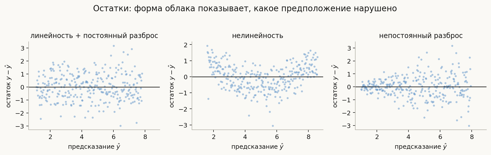
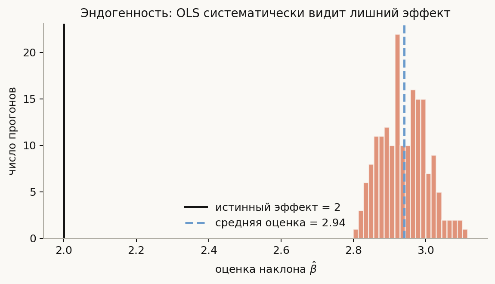
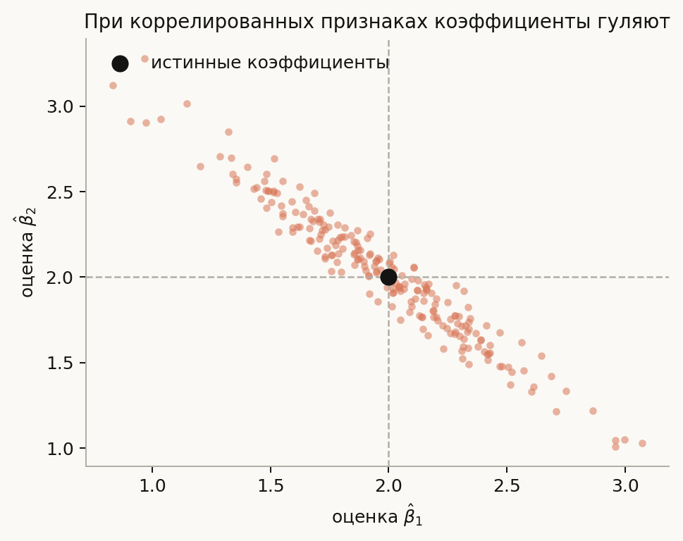

# Предположения линейной регрессии

**Вопрос (EN)**: What are the basic assumptions for linear regression?

Короткий ответ на собеседовании обычно выглядит как список: линейность, гомоскедастичность, независимость ошибок, нормальность остатков, отсутствие идеальной мультиколлинеарности и эндогенности. Список полезен только после одного уточнения: **какое свойство оценки мы хотим сохранить?** Не каждое предположение нужно для самого OLS. Линейность условного среднего и экзогенность связаны со смещением коэффициентов; полный ранг делает решение единственным; гомоскедастичность и некоррелированные ошибки дают стандартные формулы дисперсии; нормальность нужна главным образом для точного маловыборочного вывода.

В этой лекции мы разложим это по полочкам и проверим на симуляциях. Код в [`notebook.ipynb`](notebook.ipynb) воспроизводит все численные примеры, а [`generate_visuals.py`](generate_visuals.py) строит диаграммы из тех же идей. Главная практическая мысль: нарушение предположения не означает автоматически «линейную регрессию использовать нельзя» — сначала нужно понять, ломаются ли прогнозы, коэффициенты, стандартные ошибки или причинная интерпретация.

## План

1. Что именно предполагает линейная модель
2. Какие гарантии даёт OLS
3. Линейность условного среднего
4. Экзогенность: самое важное предположение
5. Полный ранг и мультиколлинеарность
6. Гомоскедастичность
7. Независимость и зависимость наблюдений
8. Нормальность остатков
9. Как диагностировать нарушения
10. Что спрашивают на собеседовании
11. Типичные ошибки
12. Итог

---

## 1. Что именно предполагает линейная модель

Запишем модель с $n$ наблюдениями и $p$ признаками:

$$
y = X\beta + \varepsilon,
$$

где:

- $y \in \mathbb{R}^n$ — целевая переменная;
- $X \in \mathbb{R}^{n\times p}$ — матрица признаков, обычно с колонкой единиц для свободного члена;
- $\beta \in \mathbb{R}^p$ — неизвестные коэффициенты;
- $\varepsilon \in \mathbb{R}^n$ — ошибки, то есть часть $y$, которую признаки не объяснили.

Метод наименьших квадратов выбирает коэффициенты, минимизирующие сумму квадратов остатков:

$$
\hat\beta = \arg\min_b \|y - Xb\|_2^2.
$$

Если $X^\mathsf{T}X$ обратима, решение можно записать явно:

$$
\hat\beta = (X^\mathsf{T}X)^{-1}X^\mathsf{T}y.
$$

Подставив истинную модель, получаем:

$$
\hat\beta = \beta + (X^\mathsf{T}X)^{-1}X^\mathsf{T}\varepsilon.
$$

Эта запись — карта всей темы. Если выполняется условие $E[\varepsilon\mid X]=0$, коэффициенты не смещены. Если ошибки имеют одинаковую дисперсию и не коррелируют, у OLS простая формула условной ковариации коэффициентов, а сама оценка является BLUE при экзогенности и полном ранге. Если ошибки нормальны, можно получить точные $t$- и $F$-распределения в конечной выборке.

### Не смешивайте четыре разных вопроса

У линейной регрессии есть как минимум четыре уровня требований:

1. **Вычислимость:** существует ли единственное решение OLS? Нужен полный столбцовый ранг $X$.
2. **Несмещённость коэффициентов:** можно ли интерпретировать $\hat\beta$ как оценку заданного $\beta$? Ключевое условие — $E[\varepsilon\mid X]=0$.
3. **Эффективность и стандартные ошибки:** насколько точна оценка и верны ли привычные формулы для SE? Здесь важны постоянная дисперсия и отсутствие корреляции ошибок.
4. **Точный вывод:** можно ли в малой выборке доверять обычным $t$-тестам и доверительным интервалам? Для этого обычно добавляют нормальность ошибок.

Для чистого прогноза на новых объектах часть требований к выводу не обязательна. Например, ненормальные остатки сами по себе не мешают минимизировать MSE на тесте.

---

## 2. Какие гарантии даёт OLS

Классический результат — теорема Гаусса—Маркова. При фиксированном $X$, полном ранге и условиях

$$
E[\varepsilon\mid X]=0,
\qquad
\operatorname{Var}(\varepsilon\mid X)=\sigma^2 I,
$$

оценка OLS является **BLUE** — лучшей линейной несмещённой оценкой: среди линейных несмещённых оценок у неё минимальная ковариационная матрица.

В записи с отдельными наблюдениями это означает:

- $E[\varepsilon_i\mid X]=0$ — нет систематической связи ошибки с признаками;
- $\operatorname{Var}(\varepsilon_i\mid X)=\sigma^2$ — одинаковый разброс ошибок;
- $\operatorname{Cov}(\varepsilon_i,\varepsilon_j\mid X)=0$ при $i\ne j$ — ошибки не связаны между наблюдениями.

**Нормальность в теорему Гаусса—Маркова не входит.** Она добавляется, когда нужны точные распределения статистик в конечной выборке. Поэтому фраза «OLS требует нормальных остатков» слишком сильная: OLS можно считать и без неё, но обычные маловыборочные тесты становятся менее надёжными.

---

## 3. Линейность условного среднего

Предположение формулируют так:

$$
E[Y\mid X] = X\beta.
$$

Линейность здесь означает линейность **по параметрам**, а не обязательно по исходным измерениям. Модель

$$
E[Y\mid x] = \beta_0 + \beta_1x + \beta_2x^2
$$

остаётся линейной регрессией: она линейна по $\beta_0,\beta_1,\beta_2$, хотя кривая нелинейна по $x$.

Если истинное среднее имеет вид $E[Y\mid x]=\sin x$, а мы подгоняем прямую, то остатки будут систематически положительными и отрицательными в разных диапазонах $x$. OLS всё равно найдёт лучшую линейную проекцию в смысле MSE, но она может плохо описывать условное среднее: прогнозы будут систематически ошибаться в форме кривой, а причинный смысл коэффициентов потребует дополнительных условий о дизайне и спецификации.

На диагностическом графике «остаток против предсказания» случайное облако вокруг нуля — хороший знак. Дуга или волна указывает на пропущенную нелинейность; расширяющийся конус — на меняющуюся дисперсию.

### Как чинить

- добавить осмысленные преобразования: $x^2$, $\log x$, $\sqrt{x}$;
- добавить взаимодействия, например $x_1x_2$;
- использовать сплайны или обобщённые аддитивные модели;
- перейти к другой модели, если форма связи неизвестна.

Пример: влияние площади квартиры на цену часто растёт не строго линейно. Модель с `log(price)` и `log(area)` может быть уместнее прямой в исходных единицах. При этом преобразование меняет интерпретацию коэффициентов — его нужно проговорить.

Проверка по $R^2$ одна не заменяет диагностику: более гибкая модель почти всегда может поднять $R^2$, но это не доказывает, что форма связи стала правдоподобной.

---

## 4. Экзогенность: самое важное предположение

Условие

$$
E[\varepsilon\mid X]=0
$$

называют условной экзогенностью. Интуитивно: после учёта всех признаков в ошибке не осталось систематической причины, связанной с $X$. Из него следует несмещённость OLS:

$$
E[\hat\beta\mid X]
= \beta + (X^\mathsf{T}X)^{-1}X^\mathsf{T}E[\varepsilon\mid X]
= \beta.
$$

Это условие сильнее, чем «корреляция ошибки с каждым признаком равна нулю» в некоторых случайных моделях, и именно его лучше называть на собеседовании.

### Откуда берётся эндогенность

1. **Пропущенная переменная.** Зарплату объясняют образованием, но не учитывают способность или опыт, которые связаны и с образованием, и с зарплатой.
2. **Обратная причинность.** Цена влияет на спрос, а спрос влияет на цену; регрессия одной величины на другую смешивает направления.
3. **Ошибка измерения в признаке.** При классической ошибке измерения — независимом шуме в регрессоре — оценка в простой модели обычно ослабляется (attenuation bias). Для общего, зависимого или систематического измерительного смещения направление и величина смещения не обязаны быть такими.
4. **Самоотбор.** В данные попали не случайные объекты: например, наблюдаются только клиенты, которые согласились на продукт.

В симуляции истинный коэффициент равен $2$, но признак и ошибка имеют общую скрытую причину. Повторные OLS-оценки устойчиво смещены вправо. Увеличение размера выборки уменьшает случайный разброс, но не убирает систематическое смещение.

### Что делать

- добавить важную переменную, если её можно измерить;
- использовать инструментальную переменную (IV): она должна быть релевантна $X$, удовлетворять условию исключения (не влиять на $Y$ иначе чем через $X$) и быть экзогенна относительно структурной ошибки;
- применить квазиэкспериментальный дизайн, fixed effects или разности, понимая, какую именно неизменную во времени компоненту они убирают;
- явно отказаться от причинной интерпретации и говорить только о прогнозе.

Важно: хороший тестовый MSE не доказывает экзогенность. Для прогноза коррелированный с ошибкой признак иногда полезен; для причинного вывода тот же признак делает коэффициент ненадёжным.

---

## 5. Полный ранг и мультиколлинеарность

Чтобы формула $(X^\mathsf{T}X)^{-1}$ имела смысл, столбцы $X$ должны быть линейно независимыми. **Идеальная мультиколлинеарность** — точная линейная комбинация признаков, например одновременно включить `age` и `age_in_months`. В таком случае коэффициенты не определены однозначно: разные наборы коэффициентов дают одинаковые предсказания.

**Сильная, но не идеальная мультиколлинеарность** не делает OLS смещённым. Она делает матрицу $X^\mathsf{T}X$ плохо обусловленной, поэтому небольшое изменение выборки может сильно поменять отдельные коэффициенты и их стандартные ошибки.

В симуляции два признака коррелируют примерно на $0.97$ и имеют одинаковый истинный вклад. Точки оценок $\hat\beta_1,\hat\beta_2$ образуют вытянутое облако: сумма вкладов может быть стабильной, а разделение вклада между двумя почти одинаковыми признаками — нет.

### Как заметить

- проверить ранг и число обусловленности матрицы;
- посмотреть корреляции и VIF;
- сравнить коэффициенты на bootstrap-подвыборках;
- проверить, не меняются ли знаки и величины коэффициентов при небольших изменениях данных.

### Как поступать

- удалить один из дублирующих признаков или объединить их;
- использовать предметный агрегат или латентное представление;
- применять Ridge или Elastic Net, если цель — прогноз;
- не интерпретировать отдельный коэффициент как устойчивый эффект, когда признаки измеряют почти одно и то же.

Регуляризация решает численную проблему, но меняет оценку: коэффициенты становятся смещёнными в обмен на меньшую дисперсию. Это разумный обмен для прогноза, но его нельзя выдавать за обычный OLS.

---

## 6. Гомоскедастичность

Гомоскедастичность означает постоянную условную дисперсию:

$$
\operatorname{Var}(\varepsilon_i\mid X)=\sigma^2
\quad\text{для всех }i.
$$

Если у дешёвых объектов ошибка около 1, а у дорогих около 100, дисперсия меняется с уровнем признаков — это **гетероскедастичность**.

Нарушение не обязательно смещает $\hat\beta$. При экзогенности коэффициенты OLS всё ещё могут быть несмещёнными, но обычная формула стандартных ошибок

$$
\operatorname{Var}(\hat\beta\mid X)=\sigma^2(X^\mathsf{T}X)^{-1}
$$

становится неверной. Поэтому страдают $t$-статистики, p-value и доверительные интервалы. OLS также перестаёт быть наиболее эффективной линейной несмещённой оценкой.

### Диагностика и исправление

- построить остатки против предсказаний и признаков;
- использовать тесты Breusch–Pagan или White как вспомогательные, а не как единственный вердикт;
- считать heteroskedasticity-robust (sandwich, HC) стандартные ошибки;
- применять WLS, если форма дисперсии известна или хорошо оценивается;
- преобразовать цель, например использовать `log(y)` для положительных величин, помня, что это меняет оцениваемую величину и требует осторожности при обратном преобразовании прогноза.

Robust SE меняют оценку неопределённости, но не исправляют неправильную среднюю функцию и не делают коэффициент причинным. WLS меняет и способ подгонки: наблюдения с меньшей дисперсией получают больший вес.

---

## 7. Независимость и зависимость наблюдений

Для классической формулы OLS требуется, чтобы ошибки разных наблюдений не имели ковариации:

$$
\operatorname{Cov}(\varepsilon_i,\varepsilon_j\mid X)=0,
\qquad i\ne j.
$$

Это не то же самое, что «признаки не коррелируют». Признаки могут быть сильно связаны между собой — это мультиколлинеарность. Здесь речь о зависимости **ошибок между строками**.

Типичные источники зависимости:

- последовательные измерения одного устройства или человека;
- временные ряды, где ошибка сегодня похожа на ошибку вчера;
- несколько клиентов из одной компании или пациентов из одной клиники;
- пространственно близкие объекты.

При автокорреляции OLS-коэффициенты при экзогенности могут остаться несмещёнными, но стандартные ошибки часто оказываются слишком маленькими: модель думает, что наблюдений больше независимых, чем есть на самом деле.

### Что делать

- разделять данные по времени или группам, а не случайно перемешивать связанные строки;
- использовать cluster-robust SE по субъекту/группе;
- для временных рядов — HAC/Newey–West или явную модель временной зависимости;
- использовать GLS, если ковариационная структура ошибок задана правдоподобно;
- агрегировать измерения, если уровень решения допускает это.

Cluster-robust и HAC-оценки требуют достаточно информативных кластеров или временных наблюдений; при нескольких кластерах обычная асимптотика может быть плохой, и нужны маловыборочные поправки или bootstrap, сохраняющий зависимость (например, block bootstrap).

Случайный `train_test_split` по строкам может дать утечку между train и test: модель увидит почти того же пациента или соседний временной момент. Это проблема оценки обобщения, даже если итоговый OLS технически посчитан.

---

## 8. Нормальность остатков

Предположение имеет вид

$$
\varepsilon\mid X \sim \mathcal{N}(0,\sigma^2 I).
$$

Нормальность **не нужна** для вычисления OLS, несмещённости коэффициентов или теоремы Гаусса—Маркова. Она нужна для удобных точных распределений в малой выборке:

- $t$-теста одного коэффициента;
- $F$-теста нескольких линейных ограничений;
- классических доверительных интервалов и prediction intervals.

При большом $n$ асимптотическая нормальность оценок часто делает вывод устойчивым к умеренной ненормальности, если нет тяжёлых выбросов и остальные условия приемлемы. При маленьком $n$, сильной асимметрии или тяжёлых хвостах полезны bootstrap, перестановочные методы, робастная регрессия или явная модель распределения.

Проверять нормальность по одному гистограммному «колоколу» не стоит: тесты чувствительны к размеру выборки и не отвечают на вопрос о независимости, линейности или гомоскедастичности. Q–Q plot — полезная диагностика формы хвостов, но не доказательство всех предположений сразу.

---

## 9. Как диагностировать нарушения

Диагностика начинается не с механического запуска шести тестов, а с дизайна данных и вопроса, который мы задаём модели.

1. **Посмотреть на данные до подгонки.** Есть ли временная ось, группы, цензура, пропуски, признаки, появляющиеся после целевой переменной?
2. **Проверить форму среднего.** Графики $y$ против важных признаков, остатки против предсказаний, добавление нелинейных базисов.
3. **Проверить дисперсию.** Остатки против fitted values; ищем конус или полосы разной ширины.
4. **Проверить зависимость.** Остатки по времени, по группам, ACF; не разбиваем ли связанные измерения между train и test.
5. **Проверить влияние.** Leverage, Cook’s distance и устойчивость коэффициентов к удалению отдельных точек.
6. **Проверить коллинеарность.** Ранг, condition number, VIF, bootstrap коэффициентов.
7. **Проверить распределение остатков.** Q–Q plot и разумный bootstrap для вывода.
8. **Проверить задачу.** Если нужен прогноз, сравнить честную кросс-валидацию. Если нужен эффект, сначала защитить экзогенность дизайном.

Диагностика остатков — это не способ доказать, что модель «истинна». Она помогает обнаружить конкретные способы, которыми модель не соответствует данным.

---

## 10. Что спрашивают на собеседовании

**«Назовите предположения линейной регрессии».** Сначала уточните цель. Для BLUE обычно называют линейность условного среднего, экзогенность, постоянную дисперсию и отсутствие корреляции ошибок; полный ранг нужен для единственности решения. Нормальность — дополнительное условие для точного маловыборочного вывода.

**«Что будет при гетероскедастичности?»** Коэффициенты не обязательно смещены, но обычные стандартные ошибки и тесты неверны; использовать robust SE или WLS, если модель дисперсии известна.

**«Что будет при мультиколлинеарности?»** При идеальной — нет единственного OLS-решения. При сильной — коэффициенты нестабильны и имеют большие SE; прогноз может оставаться хорошим. Удаление признака, Ridge или объединение признаков — выбор зависит от цели.

**«Нужна ли нормальность остатков?»** Не для OLS и не для несмещённости. Она нужна главным образом для точных $t/F$-тестов и интервалов в малой выборке.

**«Почему коррелированные признаки — это не эндогенность?»** Мультиколлинеарность — связь признаков друг с другом. Эндогенность — связь признаков с ошибкой. Первая увеличивает дисперсию оценок, вторая может смещать их.

**«Можно ли считать OLS, если предположения нарушены?»** Да, можно вычислить OLS. Следующий вопрос — какие гарантии потеряны и какая адаптация нужна: другой дизайн, robust covariance, WLS, GLS, преобразование признаков или отказ от причинной интерпретации.

---

## 11. Типичные ошибки

1. **Говорить, что нормальность нужна для самой линейной регрессии.** OLS минимизирует квадратичную ошибку без нормальности; нормальность относится к точному выводу.
2. **Считать любую корреляцию признаком эндогенности.** Корреляция двух столбцов $X$ — мультиколлинеарность; нужна корреляция регрессоров с ошибкой.
3. **Обещать, что robust SE исправят смещение.** Они меняют стандартные ошибки, но не устраняют пропущенную переменную или обратную причинность.
4. **Удалять все коррелированные признаки автоматически.** При прогнозе коррелированные признаки могут давать устойчивый предиктор; проблема прежде всего в интерпретации отдельных коэффициентов и численной устойчивости.
5. **Проверять независимость случайным перемешиванием.** Временные и групповые данные требуют разбиения по времени или группам.
6. **Считать красивый Q–Q plot доказательством корректности модели.** Он говорит только о форме распределения остатков и ничего не доказывает про экзогенность.
7. **Путать линейность по признакам с линейностью по параметрам.** Полиномиальная регрессия линейна по коэффициентам.
8. **Делать причинный вывод из хорошего MSE.** Предсказательная сила и причинная идентификация отвечают на разные вопросы.

---

## 12. Итог

Линейная регрессия предполагает, что условное среднее цели можно выразить линейно по параметрам, а ошибка после учёта признаков имеет условное среднее ноль. Полный ранг нужен для единственности OLS; сильная мультиколлинеарность в основном увеличивает дисперсию коэффициентов. Гомоскедастичность и отсутствие зависимости ошибок делают обычные стандартные ошибки корректными и дают результат Гаусса—Маркова; при их нарушении часто помогают robust SE, WLS, cluster или HAC. Нормальность нужна прежде всего для точного вывода в малой выборке. Наконец, эндогенность — самый опасный случай для интерпретации: она может сместить коэффициенты, и увеличение выборки это смещение не уберёт.

## Вопросы для самопроверки

1. Что означает $E[Y\mid X]=X\beta$ и почему полиномиальная регрессия всё ещё линейная?
2. Выведите формулу $\hat\beta-\beta$ и укажите, какое условие делает OLS несмещённым.
3. Какие предположения входят в теорему Гаусса—Маркова?
4. Почему гетероскедастичность может испортить p-value, но не обязательно сместить коэффициенты?
5. Чем идеальная мультиколлинеарность отличается от сильной?
6. Почему корреляция признаков между собой не равна эндогенности?
7. Зачем нужны HAC и cluster-robust стандартные ошибки?
8. В каких случаях нормальность остатков действительно важна?
9. Приведите пример пропущенной переменной и объясните знак смещения.
10. Как бы вы построили честное разбиение для повторных измерений одного клиента во времени?
11. Какие паттерны на графике «остаток против предсказания» указывают на нелинейность и гетероскедастичность?
12. Почему хороший тестовый MSE не доказывает причинную интерпретацию коэффициента?

## Источник исходного вопроса

Краткий конспект: [MLIB](https://huyenchip.com/ml-interviews-book/).
