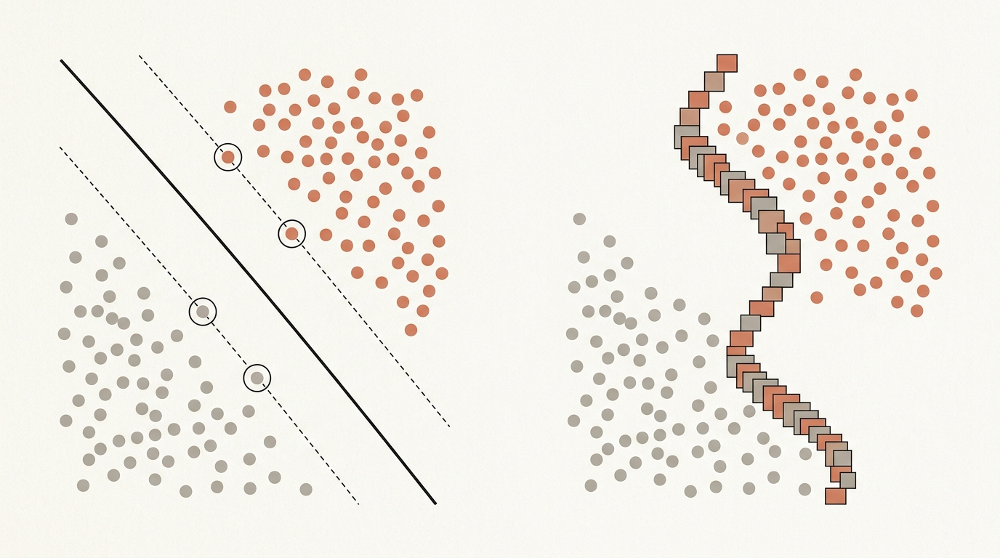
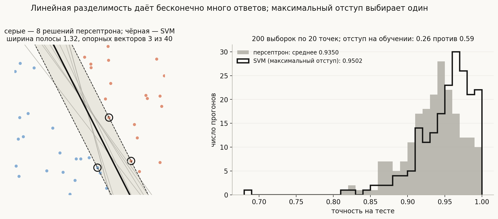
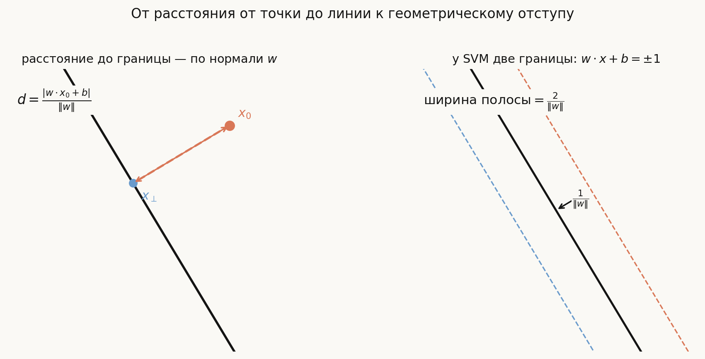
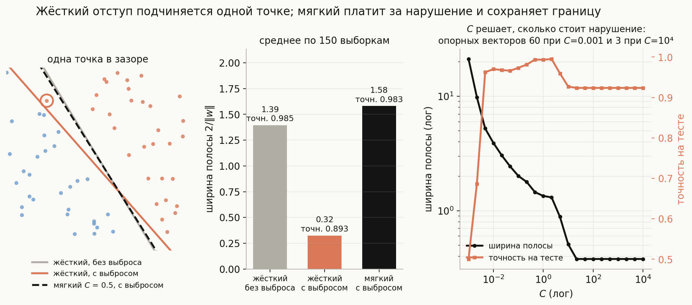
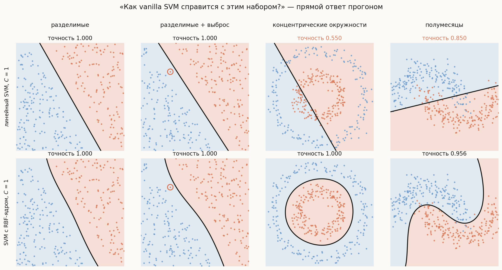
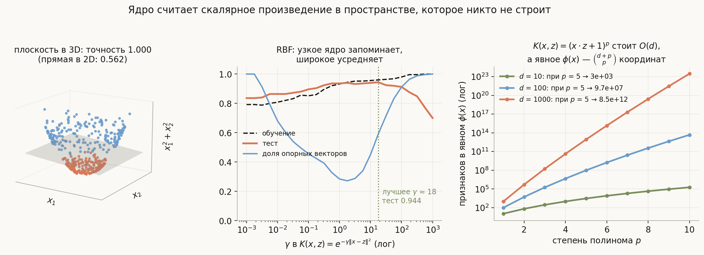
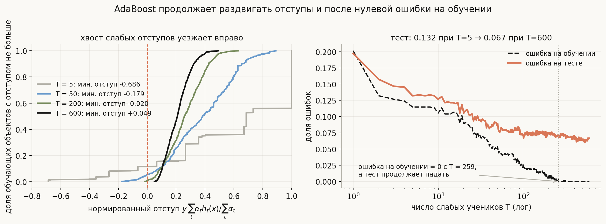
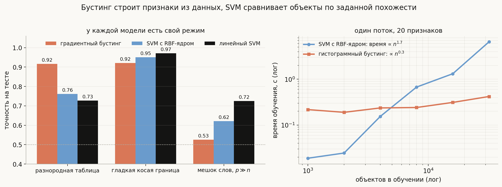

# SVM и градиентный бустинг

**Вопросы (EN)**: What's linear separation? Why is it desirable when we use SVM? How well would vanilla SVM work on these datasets? What is gradient boosting? What problems is gradient boosting good for?

Две половины этого вопроса кажутся не связанными: одна про геометрию разделяющей прямой, другая про ансамбль деревьев. Стандартные ответы на них тоже живут отдельно: «SVM ищет гиперплоскость с максимальным отступом, на нелинейных данных нужен kernel trick» и «бустинг последовательно добавляет деревья по антиградиенту, хорош для табличных данных». Оба ответа верны и оба разваливаются на первом уточнении. Зачем максимизировать отступ, если любая разделяющая прямая даёт нулевую ошибку на обучении? Что сделает одна-единственная выброшенная точка? Почему RBF-ядро то идеально разделяет окружности, то даёт 70% на тесте? Почему бустинг продолжает улучшать тест, когда ошибка на обучении уже ноль? И почему на мешке слов тот же бустинг работает на уровне монетки?

У двух методов есть общий язык, и он же даёт ответы: **отступ** (margin) — насколько уверенно объект лежит по правильную сторону границы. SVM максимизирует геометрический отступ в пространстве признаков, которое **вы задаёте заранее** через ядро. Бустинг наращивает отступ в пространстве слабых учеников, которое он **строит сам из данных**. Отсюда и практическое правило: SVM силён, когда хорошее понятие похожести известно и данные однородны; бустинг — когда его нет, а таблица разнородна. Все утверждения ниже проверены прогоном — код в [`generate_visuals.py`](generate_visuals.py) и [`notebook.ipynb`](notebook.ipynb).

## План

1. Линейная разделимость и почему её мало
2. Максимальный отступ, расстояние до гиперплоскости и оптимизация
3. Жёсткий и мягкий отступ: hinge loss и параметр $C$
4. Как vanilla SVM справится с этим набором данных
5. Ядерный трюк
6. Градиентный бустинг — коротко и по существу
7. Общий знаменатель: отступ
8. Для каких задач хорош бустинг — и для каких нет
9. Что спрашивают на собеседовании
10. Типичные ошибки
11. Итог

---

## 1. Линейная разделимость и почему её мало

Выборка $\{(x_i, y_i)\}$, $y_i \in \{-1, +1\}$, **линейно разделима**, если существует гиперплоскость, по одну сторону которой лежат все объекты одного класса, а по другую — все объекты другого:

$$\exists\, w, b:\quad y_i\,(w \cdot x_i + b) > 0 \quad \forall i.$$

Это свойство **данных в выбранном признаковом пространстве**, а не задачи: окружности, неразделимые на плоскости, становятся разделимыми после добавления признака $x_1^2 + x_2^2$ (раздел 5).

Если выборка разделима, то разделяющих гиперплоскостей не одна, а **бесконечно много**. Классический персептрон это прекрасно иллюстрирует: по теореме Новикова он гарантированно сходится за не более чем $(R/\gamma)^2$ ошибок, где $R$ — радиус данных, а $\gamma$ — отступ лучшей разделяющей гиперплоскости. Но сходится он к **какой-то** из них — какой именно, зависит от порядка объектов и начальной точки.

Слева — восемь решений персептрона на одних и тех же 40 точках (серые линии): все они дают нулевую ошибку на обучении и все разные. Чёрная — решение SVM. Вопрос «какая из разделяющих прямых лучше» — и есть содержательная часть вопроса про разделимость.

## 2. Максимальный отступ: что именно оптимизирует SVM

### Расстояние от точки до гиперплоскости

Граница линейного классификатора задаётся уравнением

$$
w\cdot x+b=0.
$$

Вектор $w$ перпендикулярен этой границе и задаёт её нормаль. Для точки $x_0$ проведём перпендикуляр до границы. Проекция точки на гиперплоскость равна

$$
x_{\perp}
=x_0-\frac{w\cdot x_0+b}{\|w\|^2}\,w.
$$

Коэффициент перед $w$ показывает, насколько нужно сдвинуть точку вдоль нормали, а длина этого сдвига даёт расстояние:

$$
d(x_0,\;w\cdot x+b=0)
=\frac{\lvert w\cdot x_0+b\rvert}{\|w\|}.
$$

Для привычной прямой $Ax+By+C=0$ и точки $(x_0,y_0)$ это та же формула в координатах:

$$
d=\frac{\lvert Ax_0+By_0+C\rvert}{\sqrt{A^2+B^2}}.
$$

Без модуля это **знаковое расстояние**: знак показывает, по какую сторону границы находится точка. На рисунке расстояние измеряется по направлению нормали $w$:

**Геометрический отступ** гиперплоскости — расстояние от неё до ближайшей точки обучающей выборки:

$$\gamma(w, b) = \min_i \frac{y_i\,(w \cdot x_i + b)}{\|w\|}.$$

Множитель $y_i\in\{-1,+1\}$ разворачивает расстояние к правильной стороне границы: для правильно классифицированной точки выражение положительно. В принятой здесь терминологии $\gamma$ — расстояние от центральной границы до ближайшего объекта, то есть **одна половина** полосы; полная ширина полосы равна $2\gamma$.

SVM выбирает гиперплоскость, максимизирующую эту величину. Поскольку $(w, b)$ определены с точностью до масштаба, можно зафиксировать $\min_i y_i(w\cdot x_i + b) = 1$ — тогда ширина полосы между классами равна $2/\|w\|$, и задача превращается в выпуклую квадратичную:

$$\min_{w,\,b}\ \tfrac12\|w\|^2 \quad \text{при}\quad y_i\,(w \cdot x_i + b) \ge 1\ \ \forall i.$$

### Линейное программирование и SVM

Линейное программирование (ЛП) — это задача вида

$$
\min_z c^\mathsf{T}z
\quad\text{при}\quad
Az\le d,\qquad Ez=f.
$$

И целевая функция, и ограничения здесь линейны. В контексте SVM ЛП полезно как задача **проверки существования разделителя**: переменными будут $w$ и $b$, а ограничения

$$
y_i(w\cdot x_i+b)\ge 1
$$

линейны по неизвестным. Если они совместны, выборка линейно разделима; если нет — жёсткий SVM не имеет решения. Такую проверку можно рассматривать как ЛП с нулевой целевой функцией или как его фазу поиска допустимой точки.

Сам SVM — уже не ЛП. В его цели стоит $\tfrac12\|w\|^2$, поэтому жёсткий и мягкий SVM являются **выпуклыми задачами квадратичного программирования**: ограничения остаются линейными, а цель содержит квадрат нормы. В двойственной задаче квадрат появляется в форме матрицы попарных произведений $\langle x_i,x_j\rangle$ или ядра $K(x_i,x_j)$.

Обычно ЛП решают симплекс-методом или методами внутренней точки. Для выпуклого квадратичного SVM используют QP-решатели и специализированные алгоритмы вроде SMO или координатного спуска; вручную выписывать все $\alpha_i$ обычно не требуется.

Теперь можно ответить на вопрос книги «почему линейная разделимость желательна для SVM» — четырьмя пунктами:

1. **Задача вообще разрешима только при разделимости.** Ограничения $y_i(w\cdot x_i+b) \ge 1$ совместны тогда и только тогда, когда выборка линейно разделима. Нет разделимости — нет жёсткого SVM.
2. **Решение единственно.** Целевая функция строго выпукла, ограничения линейны — в отличие от персептрона, SVM всегда даёт один и тот же ответ.
3. **Решение разреженно.** Гиперплоскость определяется только точками на краю полосы — **опорными векторами**. В примере на картинке таких точек 3 из 40; остальные 37 можно удалить, и ответ не изменится.
4. **Обобщение контролирует отступ, а не размерность.** Оценки обобщающей способности для классификаторов с большим отступом зависят от $R^2/\gamma^2$, а не от числа признаков — именно поэтому SVM может работать в пространствах огромной (и даже бесконечной) размерности, куда его переносит ядро.

Последний пункт стоит проверить, а не принять на веру. Правая панель: 200 независимых выборок по 20 точек, на каждой обучены персептрон и SVM, качество — на 3000 новых точек. Средний отступ на обучении у SVM **0.59** против **0.26** у персептрона, средняя точность на тесте **0.950** против **0.935**, и SVM не хуже персептрона в 64% прогонов. Выигрыш реальный, но не магический: при маленькой выборке у обоих большой разброс, и в отдельной выборке SVM может оказаться хуже. Отступ — это аргумент в среднем, а не гарантия на каждом наборе.

## 3. Жёсткий и мягкий отступ: hinge loss и параметр $C$

У жёсткого SVM есть серьёзный недостаток: гиперплоскость определяется **ближайшими** точками, а значит, одна неудачная точка может её сломать.

Эксперимент: к разделимой выборке добавлена одна точка класса «+» в зазоре со стороны класса «−» — данные остаются разделимыми, но зазор теперь узкий. Средние по 150 выборкам:

| | ширина полосы | точность на тесте | наклон относительно истинной границы |
|---|---|---|---|
| жёсткий отступ, без выброса | 1.39 | 0.985 | 1.7° |
| жёсткий отступ, **с одним выбросом** | **0.32** | **0.893** | 4.0° |
| мягкий отступ ($C = 0.5$), с выбросом | 1.58 | 0.983 | 1.8° |

Одна точка из 61 сужает полосу вчетверо и отнимает 9 пунктов точности — жёсткий SVM обязан пропустить границу между ней и классом «−». Мягкий отступ позволяет её нарушить за штраф:

$$\min_{w,\,b,\,\xi}\ \tfrac12\|w\|^2 + C\sum_i \xi_i \quad \text{при}\quad y_i(w\cdot x_i + b) \ge 1 - \xi_i,\ \ \xi_i \ge 0.$$

Если исключить $\xi_i$, получится знакомая форма «потеря + регуляризация»:

$$\min_{w,\,b}\ \sum_i \max\big(0,\ 1 - y_i(w\cdot x_i + b)\big) + \frac{1}{2C}\|w\|^2.$$

То есть **SVM — это линейная модель с hinge loss и $L_2$-регуляризацией**. Hinge loss равна нулю для объектов, лежащих за краем полосы, и растёт линейно для нарушителей — поэтому на решение влияют только объекты у границы и внутри неё. Этим же объясняется устойчивость к выбросам по сравнению с квадратичной потерей и отличие от логистической регрессии: логлосс никогда не становится ровно нулём, и на решение влияют все объекты.

Параметр $C$ — это цена нарушения, то есть обратная сила регуляризации (правая панель). При $C = 0.001$ нарушать дёшево: полоса шириной 21 единицу накрывает всю выборку, опорными становятся 60 точек из 61, модель вырождается в константу (точность 0.50). При $C = 10^4$ нарушения запрещены: полоса сжимается до 0.38, опорных векторов остаётся 3, и модель подчиняется выбросу (0.92). Максимум 0.995 — посередине. $C$ подбирают кросс-валидацией, как любой коэффициент регуляризации.

## 4. Как vanilla SVM справится с этим набором данных

В книге этот вопрос задан с картинками наборов данных. Ответ удобнее всего дать прогоном на четырёх классических случаях — линейный SVM с $C = 1$ против SVM с RBF-ядром:

| набор | линейный SVM | SVM с RBF-ядром | почему |
|---|---|---|---|
| линейно разделимые | 1.000 | 1.000 | ровно та задача, для которой метод создан |
| разделимые + выброс | 1.000 | 1.000 | мягкий отступ ($C = 1$) просто платит за нарушение; жёсткий сломался бы (раздел 3) |
| концентрические окружности | **0.550** | 1.000 | ни одна прямая не отделяет внутренний круг от кольца — это уровень монетки |
| полумесяцы | 0.850 | 0.956 | граница нелинейна, но «в целом наклонна»: прямая ловит основную массу, ошибается на концах |

Хороший устный ответ на вопрос «how well would vanilla SVM work» строится из трёх проверок: разделимы ли классы гиперплоскостью; есть ли выбросы у границы (и тогда нужен мягкий отступ); если граница нелинейна — нужна ли она **глобально** (окружности, XOR: линейная модель на уровне случайного угадывания) или только **локально** (полумесяцы: линейная модель неплоха, но не идеальна).

## 5. Ядерный трюк

До этого мы описывали SVM в **прямой (primal) форме**: искали параметры разделяющей гиперплоскости $w$ и $b$. Ядерный трюк не вводит другую модель. Он переписывает ту же задачу в **двойственной (dual) форме**, где вместо одного вектора $w$ появляются коэффициенты $\alpha_i$ — по одному на каждый обучающий объект.

Коэффициенты $\alpha_i$ возникают как множители Лагранжа для ограничений мягкого SVM. Условия оптимальности связывают две записи:

$$
w = \sum_i \alpha_i y_i x_i.
$$

Это тот же самый $w$ из предыдущих разделов: $w$ имеет размерность числа признаков, а $\alpha$ — размерность числа объектов. Вектор $w$ задаёт направление границы напрямую; коэффициенты $\alpha_i$ задают его как комбинацию обучающих объектов. Для свободного члена $b$ условия оптимальности дают $\sum_i\alpha_i y_i=0$, а для мягкого отступа — $0\le\alpha_i\le C$.

Теперь запишем эквивалентную двойственную задачу мягкого SVM:

$$\max_{\alpha}\ \sum_i \alpha_i - \tfrac12\sum_{i,j}\alpha_i\alpha_j\, y_i y_j\, \langle x_i, x_j\rangle \quad \text{при}\quad 0 \le \alpha_i \le C,\ \ \sum_i \alpha_i y_i = 0,$$

а предсказание, после подстановки связи для $w$, имеет вид

$$
f(x)=w\cdot x+b
    =\sum_i \alpha_i y_i\langle x_i,x\rangle+b.
$$

Теперь видно, зачем нужны $\alpha$: и целевая функция, и предсказание используют признаки только через попарные скалярные произведения $\langle x_i,x_j\rangle$. Их можно заменить функцией

$$
K(x,z)=\langle\phi(x),\phi(z)\rangle,
$$

где $\phi(x)$ — явное или неявное отображение в новое признаковое пространство. Тогда в этом пространстве

$$
w_{\phi}=\sum_i\alpha_i y_i\phi(x_i),
\qquad
f(x)=\sum_i\alpha_i y_i K(x_i,x)+b,
$$

и само отображение $\phi$ строить не нужно. Это и есть ядерный трюк.

Опорными векторами являются объекты с $\alpha_i>0$: только они влияют на $w$ и на предсказание. Объекты с $\alpha_i=0$ не входят в границу; обычно $0<\alpha_i<C$ означает точку на краю полосы, а $\alpha_i=C$ — точку внутри полосы или нарушителя.

Левая панель показывает идею буквально: окружности на плоскости неразделимы (прямая даёт 0.562), но после добавления третьей координаты $x_1^2 + x_2^2$ внутренний круг опускается вниз, кольцо поднимается вверх, и **плоскость** разделяет их идеально (1.000). Ядро делает то же самое неявно.

Правая панель — зачем «неявно». Полиномиальное ядро $K(x, z) = (x\cdot z + 1)^p$ вычисляется за $O(d)$ операций, а соответствующее явное отображение содержит $\binom{d+p}{p}$ координат: при $p = 5$ это 3003 признака для $d = 10$, 97 миллионов для $d = 100$ и $8.5\cdot10^{12}$ для $d = 1000$. У RBF-ядра $K(x, z) = e^{-\gamma\|x - z\|^2}$ пространство $\phi$ и вовсе бесконечномерно. Условие, при котором функция годится в ядра, — теорема Мерсера: матрица $K(x_i, x_j)$ должна быть неотрицательно определённой для любого набора точек.

Средняя панель — главный рычаг RBF-ядра, ширина $\gamma$. Это радиус «влияния» одного опорного вектора:

- **малое $\gamma$** ($10^{-3}$): ядро широкое, модель почти линейна и недообучена — на обучении 0.79, на тесте 0.84;
- **большое $\gamma$** ($10^{3}$): каждое ядро — узкий пик вокруг своей точки, модель запоминает выборку — на обучении 1.000, на тесте 0.70, и **100% объектов** становятся опорными векторами;
- лучший тест 0.944 при $\gamma \approx 18$.

Доля опорных векторов — полезная диагностика: если опорными стали почти все объекты, модель либо переобучена (большое $\gamma$), либо слишком зарегуляризована (маленькое $C$).

Цена ядерного трюка — масштабируемость. Матрица ядра имеет размер $n \times n$, обучение стоит от $O(n^2)$ до $O(n^3)$, а предсказание — $O(n_{SV}\cdot d)$ на объект. На сотнях тысяч объектов ядерный SVM уже непрактичен (раздел 8).

## 6. Градиентный бустинг — коротко и по существу

Подробная механика — в теме [Bagging и Boosting](../bagging-vs-boosting/lesson.md); здесь то, что нужно для ответа на вопрос.

Градиентный бустинг строит аддитивную модель $F_M(x) = F_0(x) + \nu\sum_{m=1}^{M} h_m(x)$, где каждое новое неглубокое дерево $h_m$ приближает **антиградиент функции потерь** по текущим предсказаниям на обучающих объектах:

$$r_i^{(m)} = -\left.\frac{\partial L(y_i, F(x_i))}{\partial F(x_i)}\right|_{F = F_{m-1}}, \qquad h_m = \arg\min_h \sum_i \big(r_i^{(m)} - h(x_i)\big)^2.$$

Для квадратичной потери это просто остатки, для логистической — $y_i - p_i$. Три вещи, которые отличают хороший ответ:

- это **градиентный спуск в пространстве функций**: деревья — направления шагов, $\nu$ — длина шага;
- базовые деревья **обязаны быть слабыми** (глубина 2–8): сильное дерево забирает остаток вместе с шумом;
- число деревьев — параметр сложности: тестовая ошибка проходит минимум, поэтому нужна ранняя остановка.

## 7. Общий знаменатель: отступ

Вот где две половины вопроса сходятся. Здесь $\alpha_t$ — веса слабых учеников в бустинге; это **другая** роль буквы $\alpha$, не двойственные коэффициенты $\alpha_i$ из SVM. У бинарного классификатора вида $F(x) = \sum_t \alpha_t h_t(x)$ с $h_t(x) \in \{-1, +1\}$ есть естественный **нормированный отступ**:

$$\text{margin}(x_i) = \frac{y_i \sum_t \alpha_t h_t(x_i)}{\sum_t \alpha_t} \in [-1, 1].$$

Он положителен, когда объект классифицирован верно, и тем больше, чем единодушнее ансамбль. Это прямой аналог отступа SVM, только расстояние меряется не в исходных признаках, а в пространстве, координаты которого — ответы слабых учеников. Известный результат (Schapire, Freund, Bartlett, Lee, 1998) связывает обобщающую способность бустинга именно с распределением этих отступов, а Rosset, Zhu и Hastie (2004) показали, что бустинг с малым шагом идёт вдоль пути $L_1$-регуляризованных решений, который на разделимых данных сходится к классификатору с максимальным отступом в $L_1$-норме по весам учеников. В этом смысле бустинг — близкий родственник SVM, только в пространстве деревьев и с $L_1$-нормой вместо $L_2$.

Это объясняет знаменитый парадокс AdaBoost: тест продолжает улучшаться после того, как ошибка на обучении стала нулевой.

AdaBoost с деревьями глубины 2 на 750 объектах. Ошибка на обучении становится нулевой на 259-м ученике — казалось бы, учить больше нечему. Но тестовая ошибка продолжает падать: 0.132 при $T = 5$, 0.071 при $T = 259$, **0.067** при $T = 600$. Левая панель показывает, почему: бустинг продолжает раздвигать **самые слабые** отступы.

| $T$ | минимальный отступ | 5-й перцентиль | медиана |
|---|---|---|---|
| 5 | −0.686 | −0.265 | +0.686 |
| 50 | −0.179 | −0.004 | +0.384 |
| 200 | −0.020 | +0.064 | +0.258 |
| 600 | **+0.049** | **+0.088** | +0.208 |

Честная деталь, которую обычно не показывают: медиана отступов при этом **падает**. Бустинг, как и SVM, оптимизирует не средний, а **худший** случай — он жертвует уверенностью на лёгких объектах ради трудных. Ровно так же SVM игнорирует все точки, кроме опорных. И та же деталь объясняет, почему бустинг чувствителен к шуму в метках: ошибочно размеченный объект — это вечный «худший случай», в который алгоритм будет вкладываться бесконечно. Это видно на тех же данных, если перевернуть всего **1%** меток ([`notebook.ipynb`](notebook.ipynb)):

| $T$ | тест, метки чистые | тест, 1% перевёрнутых меток |
|---|---|---|
| 50 | 0.089 | 0.108 |
| 200 | 0.073 | 0.089 |
| 400 | 0.068 | 0.081 |
| 600 | **0.067** | **0.091** |

На чистых метках тест монотонно улучшается и после нулевой ошибки на обучении. С одним процентом шума, чтобы довести обучающую ошибку до нуля, бустингу приходится выучить неправильные метки — и тестовая ошибка разворачивается вверх. «Бустинг не переобучается благодаря отступам» — правда только для чистых данных.

## 8. Для каких задач хорош бустинг — и для каких нет

Раз оба метода максимизируют отступ, разница между ними — в пространстве, где отступ меряется. SVM сравнивает объекты по **заданной** похожести (ядру). Бустинг **строит** признаки — пороги и их комбинации — из самих данных. Отсюда предсказуемо, кто где выигрывает. Три режима, одинаковый протокол:

| режим | бустинг | SVM с RBF | линейный SVM |
|---|---|---|---|
| разнородная таблица: коды категорий, тяжёлые хвосты, пороговые эффекты, взаимодействия, шумовые признаки | **0.917** | 0.762 | 0.727 |
| гладкая косая граница в двух признаках | 0.921 | 0.950 | **0.971** |
| мешок слов: 600 документов, 4000 редких слов | 0.525 | 0.621 | **0.725** |

**Где бустинг хорош.**

- **Разнородные табличные данные.** Деревьям безразличны шкалы и монотонные преобразования, тяжёлые хвосты, коды категорий, пороговые эффекты («сумма больше 60») и взаимодействия («признак важен только при другом условии»). Ядру RBF для этого нужна евклидова метрика, в которой расстояние между кодом категории 3 и 4 ничего не значит.
- **Пропуски и мусорные признаки.** Современные реализации обрабатывают пропуски как отдельное направление разбиения, а по шумовым признакам просто не делают разбиений.
- **Большие $n$.** Гистограммный бустинг практически линеен по числу объектов (правая панель, один поток: время растёт как $n^{0.3}$ на этом диапазоне — фиксированные накладные расходы ещё не отбиты), тогда как ядерный SVM — как $n^{1.7}$: при 32 тысячах объектов 6.5 секунды против 0.4, и разрыв растёт.
- **Произвольные дифференцируемые потери**: логлосс, квантили, ранжирование, пуассоновская регрессия — достаточно выписать градиент.

**Где бустинг плох.**

- **Гладкие косые границы в малом числе признаков.** Деревья режут только параллельно осям, и диагональ приходится собирать лестницей из ступенек: 0.921 против 0.971 у линейного SVM на простейшей границе $x_1 + x_2 = 0$.
- **Высокоразмерные разреженные данные при малом $n$** — тексты, мешки слов, счётчики. Сигнал размазан слабым вкладом по сотням редких признаков; линейная модель складывает эти вклады, а дерево делает разбиение по одному редкому слову за раз. Результат — 0.525, почти монетка, против 0.725 у линейного SVM.
- **Экстраполяция.** Дерево кусочно-постоянно, поэтому за пределами обучающего диапазона бустинг выдаёт константу: в [`notebook.ipynb`](notebook.ipynb) модель, обученная на $y = 2x$ для $x \in [0, 10]$, при $x = 15$ и $x = 30$ предсказывает одно и то же значение около 20, тогда как линейная регрессия — 30 и 60. Для трендов во времени это критично.
- **Сырые изображения, звук, текст как последовательность.** Там признаки нужно извлекать иерархически, и выигрывают нейросети.

**Где уместен SVM.** Небольшие и средние выборки (до десятков тысяч), однородные числовые признаки после стандартизации, известная осмысленная мера похожести (строковые, графовые, специализированные ядра), высокоразмерные разреженные данные — в линейном варианте. И оговорка: SVM не выдаёт вероятностей; `probability=True` в sklearn — это дополнительная калибровка Платта на внутренней кросс-валидации, которая стоит времени и не всегда согласована с `decision_function`.

## 9. Что спрашивают на собеседовании

**Что такое линейная разделимость?** Существуют $w, b$, при которых $y_i(w\cdot x_i + b) > 0$ для всех объектов. Это свойство данных в выбранном признаковом пространстве: окружности неразделимы на плоскости, но разделимы после добавления $x_1^2 + x_2^2$ (в прогоне 0.562 → 1.000).

**Почему она желательна для SVM?** Жёсткая задача $\min \frac12\|w\|^2$ при $y_i(w\cdot x_i+b) \ge 1$ разрешима только при разделимости; её решение единственно (строго выпуклая задача) и разреженно (определяется опорными векторами — в примере 3 из 40); обобщение контролируется отступом, а не размерностью.

**Как SVM связан с линейным программированием?** Проверка существования разделителя с линейными ограничениями — задача ЛП. Сам SVM максимизирует отступ через квадратичную цель $\frac12\|w\|^2$, поэтому это выпуклая задача квадратичного программирования; на практике её решают QP-решатели, SMO или координатным спуском.

**Зачем максимизировать отступ, если любая разделяющая прямая даёт ноль ошибок?** Разделяющих прямых бесконечно много, и лишний запас от границы лучше обобщается. На 200 выборках по 20 точек средний отступ SVM 0.59 против 0.26 у персептрона, точность 0.950 против 0.935. Выигрыш в среднем, а не на каждом наборе.

**Что такое мягкий отступ и за что отвечает $C$?** Нарушения разрешены за штраф $C\sum\xi_i$; эквивалентно hinge loss с $L_2$-регуляризацией силы $1/(2C)$. Малое $C$ — широкая полоса, много опорных векторов, недообучение; большое — узкая полоса и подчинение выбросам. Одна точка в зазоре сужает жёсткую полосу вчетверо (1.39 → 0.32) и снижает точность с 0.985 до 0.893; мягкий отступ возвращает 0.983.

**Как vanilla SVM справится с нелинейными данными?** Зависит от того, глобальна ли нелинейность. На концентрических окружностях линейный SVM — монетка (0.550), на полумесяцах — неплохо (0.850), но в обоих случаях RBF-ядро лучше (1.000 и 0.956).

**Что такое ядерный трюк?** В прямой форме SVM ищет $w$ и $b$, а в двойственной вводит по одному множителю $\alpha_i$ на объект. Условия оптимальности связывают записи: $w=\sum_i\alpha_i y_i x_i$. Поэтому в двойственной задаче и в предсказании объекты входят только через скалярные произведения, которые заменяются на $K(x,z)=\langle\phi(x),\phi(z)\rangle$ без построения $\phi$. Полиномиальное ядро степени 5 при $d = 100$ соответствует 97 миллионам явных признаков, а считается за $O(d)$; у RBF-ядра $\phi$ бесконечномерно.

**Как выбрать $\gamma$ у RBF?** Кросс-валидацией вместе с $C$. Малое $\gamma$ — почти линейная модель, большое — запоминание: при $\gamma = 1000$ на обучении 1.000, на тесте 0.70, и все объекты стали опорными векторами.

**Что такое градиентный бустинг?** Аддитивная модель из неглубоких деревьев, где каждое следующее дерево аппроксимирует антиградиент потерь по текущим предсказаниям — градиентный спуск в пространстве функций с шагом $\nu$ и ранней остановкой по числу деревьев.

**Что общего у SVM и бустинга?** Оба максимизируют отступ — SVM геометрический в пространстве признаков, бустинг нормированный в пространстве слабых учеников. Поэтому AdaBoost улучшает тест после нулевой ошибки на обучении: ошибка стала нулевой на 259-м ученике, но минимальный отступ продолжил расти (−0.020 → +0.049), а ошибка на тесте — падать (0.071 → 0.067). Оговорка: это верно на чистых метках — при 1% шума тестовая ошибка к 600-му ученику растёт.

**Для каких задач хорош градиентный бустинг?** Разнородные таблицы с порогами, взаимодействиями, пропусками и мусорными признаками; большие $n$; нестандартные функции потерь. В прогоне на разнородной таблице — 0.917 против 0.762 у SVM с RBF. Плох на гладких косых границах, на разреженных высокоразмерных данных при малом $n$ (0.525 против 0.725 у линейного SVM на мешке слов), при экстраполяции и на сырых сигналах.

**Когда выбрать SVM вместо бустинга?** Небольшая или средняя выборка, однородные числовые признаки, известная хорошая мера похожести, высокая размерность при малом числе объектов — там линейный SVM очень силён. И наоборот, от SVM стоит отказаться при сотнях тысяч объектов (обучение растёт как $n^{1.7}$ и хуже), разнородных таблицах и потребности в хорошо откалиброванных вероятностях.

## 10. Типичные ошибки

- **Говорить, что SVM «требует» линейной разделимости.** Жёсткий — да; мягкий работает с любыми данными, а с ядром разделимость переносится в другое пространство.
- **Использовать жёсткий отступ (огромное $C$) «для точности».** Одна точка у границы сужает полосу вчетверо и отнимает 9 пунктов точности; $C$ — регуляризатор, его подбирают, а не максимизируют.
- **Не масштабировать признаки перед SVM.** Отступ и RBF-ядро — это евклидовы расстояния: признак в тысячах единиц полностью заглушит признак в долях. Для бустинга масштабирование безразлично, для SVM обязательно.
- **Путать число опорных векторов с качеством.** Когда опорными стали почти все объекты, модель переобучена (большое $\gamma$) или слишком зарегуляризована (малое $C$) — это сигнал, а не достижение.
- **Считать RBF-ядро универсальным решением.** На разнородной таблице с кодами категорий оно проигрывает бустингу 0.762 против 0.917: евклидово расстояние между кодами категорий бессмысленно.
- **Брать ядерный SVM на больших данных.** Время обучения растёт как $n^{1.7}$ и хуже, а предсказание — пропорционально числу опорных векторов. На сотнях тысяч объектов — линейный SVM или бустинг.
- **Читать `decision_function` SVM как вероятность.** Это расстояние до границы; вероятности требуют отдельной калибровки.
- **Считать бустинг лучшим выбором для любых табличных данных.** На разреженных высокоразмерных признаках при малом $n$ он работает на уровне монетки (0.525), а линейная модель — 0.725.
- **Использовать бустинг для экстраполяции тренда.** За пределами обучающего диапазона деревья выдают константу.
- **Говорить, что бустинг «максимизирует уверенность на всех объектах».** Он раздвигает худшие отступы ценой лучших — медиана отступов при обучении падает (0.686 → 0.208). Отсюда и его чувствительность к шуму в метках: уже 1% перевёрнутых меток разворачивает тестовую ошибку вверх (0.081 → 0.091 между 400-м и 600-м учеником).

## 11. Итог

Линейная разделимость — это существование гиперплоскости, по разные стороны которой лежат классы; она желательна для SVM, потому что только при ней разрешима задача жёсткого отступа, решение этой задачи единственно и определяется несколькими опорными векторами (3 из 40 в примере), а обобщение контролируется отступом, а не размерностью — на 200 малых выборках максимальный отступ SVM (0.59 против 0.26 у персептрона) даёт в среднем 0.950 против 0.935 на тесте. Жёсткий отступ ломается от одной точки у границы (полоса сужается с 1.39 до 0.32, точность падает с 0.985 до 0.893), поэтому на практике используют мягкий — линейную модель с hinge loss и $L_2$-регуляризацией, где $C$ задаёт цену нарушения. Vanilla SVM безупречен на разделимых данных, бесполезен на глобально нелинейных (0.550 на окружностях) и приемлем на локально нелинейных (0.850 на полумесяцах); ядерный трюк переносит задачу в пространство, где граница линейна, не строя его явно, а ширина RBF-ядра $\gamma$ управляет переходом от почти линейной модели к запоминанию, при котором все объекты становятся опорными. Градиентный бустинг — это спуск по антиградиенту потерь в пространстве функций из слабых деревьев, и его роднит с SVM максимизация отступа: AdaBoost продолжает раздвигать худшие отступы и снижать тестовую ошибку уже после нулевой ошибки на обучении — но только на чистых метках, при 1% перевёрнутых меток та же погоня за худшим случаем разворачивает тест вверх. Различаются методы пространством, где меряется отступ: SVM сравнивает объекты по заданной похожести, бустинг строит признаки из данных — поэтому бустинг выигрывает на разнородных таблицах (0.917 против 0.762) и масштабируется почти линейно, а проигрывает на гладких косых границах, на разреженных высокоразмерных данных (0.525 против 0.725 у линейного SVM) и при экстраполяции.

## Что рядом

- [`notebook.ipynb`](notebook.ipynb) — SVM с нуля через двойственную задачу (те же опорные векторы и та же гиперплоскость, что у sklearn); hinge loss и субградиентный спуск; численная проверка ядерного трюка и его стоимости; опорные векторы при разных $C$ и $\gamma$; отступы AdaBoost на чистых и зашумлённых метках; экстраполяция бустинга
- [`generate_visuals.py`](generate_visuals.py) — код всех диаграмм; ширины полос, отступы и время обучения меряются прогоном
- [Bagging и Boosting](../bagging-vs-boosting/lesson.md) — механика бустинга, темп обучения, переобучение по числу деревьев, чувствительность к шуму
- [Выбор признаков](../feature-selection/lesson.md) — $L_1$ против $L_2$ и важности деревьев
- [Детекция мошенничества](../fraud-detection/lesson.md) — бустинг в его родной среде: разнородная таблица, редкий класс, деньги
- [Logistic Regression Feature Scaling](../Logistic%20Regression%20Feature%20Scaling.md) — почему масштаб признаков важен для моделей, основанных на расстояниях и отступах

---
*Источник вопроса: [Introduction to Machine Learning Interviews](https://huyenchip.com/ml-interviews-book/)*
