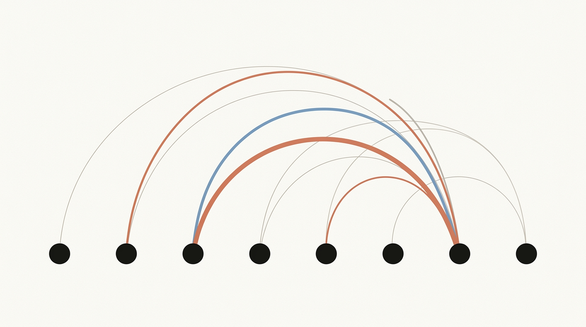
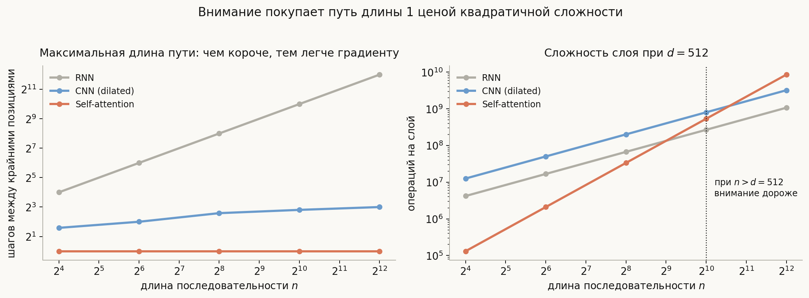
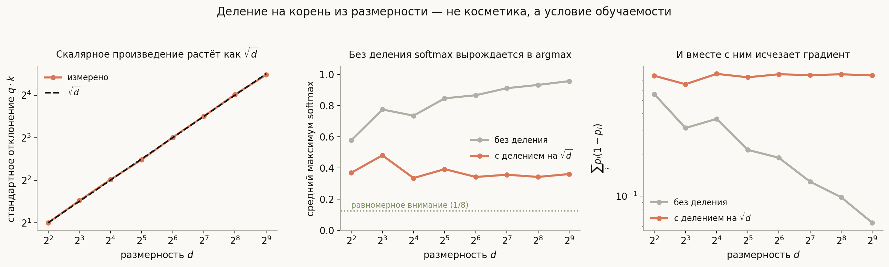
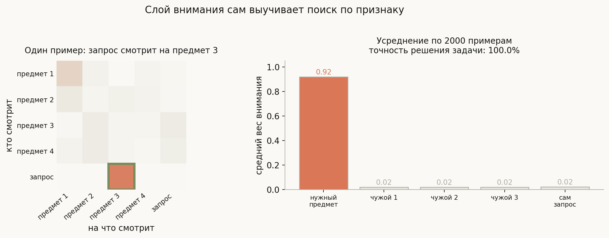
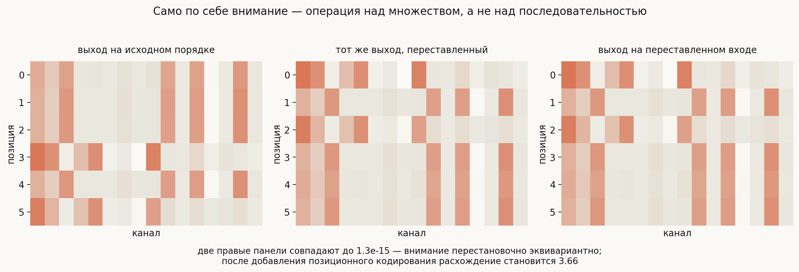
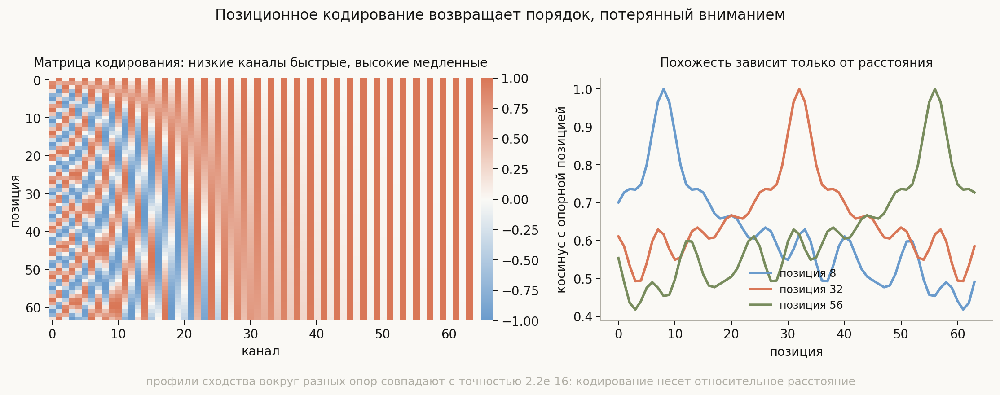
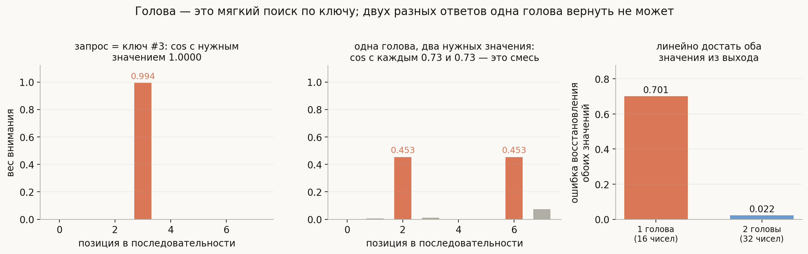
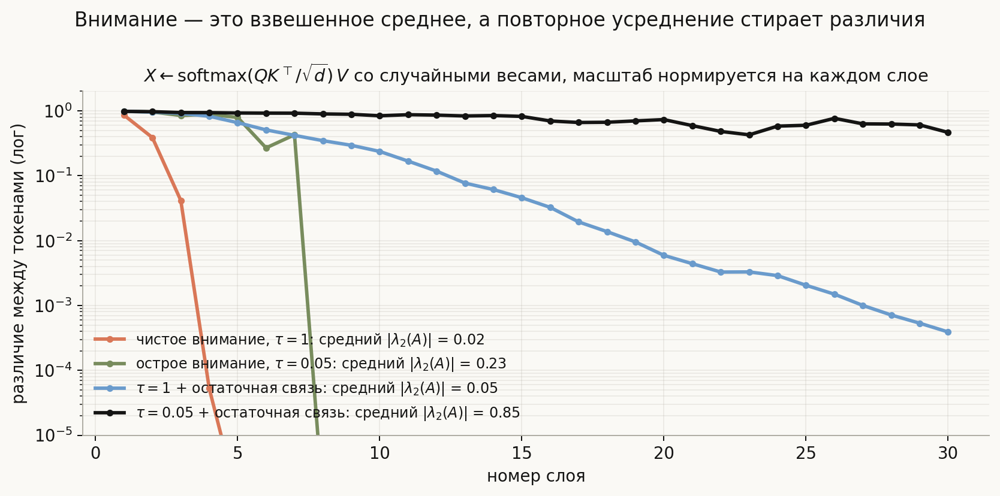
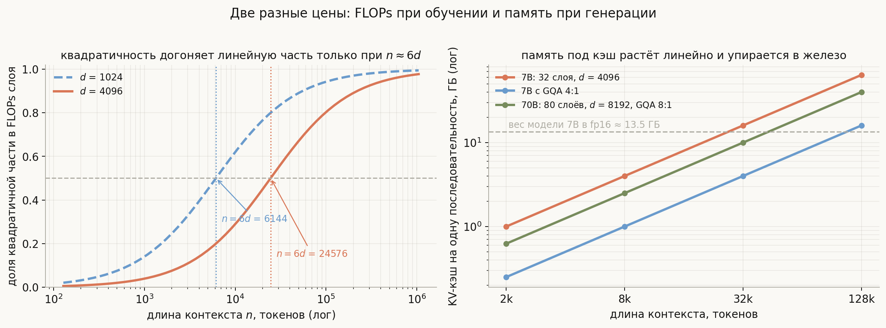

# Self-attention и трансформеры

**Вопросы (EN)**: What is the motivation for self-attention? Why choose it over RNNs and CNNs? Why multi-headed attention? How does the number of heads affect performance?

Внимание проще, чем кажется по формуле. Это **взвешенное среднее**: выход в каждой позиции — выпуклая комбинация векторов-значений всех позиций. Необычно в нём ровно одно: веса не фиксированы и не выучены заранее, а вычисляются на лету из самого содержимого — насколько запрос одной позиции похож на ключ другой.

Отсюда удобная рамка для всей темы. Всё, что делает внимание сильным, — следствие того, что веса **содержательные и глобальные**: любая позиция достаёт нужную ей информацию из любой другой за один шаг. А всё остальное в блоке трансформера существует, чтобы починить то, чего взвешенное усреднение **не может само**:

- оно не различает порядок → позиционное кодирование;
- оно линейно по значениям → полносвязный слой;
- одного канала не хватает, когда нужно достать сразу несколько вещей → несколько голов;
- глубокая стопка таких слоёв не обучается → residual и нормализация.

Если держать этот список в голове, архитектура перестаёт быть набором деталей и становится списком заплат к одной операции. Ниже каждый пункт проверен прогоном, а не заявлен.

## План

1. Чем плохи RNN и CNN
2. Внимание как обучаемый поиск
3. Зачем делить на корень из размерности
4. Что внимание умеет само
5. Оно не знает о порядке
6. Оно линейно по значениям
7. Multi-head: зачем и сколько голов
8. Остальной блок: residual и нормализация
9. Маскирование и три вида внимания
10. Цена: FLOPs, память и KV-кэш
11. Что спрашивают на собеседовании
12. Типичные ошибки
13. Итог

---

## 1. Чем плохи RNN и CNN

Задача, ради которой всё затевалось, — уловить зависимость между далеко стоящими словами. Мерой трудности здесь служит **длина пути**: сколько последовательных операций разделяет две позиции. Чем путь длиннее, тем сильнее размывается градиент по дороге.

**RNN** обрабатывает последовательность по одному шагу: между первым и последним словом $n$ операций, и все они строго последовательны. Отсюда две беды сразу — затухающий градиент и невозможность параллелить обучение по длине.

**CNN** с дилатацией даёт логарифмический путь, что уже неплохо, и полностью параллелится. Но окно фиксировано: чтобы связать далёкие позиции, нужна глубина.

**Self-attention** даёт путь длины **1** между любыми двумя позициями и полный параллелизм: все веса считаются одной матричной операцией.

Правая панель показывает цену самой операции: $O(n^2 d)$ у внимания против $O(n d^2)$ у RNN. По этим главным членам перелом получается при $n$ порядка $d$. Полный блок трансформера содержит ещё проекции и FFN: их стоимость линейна по $n$, и сравнение с квадратичной частью даёт другой порог — $n = 6d$ в модели подсчёта из раздела 10. Поэтому цену операции внимания и цену всего блока нужно различать.

## 2. Внимание как обучаемый поиск

Каждая позиция порождает три вектора линейными проекциями входа: **запрос** $q$ («что мне нужно»), **ключ** $k$ («что я могу предложить») и **значение** $v$ («что я отдам, если меня выберут»).

$$\mathrm{Attention}(Q, K, V) = \mathrm{softmax}\!\left(\frac{QK^\top}{\sqrt{d_k}}\right) V$$

Читается это как поиск по ассоциативной памяти: $QK^\top$ даёт похожесть каждого запроса на каждый ключ, softmax превращает похожести в веса, сумма которых равна единице, и результат — взвешенное среднее значений.

Полезно проговорить, почему проекций именно три, а не одна. Роль «что я ищу» и роль «чем я полезен другим» — разные, и склеивать их в один вектор незачем: тогда позиция была бы вынуждена искать похожих на себя. Разделение $Q$ и $K$ позволяет искать по одному признаку, а отдавать по другому.

Есть и точный аргумент: если положить $K = Q$, матрица оценок $QQ^\top$ станет симметричной. Отдельные проекции задают форму $x_i^\top W_QW_K^\top x_j$, которая может быть несимметричной: отношение «кто на кого смотрит» не обязано работать в обе стороны. Отдельная проекция $V$ отделяет содержимое записи от признака, по которому её находят.

## 3. Зачем делить на корень из размерности

Деталь, которая выглядит технической, а на деле определяет, обучится ли модель вообще.

Если координаты $q$ и $k$ независимы со средним 0 и дисперсией 1, то $q \cdot k$ — сумма $d$ таких произведений, и её стандартное отклонение растёт как $\sqrt{d}$.

Левая панель: измеренное отклонение ложится на $\sqrt{d}$ точно — при $d = 512$ это 22.3 против теоретических 22.6.

Что это значит для softmax, показывает средняя панель. Логиты разлетаются на десятки, softmax насыщается и вырождается в жёсткий argmax: средний максимальный вес при $d = 512$ равен **0.956** без деления против **0.360** с делением.

Почему это плохо, показывает правая панель. Градиент softmax по логитам пропорционален $p(1-p)$, а у насыщенного распределения эта величина обращается в ноль: **0.064** против **0.769**, разница в 12 раз. Модель, у которой внимание с самого начала жёсткое, почти не получает сигнала для его перестройки — она застревает в случайном выборе, сделанном при инициализации.

Отсюда точная формулировка для ответа: делят не «чтобы числа были поменьше», а чтобы дисперсия логитов не зависела от размерности и softmax оставался в рабочем режиме, где у него есть градиент.

## 4. Что внимание умеет само

Проверим, что механизм действительно выучивает поиск, а не просто красиво описывается. В `generate_visuals.py` один слой внимания обучается градиентным спуском на задаче «найди по признаку»: даны четыре предмета, у каждого свой тип и своё значение, плюс запрос — тип; нужно назвать значение предмета этого типа.

Слой решает задачу с точностью **100%**, а карта внимания оказывается ровно такой, какой должна быть: строка запроса кладёт **0.92** веса на нужный предмет и по 0.02 на всех остальных. Никто не подсказывал модели, куда смотреть, — это выучено из одной лишь функции потерь.

Композиция слоёв позволяет строить более сложный поиск. В классическом механизме для задачи «значение стоит сразу после ключа» работают две головы в последовательных слоях: сначала одна копирует информацию о предыдущем токене, затем другая сопоставляет ключ и читает продолжение. Вторая называется **induction head**. Это пример полезности глубины, а не доказательство невозможности любого другого решения одним слоем.

## 5. Оно не знает о порядке

Взвешенное среднее не различает, в каком порядке стоят слагаемые. Формально: если переставить входные позиции, выход переставится точно так же — операция **перестановочно эквивариантна**.

Это не рассуждение, а тождество: на прогоне выход на переставленном входе совпадает с переставленным выходом с точностью **1.3 · 10⁻¹⁵**, то есть до машинного эпсилон. Для внимания «мама мыла раму» и «раму мыла мама» — один и тот же объект.

Лечится добавлением к входу **позиционного кодирования**. После него та же перестановка меняет результат уже на 3.66 — позиции перестали быть взаимозаменяемыми.

Синусоидальный вариант из исходной статьи задаёт каналы с разными частотами: быстрые различают соседние позиции, медленные — далёкие. Ключевое его свойство видно на правой панели: похожесть двух позиций зависит **только от расстояния между ними**, а не от абсолютных номеров. Профили вокруг разных опорных точек совпадают с точностью $2.2 \cdot 10^{-16}$.

Именно это свойство даёт надежду на обобщение на длины, не встречавшиеся при обучении, — надежду, надо сказать, частичную: на практике качество за пределами обученных длин всё равно падает, и современные схемы (RoPE, ALiBi) кодируют относительную позицию явно, а не через сложение с входом.

Уточнение: от сдвига зависит только член $PE(t)\cdot PE(t+k)$; после сложения кодировок с содержимым в $QK^\top$ появляются перекрёстные члены. Поэтому синусоидальные кодировки не делают всё внимание строго относительным. RoPE поворачивает $q$ и $k$ так, что позиционная часть их скалярного произведения зависит от разности позиций; ALiBi добавляет к оценкам штраф за расстояние.

Эквивариантность выше относится к вниманию **без позиционно зависимой маски**. Каузальная маска уже задаёт отношение «раньше — позже», поэтому утверждение о полной неразличимости порядка на неё не переносится.

## 6. Оно линейно по значениям

Пункт, который чаще всего пропускают, а он объясняет половину параметров модели.

Выход внимания — выпуклая комбинация векторов $v$: $\sum_i \alpha_i v_i$. Если зафиксировать $Q$ и $K$, веса $\alpha$ тоже фиксированы и отображение по $V$ **линейно**. При этом self-attention в целом нелинеен по $X$: от входа зависят и значения, и веса после softmax. Здесь важно различать линейность по значениям и линейность всего слоя.

FFN добавляет отдельное нелинейное преобразование содержимого каждой позиции, независимо от перемешивания между позициями. В стандартном блоке это **полносвязная сеть** с расширением размерности:

$$\mathrm{FFN}(x) = W_2\,\sigma(W_1 x + b_1) + b_2$$

Разделение труда получается чистым: **внимание перемешивает информацию между позициями, FFN обрабатывает её внутри позиции**. Внутренняя размерность FFN обычно вчетверо больше модельной ($d_{ff} = 4d$), из-за чего на FFN приходится примерно **две трети параметров блока** — при $d = 512$ это $8d^2$ против $4d^2$ у внимания. Отсюда и популярный вопрос «где в трансформере хранятся знания»: скорее в FFN, чем во внимании.

## 7. Multi-head: зачем и сколько голов

Одно взвешенное среднее выражает **одно** отношение: softmax по своей природе выделяет один-два источника, и одна голова вынуждена выбирать, какую именно связь отслеживать. Но в предложении одновременно важны и синтаксическая связь, и кореференция, и лексическая близость.

**Multi-head** решает это буквально: $h$ независимых механизмов внимания в подпространствах размерности $d_k = d/h$, результаты которых конкатенируются и смешиваются матрицей $W^O$.

Три факта, которые стоит знать точно:

**Число параметров от числа голов не зависит.** Проекции всех голов вместе — те же матрицы $d \times d$, просто нарезанные на $h$ блоков. Меняется не объём, а разбиение.

**Размерность каждой головы падает как $d/h$.** Отсюда компромисс: больше голов — больше разных отношений, но каждое выражается в более узком подпространстве. При $d = 512$ и $h = 8$ на голову приходится 64 измерения; при $h = 64$ осталось бы по 8, и голова почти ничего не смогла бы различить.

**Многие головы избыточны.** Это измеренный результат, а не догадка: в работе Michel и др. (2019) значительную долю голов обученного трансформера можно удалить после обучения почти без потери качества. При этом обучать сразу с малым числом голов хуже, чем обучить много и обрезать, — избыточность помогает оптимизации.

Насколько головы вообще решают исход, видно на прогоне из `notebook.ipynb`. Задача требует достать **два** элемента сразу: запрос называет два типа, ответ — класс $(v_1 + v_2) \bmod 5$. При сходимости одна голова упирается в **43.7%**, а две и четыре доходят до **100%** (случайная угадайка — 20%). Этот прогон сравнивает конкретные сети и их оптимизацию; сам по себе он не доказывает невозможность решения с одной головой при другой архитектуре.

А вот популярное объяснение «каждая голова смотрит на своё отношение» прогон **не подтверждает**. Все головы кладут примерно по 0.49 на оба нужных предмета — карты внимания у них почти одинаковые. Разделение труда происходит не там: у каждой головы своя матрица значений $W^V$, и каждая извлекает из одной и той же смеси свою линейную проекцию. В этом запуске двух проекций хватило для решения задачи, а одна до такого же качества не обучилась. Точная формулировка получается такая: **головы дают несколько независимых линейных каналов поверх общего механизма**, а не несколько разных взглядов на текст. Интерпретируемые головы в больших моделях действительно находят, но это следствие обучения на богатых данных, а не устройство механизма.

Практический ответ на «как число голов влияет на качество»: до некоторого порога рост помогает, дальше выходит на плато, а при слишком большом $h$ качество падает из-за узости голов. Типичный выбор 8–16 при $d = 512$–1024 — не теория, а эмпирика.

Дополнительный опыт отделяет обучение от конструкции головы: задаём ключи и запросы вручную и пытаемся восстановить **оба** выбранных значения, а не только их сумму.

На 400 случайных сценах одна голова с выходом из 16 чисел даёт относительную ошибку линейного восстановления пары 0.701, две головы с суммарным выходом из 32 чисел — 0.022. У двух голов здесь больше размерность выхода, поэтому это иллюстрация потери информации при смешивании, а не сравнение при равном бюджете. Отдельный опыт при фиксированном $d_{model}=512$ проверяет сужение голов: поиск среди 64 записей имеет точность 1.000 при $d_k \geq 32$, 0.967 при $d_k=16$ и 0.635 при $d_k=8$. Эти числа относятся к синтетической задаче с зашумлёнными ключами и не задают универсального правила выбора $h$.

## 8. Остальной блок: residual и нормализация

Полный блок — это внимание и FFN, каждый обёрнутый остаточной связью и нормализацией слоя.

**Residual** нужен не только градиенту. У него есть содержательная роль: позиция сохраняет собственное представление и **добавляет** к нему то, что вычитала из контекста. Без остаточной связи каждый слой перезаписывал бы содержимое усреднением, и глубокая стопка вырождалась бы — все позиции сходились бы к одному вектору.

**LayerNorm, а не BatchNorm.** Причина простая: нормировать по батчу для последовательностей неудобно, потому что длины разные, а статистики батча зависят от того, что попало в него рядом. LayerNorm нормирует по признакам внутри одного примера и от батча не зависит вовсе — важное свойство при генерации по одному токену.

**Pre-norm против post-norm.** В исходной статье нормализация стояла после остаточной связи (post-norm), и такую модель приходилось обучать с прогревом learning rate, иначе она расходилась. Сейчас почти везде используют **pre-norm** — нормализация перед подблоком, — потому что при нём остаточный путь от входа к выходу остаётся чистым и глубокие модели обучаются устойчиво без прогрева.

Повторное усреднение сближает представления разных токенов. Это видно в отдельном опыте со случайными весами.

Для 64 токенов размерности 32 различия падают ниже 0.001 к четвёртому слою чистого внимания. Остаточная связь сдвигает этот момент до 28-го слоя; более острое внимание вместе с остаточной связью сохраняет различия на всех 30 слоях опыта. Это демонстрация механизма усреднения, а не прогноз глубины, на которой должна схлопнуться обученная модель: обучаемые проекции и FFN меняют её поведение.

## 9. Маскирование и три вида внимания

Одна и та же операция обслуживает три разных режима, и путаница между ними — частая ошибка на собеседовании.

**Self-attention энкодера.** $Q$, $K$, $V$ берутся из одной последовательности, маски нет, каждая позиция видит все. Так работает BERT.

**Маскированное self-attention декодера.** То же самое, но позиции запрещено смотреть вперёд: в матрицу похожестей до softmax добавляется $-\infty$ выше диагонали. Это делает модель авторегрессионной и позволяет обучать её на всех позициях сразу, а не по одной. Так работает GPT.

**Cross-attention.** $Q$ из декодера, а $K$ и $V$ из энкодера: декодер спрашивает, энкодер отвечает. Именно этот механизм в задаче перевода связывает генерируемое слово с исходным предложением.

Отдельно стоит помнить про маску паддинга: в батче последовательности разной длины дополняются до общей, и внимание к паддингу нужно занулять, иначе модель усредняет мусор.

Каузальность можно проверить напрямую: меняем последний токен и сравниваем выходы ранних позиций. В дополнительном опыте без маски изменение достигает 20.7, с маской оно равно нулю. При обучении правильная последовательность уже известна: входы и цели сдвигают на один токен и считают все потери параллельно. При обычной авторегрессивной генерации следующего токена ещё нет, поэтому нужны последовательные проходы. Префилл обрабатывает известный промпт сразу, декодирование продолжает его по одному токену.

Если задача требует только выбора из переданных вариантов, можно обучить модель оценивать их за один проход вместо генерации текста. Это задача скоринга, с отдельными требованиями к голове и калибровке: см. [типизированные решающие модели](../typed-decision-models/lesson.md) и [калибровку вероятностей](../../../../ml/objectives-metrics-evaluation/calibration/lesson.md).

## 10. Цена: FLOPs, память и KV-кэш

Часто говорят «внимание квадратично, это его проблема». Посчитаем, когда это действительно проблема. На один слой (одна последовательность длины $n$, размерность $d$, FFN шириной $4d$):

$$\underbrace{8nd^2}_{\text{проекции }Q,K,V,O} + \underbrace{4n^2d}_{QK^{\top}\text{ и }AV} + \underbrace{16nd^2}_{\text{FFN}}.$$

Квадратичная часть догоняет линейную при $4n^2d = 24nd^2$, то есть при $n = 6d$.

Для $d = 1024$ это **6144** токена, для $d = 4096$ — **24576**. То есть на типичных для обучения длинах (2–8 тысяч токенов при $d$ порядка тысяч) больше половины вычислений уходит вовсе не на внимание, а на FFN и проекции. Квадратичность — реальная проблема длинного контекста, но не главная статья расходов на обычных длинах.

Правая панель — про вторую цену, которая на инференсе важнее. При генерации каждый новый токен должен свериться со всеми предыдущими ключами и значениями; чтобы не пересчитывать их заново, их держат в **KV-кэше**. Для обычного multi-head attention размер кэша: $2 \cdot n \cdot d \cdot L \cdot \text{(байт на число)}$.

| конфигурация | на токен | 8k контекста | 32k | 128k |
|---|---|---|---|---|
| 7B: 32 слоя, $d$ = 4096, fp16 | 0.50 МиБ | 4.0 ГиБ | 16.0 ГиБ | 64.0 ГиБ |
| то же с GQA 4:1 | 0.125 МиБ | 1.0 ГиБ | 4.0 ГиБ | 16.0 ГиБ |
| 70B: 80 слоёв, $d$ = 8192, GQA 8:1 | 0.31 МиБ | 2.5 ГиБ | 10.0 ГиБ | 40.0 ГиБ |

Для сравнения: сами веса модели 7B в fp16 занимают около 13–14 ГиБ. Уже на 32 тысячах токенов кэш **больше модели**, и это на одну последовательность — при батче из десяти запросов он умножается на десять. Отсюда всё, что делают на практике:

- **MQA / GQA** — несколько голов делят одни ключи и значения: кэш сокращается кратно (в таблице 4:1 и 8:1).
- **FlashAttention** — важная деталь, которую часто понимают неверно: он **не меняет асимптотику** и вычисляет **точное** внимание. Он переставляет вычисления блоками так, чтобы матрица $n \times n$ никогда не материализовалась в медленной памяти, и экономит обращения к ней. Выигрыш — по памяти и по времени, потому что внимание упирается в пропускную способность памяти, а не в арифметику.
- **Разреженное и линейное внимание, SSM** (Longformer, Performer, Mamba) — меняют саму операцию, чтобы получить субквадратичную сложность; ценой становится потеря части «каждый с каждым».
- **Квантование кэша, PagedAttention** — инженерия вокруг той же памяти.

Здесь $L$ — число слоёв; для GQA/MQA вместо $d$ в формуле кэша берут суммарную размерность голов ключей и значений. Подсчёт FLOPs относится к плотному блоку с FFN ширины $4d$; другие ширины, gated FFN и GQA меняют коэффициенты.

Среди методов изменения самого внимания полезно различать **ограничение связей** (локальные окна и глобальные позиции в Longformer/BigBird) и **приближение операции** (низкоранговые или ядровые методы, например Linformer/Performer). FlashAttention к этим приближениям не относится.

## 11. Что спрашивают на собеседовании

**Почему self-attention лучше RNN?** Путь длины 1 между любыми позициями вместо $n$ и полный параллелизм по длине. Плата — $O(n^2)$ вместо $O(n)$.

**Всегда ли внимание дешевле?** Нет. Для главных членов самой операции сравниваются $O(n^2d)$ и $O(nd^2)$ у RNN: масштабы сравниваются при $n$ порядка $d$. В полном плотном блоке с FFN ширины $4d$ квадратичная часть FLOPs догоняет проекции и FFN при $n=6d$. Это разные сравнения.

**Зачем делить на $\sqrt{d_k}$?** Дисперсия скалярного произведения растёт как $d$, softmax насыщается и градиент исчезает: в прогоне $\sum p(1-p)$ падает с 0.77 до 0.06 при $d = 512$.

**Почему нужно позиционное кодирование?** Внимание перестановочно эквивариантно — проверено до $10^{-15}$. Без позиций «мама мыла раму» и «раму мыла мама» неразличимы.

**Зачем в блоке FFN?** При фиксированных $Q,K$ смешивание линейно по $V$, хотя весь self-attention нелинеен по входу. FFN отдельно нелинейно обрабатывает каждую позицию; при ширине $4d$ на него приходится около двух третей параметров блока.

**Зачем несколько голов и как их число влияет на качество?** Они дают несколько независимых линейных каналов поверх внимания: в прогоне на задаче с двумя обращениями одна голова упирается в 43.7%, две доходят до 100%. Число параметров от $h$ не зависит, но размерность головы падает как $d/h$; типичный оптимум 8–16, а многие головы после обучения можно удалить почти без потерь.

**Чем маскированное внимание отличается от обычного?** Запретом смотреть вперёд через $-\infty$ до softmax; это делает модель авторегрессионной.

**Почему LayerNorm, а не BatchNorm?** Не зависит от батча и от длины последовательности, что критично при генерации по одному токену.

## 12. Типичные ошибки

- **Говорить, что внимание «выбирает» одну позицию.** Это взвешенное среднее по всем; жёсткий выбор — вырожденный случай, и обычно нежелательный.
- **Считать деление на $\sqrt{d_k}$ косметикой.** Без него softmax насыщается уже при инициализации и модель не обучается.
- **Путать линейность по $V$ и по входу.** При фиксированных $Q,K$ внимание линейно по значениям; self-attention по $X$ нелинеен. FFN даёт отдельное поточечное преобразование.
- **Думать, что больше голов всегда лучше.** При фиксированном $d$ голова сужается как $d/h$; после порога качество падает.
- **Верить, что каждая голова отвечает за своё отношение.** В прогоне карты внимания у всех голов почти одинаковы; различаются проекции значений, а не то, куда головы смотрят.
- **Считать, что число голов меняет число параметров.** Не меняет — меняется только разбиение тех же матриц.
- **Путать позиционную маску и маску паддинга.** Первая делает модель авторегрессионной, вторая исключает служебные токены; нужны обе и по разным причинам.
- **Считать, что немаскированное внимание само «понимает порядок».** Без позиций оно эквивариантно перестановкам; каузальная маска тоже вносит информацию о порядке и требует отдельной оговорки.
- **Называть FlashAttention приближением.** Он считает то же самое, просто не материализуя матрицу; приближения — это Linformer и Performer.

## 13. Итог

Self-attention вычисляет взвешенное среднее значений, сравнивая запрос каждой позиции с ключами остальных. Содержательный глобальный поиск даёт путь длины 1 между позициями и параллельное обучение, а деление на $\sqrt{d_k}$ удерживает масштаб логитов и градиент softmax. Позиционные кодировки и маски задают порядок, FFN нелинейно преобразует каждую позицию, несколько голов дают независимые каналы, а residual и LayerNorm помогают сохранить сигнал по глубине. Обучаемые и сконструированные вручную примеры показывают, как голова находит запись и как смешивание может терять информацию; их результаты относятся к конкретным задачам и не задают универсальных пределов одной головы. Цена полного блока складывается из квадратичного внимания и линейных по длине проекций и FFN; при обычной авторегрессивной генерации существенную роль играет память KV-кэша. Поэтому FlashAttention, GQA и приближённое внимание решают разные инженерные задачи.

---

## Что рядом

- [`notebook.ipynb`](notebook.ipynb) — обе серии опытов на numpy: обучаемый поиск, маскирование и multi-head; затем ручная конструкция головы, сужение голов, коллапс токенов, FLOPs и KV-кэш
- [`generate_visuals.py`](generate_visuals.py) — генерирует оба набора диаграмм; дополнительные опыты вынесены в [`generate_extended_visuals.py`](generate_extended_visuals.py)
- [RNN and LSTM](../RNN%20and%20LSTM.md) — что было до и почему длина пути важна
- [Векторные представления слов](../../nlp/word-embeddings/lesson.md) — контекстные представления как логическое завершение дистрибутивной гипотезы
- [Архитектуры детекции объектов](../../computer-vision/object-detection-architectures/lesson.md) — DETR и предсказание множества
- [Архитектуры сегментации](../../computer-vision/segmentation-architectures/lesson.md) — Mask2Former и глобальный контекст с первого слоя

- [OCR: детекция и распознавание текста](../../computer-vision/ocr/lesson.md) — CTC и attention-декодер
- [Типизированные решающие модели](../typed-decision-models/lesson.md) — оценивание вариантов за один проход
- [Bagging и Boosting](../../../classical-ml/bagging-vs-boosting/lesson.md) — ансамбли в глубоком обучении

---
*Источник: [MLIB](https://huyenchip.com/ml-interviews-book/)*
