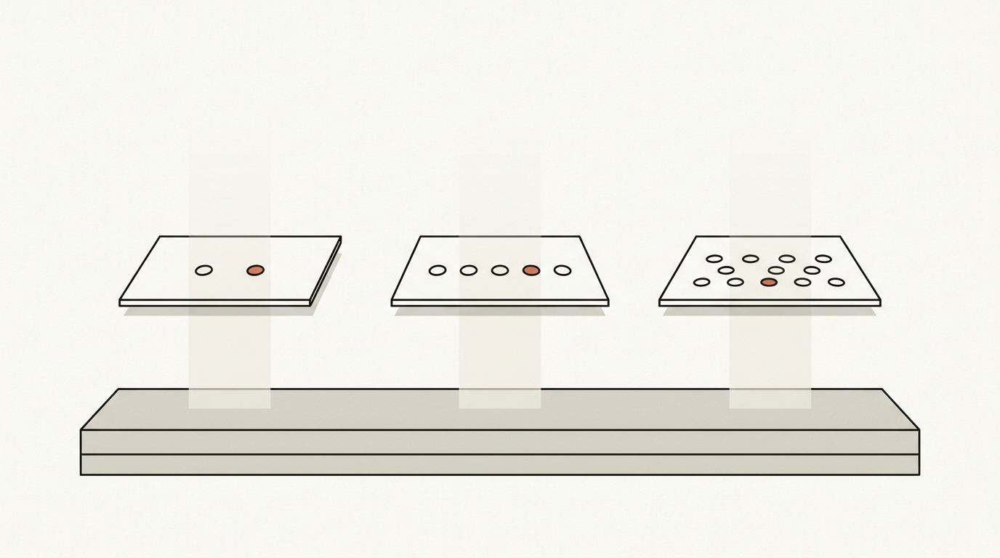
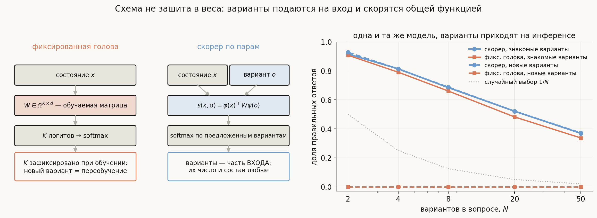
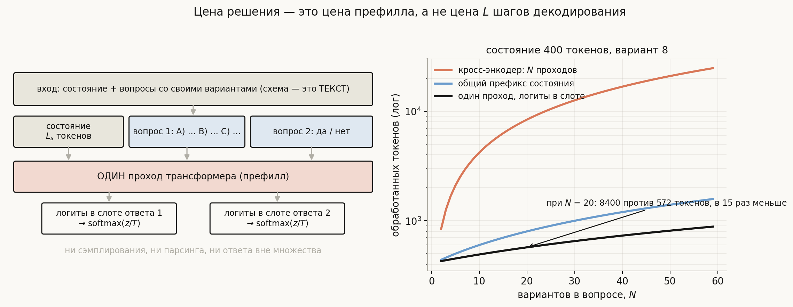
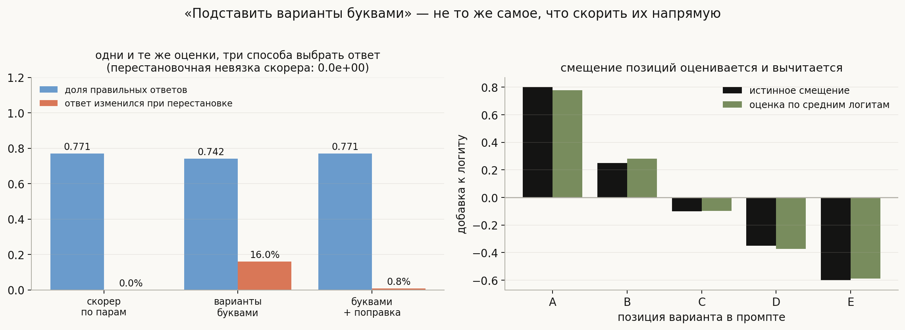
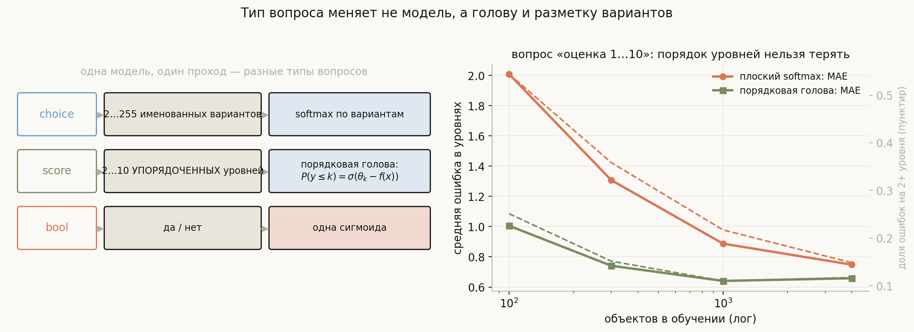
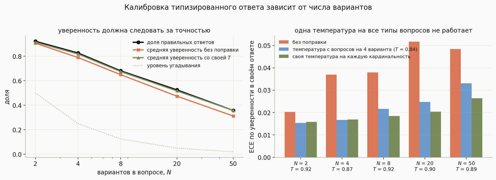

# Типизированные решающие модели: как из произвольной схемы получается калиброванный ответ за один проход

**Вопрос**: BERT для классификации и NER понятен — голова на $K$ классов или на каждый токен. Но как модель отвечает по **произвольной** схеме, которую видит впервые, да ещё за один проход и с осмысленной вероятностью?

Привычная картинка выглядит так: берём энкодер, приделываем к нему линейный слой $W \in \mathbb{R}^{K \times d}$, обучаем — и получаем $K$ логитов. Всё понятно, и всё разваливается от одного вопроса: а если множество ответов приходит **на инференсе**? Сегодня «выбери из трёх статусов», завтра «из двадцати трёх кодов ошибки», послезавтра «оцени от 1 до 7». Голова с фиксированным $K$ тут бесполезна: её выходной слой физически не имеет строки под вариант, которого не было при обучении.

Решающие модели вроде Jev устроены иначе, и весь фокус — в одной замене:

> **Варианты ответа — это не параметры модели, а часть её входа.** Голова считает не $K$ логитов, а функцию от **пары** «состояние, вариант»: $s(x, o)$. Softmax берётся по тем вариантам, которые вам прислали.

Отсюда следует всё остальное: почему схема может быть любой, почему хватает одного прохода, почему ответ не может оказаться вне множества, почему порядок вариантов либо не важен, либо важен катастрофически, и откуда берутся честные вероятности. Эту механику вы уже знаете — в `transformers` она называется `BertForMultipleChoice`; дальше разберём, что из неё вырастает.

Все числа ниже посчитаны прогоном на игрушечной модели «пространства смысла» (код — в [`generate_visuals.py`](generate_visuals.py) и [`notebook.ipynb`](notebook.ipynb)): настоящий энкодер заменён случайной проекцией, потому что проверяется **механизм**, а не качество конкретной сети.

## План

1. Почему фиксированная голова не справляется
2. Голова как функция от пары
3. Три способа посчитать $s(x, o)$
4. Один проход на всю схему
5. Порядок вариантов: инвариантность против позиционного смещения
6. Типы вопросов: choice, score, bool
7. Откуда берутся калиброванные числа
8. Что здесь нового, а что известно двадцать лет
9. Что спрашивают на собеседовании
10. Типичные ошибки
11. Итог

---

## 1. Почему фиксированная голова не справляется

Классическая голова классификации — это матрица $W \in \mathbb{R}^{K \times d}$: по строке на класс. Логит класса $k$ равен $w_k^{\top}\varphi(x)$, где $\varphi(x)$ — вектор состояния из энкодера. Строка $w_k$ — **выученное представление класса**, живущее в весах.

У такой конструкции три жёстких ограничения:

- **$K$ фиксировано.** Новый вариант ответа означает новую строку, то есть дообучение.
- **Варианты безымянны.** Модель знает про класс только то, что выучила из примеров; сам текст «статус: возвращён» ей недоступен.
- **Softmax берётся по всем $K$**, даже если в конкретном вопросе предложено три варианта из тысячи.

Проверим это измерением. Игрушечный мир: 200 «понятий», у каждого свой вектор смысла; состояние — зашумлённая проекция нужного понятия. Модель учится на 120 понятиях, а спрашивают её и про них, и про 80 понятий, **которых она не видела ни разу**.

| вариантов в вопросе | скорер, знакомые | скорер, **новые** | фикс. голова, знакомые | фикс. голова, **новые** | угадывание |
|---|---|---|---|---|---|
| 2 | 0.916 | **0.928** | 0.907 | **0.000** | 0.500 |
| 4 | 0.814 | **0.812** | 0.791 | **0.000** | 0.250 |
| 8 | 0.684 | **0.687** | 0.661 | **0.000** | 0.125 |
| 20 | 0.521 | **0.521** | 0.482 | **0.000** | 0.050 |
| 50 | 0.369 | **0.371** | 0.337 | **0.000** | 0.020 |

Два наблюдения. На знакомых вариантах обе архитектуры примерно равны — скорер ничего не теряет. А на новых вариантах фиксированная голова даёт **ровно ноль**: не «плохо угадывает», а не может выразить ответ в принципе, потому что у неё нет соответствующей строки. Скорер при этом работает так же, как на знакомых.

## 2. Голова как функция от пары

Замена выглядит так. Вместо «логит класса $k$ = $w_k^{\top}\varphi(x)$» пишем

$$s(x, o) = \varphi(x)^{\top} W \psi(o),$$

где $\psi(o)$ — представление **самого варианта** (его текста, а не его номера), а $W$ — общая для всех вариантов обучаемая матрица. Вероятности получаются softmax по предложенному множеству:

$$p(o_j \mid x, \{o_1, \dots, o_N\}) = \frac{\exp\big(s(x, o_j)/T\big)}{\sum_{i=1}^{N}\exp\big(s(x, o_i)/T\big)}.$$

Три следствия, которые стоит проговорить отдельно.

**Число вариантов нигде не зашито.** Ни в размерности весов, ни в архитектуре: $N$ входит только как длина суммы в знаменателе. Отсюда «от 2 до 255 вариантов» в описаниях таких моделей — это ограничение рендеринга и внимания, а не головы.

**Ответ не может оказаться вне множества.** Распределение определено ровно на присланных вариантах. Это и есть то, что в маркетинге называют «ноль галлюцинаций»: гарантия схемы, а не эмпирическое наблюдение.

**Обучение тоже идёт по парам.** На каждом шаге модели показывают состояние, верный вариант и несколько отвлекающих, и учат кросс-энтропией по этому маленькому множеству. Именно так натренирован скорер из прогона выше: он ни разу не видел ни одного из 80 тестовых понятий, но выучил **общее правило сопоставления**, а не список классов.

## 3. Три способа посчитать $s(x, o)$

Одну и ту же идею реализуют тремя способами, и у каждого своя цена.

**Bi-encoder (два башни).** Состояние и вариант кодируются **раздельно**, скор — скалярное произведение: $s = \varphi(x)^{\top}\psi(o)$. Представления вариантов считаются заранее и кешируются, поэтому вопрос с тысячей вариантов стоит почти столько же, сколько с двумя. Плата — вариант не «видит» состояние: взаимодействие только через скалярное произведение. Это архитектура плотного поиска (DPR и родня).

**Cross-encoder.** Состояние и вариант склеиваются в одну последовательность и проходят через энкодер **вместе**, скор снимается с головы поверх пулинга. Каждый токен варианта видит каждый токен состояния, поэтому качество выше — но и проходов нужно $N$, по одному на вариант. Так устроены реранкеры и открытое воспроизведение `open-jev-deberta-v3-large`: DeBERTa-v3-large плюс трёхслойная голова над средним токенов состояния, средним токенов варианта и их произведением. Это в точности `BertForMultipleChoice`, только голова чуть богаче.

**Чтение логитов в слоте ответа.** Варианты рендерятся прямо в промпт («A) … B) … C) …»), модель делает один проход, и в позиции ответа читаются логиты токенов-букв: $p = \mathrm{softmax}\big((z_{\text{A}}, z_{\text{B}}, \dots)/T\big)$. Температура применяется к логитам до softmax, чтобы сумма вероятностей оставалась равной единице. Декодирования нет вообще — берётся распределение следующего токена, суженное на буквы вариантов. Так работает `decider` (фултюны Qwen3.5) и вообще любой способ «спросить LLM выбором» без генерации.

| | взаимодействие состояния и варианта | проходов на вопрос | кеш вариантов | где встречается |
|---|---|---|---|---|
| bi-encoder | только скалярное произведение | 1 | да | поиск, рекомендации |
| cross-encoder | полное | $N$ | нет | реранкеры, `open-jev-deberta` |
| логиты в слоте | полное | **1** | не нужен | `decider`, «спросить LLM буквами» |

## 4. Один проход на всю схему

Теперь про «за один проход». Ключ в том, что схема — это **текст на входе**, а ответ — это **позиция в последовательности**.

Состояние и все вопросы со своими вариантами склеиваются в одну последовательность. Один префилл — и в позициях ответов уже лежат логиты, из которых softmax даёт распределения: по одному на вопрос, все за тот же проход. Несколько вопросов не мешают друг другу, если маской запретить им смотреть друг на друга — тот же приём, что каузальная маска в языковой модели, только блочный (механика масок разобрана в теме [self-attention и трансформеры](../self-attention-and-transformers/lesson.md)).

Цена при состоянии в 400 токенов и варианте в 8 токенов, вопрос с 20 вариантами:

| способ | обработано токенов |
|---|---|
| кросс-энкодер, $N$ отдельных проходов | 8400 |
| общий префикс состояния в кеше | 800 |
| один проход, логиты в слоте | **572** |

В пятнадцать раз меньше — и это только по токенам; к этому добавляется то, что **декодирования нет вовсе**. Отсюда и заявляемые десятки миллисекунд на решение: цена решения равна цене префилла, а не цене $L$ шагов генерации.

Ограничение тоже понятно из картинки: всё, что модель «думает», должно поместиться в один проход. Многошаговая арифметика или рассуждение в несколько ходов так не делаются — это прямо записано в ограничениях открытых воспроизведений.

## 5. Порядок вариантов: инвариантность против позиционного смещения

Вот место, где два способа из раздела 3 расходятся радикально.

**Скорер по парам перестановочно эквивариантен по построению.** Функция $s(x, o_j)$ считается для каждого варианта независимо; переставьте варианты — переставятся и скоры, и ничего больше. Это ровно то же свойство, что у внимания в теме про трансформеры, и проверяется оно так же численно.

**Рендеринг буквами — нет.** Логит буквы «A» в позиции ответа зависит не только от варианта, но и от самой буквы: у языковой модели есть априорное предпочтение первых позиций. Значит, ответ начинает зависеть от того, в каком порядке вы перечислили варианты.

Прогон на 9600 вопросах, **одни и те же оценки вариантов**, три способа выбрать из них ответ (позиционное смещение здесь задано явно — это модель известного эффекта, а не измерение конкретной LLM):

| способ | точность | ответ изменился при перестановке |
|---|---|---|
| скорер по парам | **0.771** | **0.0%** |
| варианты буквами | 0.742 | **16.0%** |
| буквами + поправка на позиции | 0.771 | 0.8% |

Шестнадцать процентов вопросов получают другой ответ просто от перестановки вариантов местами. Лечится это оценкой смещения и его вычитанием (правая панель: оценка по средним логитам воспроизводит истинное смещение с точностью до второго знака) — приём известен как contextual calibration. После поправки точность возвращается к уровню чистого скорера.

Практический вывод: если вы «спрашиваете LLM выбором», **обязательно** проверяйте устойчивость к перестановке вариантов. Если разброс большой — либо усредняйте по перестановкам, либо вычитайте позиционное смещение, либо берите архитектуру, где инвариантность встроена.

## 6. Типы вопросов: choice, score, bool

«Типизированность» означает, что вопрос приходит с объявленным типом, и тип меняет не модель, а **голову и рендеринг вариантов**.

- **choice** — неупорядоченные именованные варианты, softmax по ним. Всё как выше.
- **bool** — частный случай на два варианта; одной сигмоиды достаточно.
- **score** — упорядоченные уровни (оценка 1…5, «низкий/средний/высокий»), и вот здесь плоский softmax **теряет информацию**: для него уровни 1 и 5 так же различны, как 1 и 2. Правильная голова — порядковая, с общим скором $f(x)$ и порогами: $P(y \le k) = \sigma(\theta_k - f(x))$.

Разница измерима. Вопрос «оценка 1…10», одни и те же данные:

| объектов в обучении | плоский softmax: MAE | ошибок на 2+ уровня | порядковая голова: MAE | ошибок на 2+ уровня |
|---|---|---|---|---|
| 100 | 2.009 | 54.4% | **1.006** | **25.1%** |
| 300 | 1.308 | 35.9% | **0.741** | **15.2%** |
| 1000 | 0.887 | 21.7% | **0.641** | **11.0%** |
| 4000 | 0.748 | 14.8% | **0.658** | **11.8%** |

При 100 примерах плоская голова ошибается в среднем на два уровня и в 54% случаев промахивается на два и больше; порядковая — вдвое точнее. С ростом данных разрыв сокращается (плоская голова выучивает порядок из примеров), но не исчезает. Причина проста: порядковая голова имеет $d + K - 1$ параметров вместо $K \cdot d$ и **не может** выдать ответ, нарушающий порядок.

## 7. Откуда берутся калиброванные числа

Softmax по вариантам — ещё не вероятность. Честность чисел здесь получается из трёх вещей.

**Первое — температура.** Ровно та же, что в [теме про калибровку](../../../../ml/objectives-metrics-evaluation/calibration/lesson.md): один параметр, подобранный на отложенной выборке, делится на логиты перед softmax. В открытых воспроизведениях она прямо лежит в конфиге модели рядом с режимом пулинга.

**Второе — своя температура на каждый тип вопроса.** Это неочевидно и это меряется:

| вариантов $N$ | точность | уверенность без поправки | ECE без поправки | своя $T$ | ECE со своей $T$ |
|---|---|---|---|---|---|
| 2 | 0.922 | 0.906 | 0.020 | 0.92 | 0.016 |
| 4 | 0.827 | 0.789 | 0.037 | 0.87 | 0.017 |
| 8 | 0.681 | 0.650 | 0.038 | 0.92 | 0.019 |
| 20 | 0.525 | 0.474 | 0.052 | 0.90 | 0.020 |
| 50 | 0.357 | 0.312 | 0.049 | 0.89 | 0.026 |

Два вывода. Во-первых, **уверенность обязана следовать за точностью**: при 50 вариантах правильный ответ — это 0.36, а не 0.9, и модель, которая всегда «уверена на 95%», просто сломана. Во-вторых, температура, подобранная на вопросах с четырьмя вариантами, тем хуже собственной, чем дальше кардинальность от четырёх: при $N = 8$ ECE 0.022 против 0.019, при $N = 20$ — 0.025 против 0.020, при $N = 50$ — 0.033 против 0.026 (на $N = 2$ разницы нет). Поэтому калибруют **по типам вопросов**, а не одним числом на всю модель.

**Третье — обучение, которое вознаграждает честность.** Обычная кросс-энтропия уже является строго правильной функцией потерь, поэтому даёт какую-то калибровку «бесплатно»; воспроизведение `open-jev-deberta` добавляет к ней слагаемое Брайера. Дальше идёт **RLCD** (Reinforcement Learning for Calibrated Decisions) у самого Jev: награда за то, что заявленная вероятность соответствует наблюдаемой частоте правильных ответов, а не за понравившийся человеку ответ. Проверяемый результат этой линии — лучший ECE 3.1 при средней уверенности 0.673 и точности 0.675 в независимом [Decision Index](https://huggingface.co/spaces/multimodalart/jev-decision-index).

И ещё одна деталь оттуда же, которая многое говорит о жанре: в этом лидерборде **неподдержанные, ошибочные и «воздержавшиеся» запросы получают ноль** до нормализации на угадывание. Модель, которая не смогла ответить по схеме, считается ответившей неправильно — потому что в программе, которая ждёт типизированное значение, разницы нет.

## 8. Что здесь нового, а что известно двадцать лет

Честный разбор требует сказать: **почти каждый кирпич этой архитектуры старый**.

- Скоринг пар «вопрос — вариант» общей функцией — это `BertForMultipleChoice` (2018) и вся линия реранкеров.
- Ответ по варианту, которого не было в обучении, — zero-shot классификация через NLI (Yin et al., 2019): гипотеза «этот текст про {метку}» проверяется на следование. Открытое воспроизведение `openjev` буквально это и делает: Qwen3.5 как cross-encoder с тремя классами NLI.
- Ограничение выхода заданным множеством — constrained decoding и маскирование логитов, известные давно.
- Температурная шкала — 2017 год.

Новое — в **сборке и в целевой функции**: типизированная схема как первоклассный интерфейс (не «распарсь JSON из текста», а «вот типы, верни значение»), один проход на всю схему, и калибровка, переведённая из постобработки в цель обучения. Плюс инженерия: батчинг вопросов с блочными масками, кеш общего префикса состояния, замороженные эксперты у больших вариантов.

Это полезная оптика для собеседования: если вас спросят про такие модели, сильный ответ — не «это новая магия», а «это multiple-choice голова поверх сильного бэкбона, натянутая на схему, плюс калибровка как цель».

Оговорки, без которых пересказ нечестен: веса самого Jev закрыты, архитектура официально не опубликована, все архитектурные детали выше — из **открытых воспроизведений**, а заявления о скорости и «нуле галлюцинаций» принадлежат вендору (второе — гарантия схемы, а не измеренная величина).

## 9. Что спрашивают на собеседовании

**Чем голова такой модели отличается от головы BERT-классификатора?** Классическая голова — матрица $K \times d$, по строке на класс: $K$ зашито в веса. Здесь голова считает скор пары $s(x, o)$, где вариант приходит на вход; softmax берётся по присланному множеству. В прогоне на невиданных вариантах фиксированная голова даёт 0.000, скорер — те же 0.9/0.8/0.5, что и на знакомых.

**Как получается ответ за один проход?** Схема рендерится в текст: состояние, вопрос, варианты. Один префилл, и в позиции ответа читаются логиты вариантов (или снимается скор с головы). Декодирования нет: стоимость решения равна стоимости префилла, 572 токена против 8400 у наивного кросс-энкодера при 20 вариантах.

**Почему ответ не может оказаться вне множества?** Потому что распределение определено ровно на присланных вариантах — это свойство конструкции, а не выученное поведение.

**Зависит ли ответ от порядка вариантов?** У скорера по парам — нет, строго: перестановка переставляет скоры и ничего больше (численно 0.0e+00). У рендеринга буквами — да: в прогоне 16% вопросов меняют ответ при перестановке из-за позиционного смещения. Чинится оценкой смещения по средним логитам и его вычитанием.

**Как отвечать на вопрос типа «оценка от 1 до 10»?** Порядковой головой с порогами $P(y \le k) = \sigma(\theta_k - f(x))$, а не плоским softmax: при 100 обучающих примерах MAE 1.01 против 2.01 и вдвое меньше грубых промахов.

**Откуда берётся калиброванная вероятность?** Из строго правильной функции потерь при обучении, температуры, подобранной на отложенной выборке, и — в новых моделях — из RL, где награда привязана к честности вероятности (RLCD). Важно: температуру подбирают отдельно по типам вопросов, потому что уверенность обязана падать с ростом числа вариантов.

**Что такая модель принципиально не умеет?** Генерировать текст, рассуждать в несколько шагов внутри одного прохода, отвечать вне заданного множества. Это не недостатки реализации, а прямые следствия конструкции.

**Когда это лучше, чем попросить LLM вернуть JSON?** Когда нужен гарантированно валидный типизированный ответ с вероятностью, а не текст, который потом парсится; когда важна задержка (один префилл против генерации); когда решение принимается автоматически по ожидаемой стоимости и потому требует честных чисел.

## 10. Типичные ошибки

- **Думать, что «произвольная схема» требует дообучения.** Схема — это вход. Дообучение нужно новому *домену*, а не новому списку вариантов.
- **Считать softmax по вариантам вероятностью без проверки.** Это нормированные скоры; вероятностью они становятся после калибровки, и калибровать надо по типам вопросов.
- **Игнорировать порядок вариантов при работе через промпт.** Шестнадцать процентов ответов переворачиваются от перестановки; без проверки на перестановку результатам верить нельзя.
- **Использовать плоский softmax для упорядоченных уровней.** Теряется порядок, растут грубые промахи; нужна порядковая голова.
- **Путать bi-encoder и cross-encoder.** Первый кеширует варианты и дёшев, второй точнее и стоит $N$ проходов; «один проход на всё» — это третья схема, с чтением логитов в слоте.
- **Считать «ноль галлюцинаций» измеренным свойством.** Это гарантия схемы: ответ вне множества невозможен. Ошибиться внутри множества модель по-прежнему может, и ECE как раз про это.
- **Ждать многошаговых рассуждений от одного прохода.** Их там нет по построению.
- **Сравнивать такие модели с LLM по одной accuracy.** В их жанре метрика первого класса — калибровка; лидерборды жанра считают невозможность ответить нулём.

## 11. Итог

Разрыв между «понятно, как работает BERT-классификатор» и «непонятно, как модель отвечает по произвольной схеме» закрывается одной заменой: голова считает не $K$ логитов, а скор пары «состояние — вариант», $s(x, o) = \varphi(x)^{\top} W \psi(o)$, а softmax берётся по присланному множеству. Варианты становятся частью входа, поэтому их число и состав произвольны, ответ вне множества невозможен по построению, а модель, обученная на одних вариантах, работает на невиданных так же (в прогоне 0.93/0.81/0.69/0.52/0.37 на новых понятиях против ровно 0.000 у фиксированной головы). Реализуют скорер тремя способами — bi-encoder с кешем вариантов, cross-encoder с $N$ проходами и чтение логитов в слоте ответа за один проход; последний и даёт «цену решения, равную цене префилла»: 572 токена против 8400 у наивного варианта при 20 вариантах. У скорера перестановка вариантов не меняет ничего (невязка 0.0e+00), а у рендеринга буквами меняет ответ у 16% вопросов — и лечится вычитанием оценённого позиционного смещения. Тип вопроса меняет голову, а не модель: для упорядоченных уровней нужна порядковая голова (MAE 1.01 против 2.01 на сотне примеров). Наконец, честные вероятности берутся из строго правильной потери, температуры, подобранной **отдельно по типам вопросов** (уверенность обязана падать с ростом числа вариантов: 0.92 при двух вариантах и 0.36 при пятидесяти), и — в новых моделях — из обучения, где награда привязана к калиброванности. Почти все кирпичи этой конструкции известны давно; новое — сборка, типизированный интерфейс и калибровка, переведённая в цель обучения.

## Что рядом

- [`notebook.ipynb`](notebook.ipynb) — скорер по парам с нуля: обучение градиентным спуском, ответы на невиданных вариантах, проверка перестановочной инвариантности, позиционное смещение и его вычитание, порядковая голова, температура по кардинальностям
- [`generate_visuals.py`](generate_visuals.py) — код всех диаграмм; энкодер заменён случайной проекцией намеренно: проверяется механика, а не качество сети
- [Self-attention и трансформеры](../self-attention-and-transformers/lesson.md) — маски, слоты, префилл и почему генерация дороже понимания
- [Калибровка вероятностей](../../../../ml/objectives-metrics-evaluation/calibration/lesson.md) — температура, ECE, надёжность чисел
- [OCR: детекция и распознавание](../../computer-vision/ocr/lesson.md) — соседний пример, где выбор между «генерировать» и «скорить фиксированное множество» решает архитектуру
- [Минимизация эмпирического риска](../../../../ml/basics/empirical-risk-minimization/lesson.md) — почему кросс-энтропия по вариантам вообще чему-то учит

---
*Тема вне списка вопросов книги: выросла из разбора архитектуры Jev и открытых воспроизведений (`open-jev-deberta-v3-large`, `openjev`, `decider`).*
