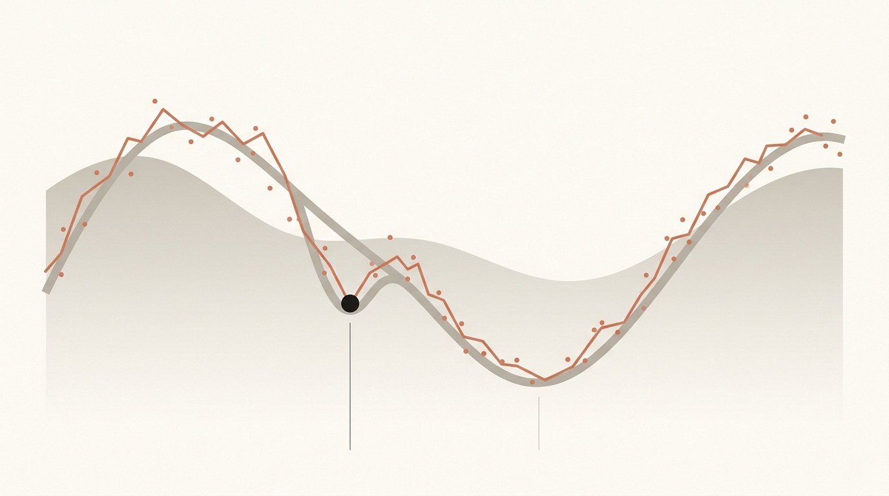
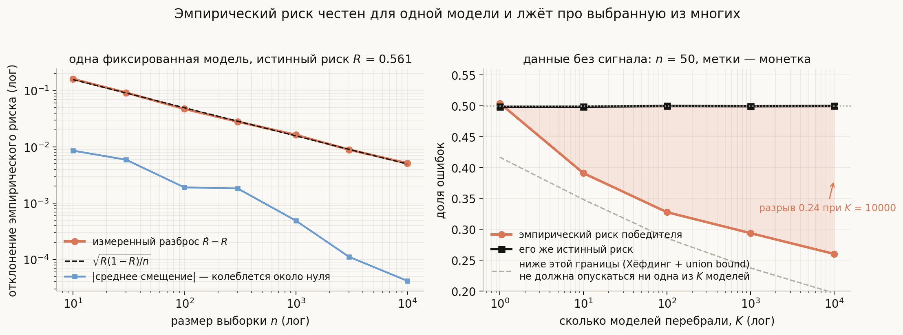
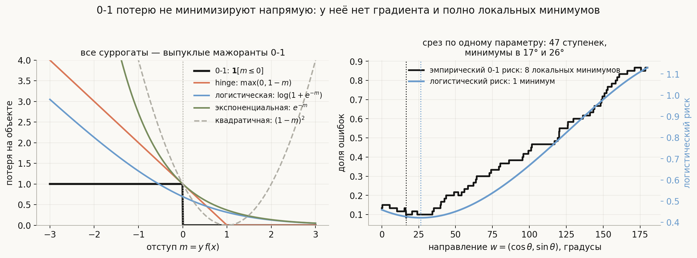
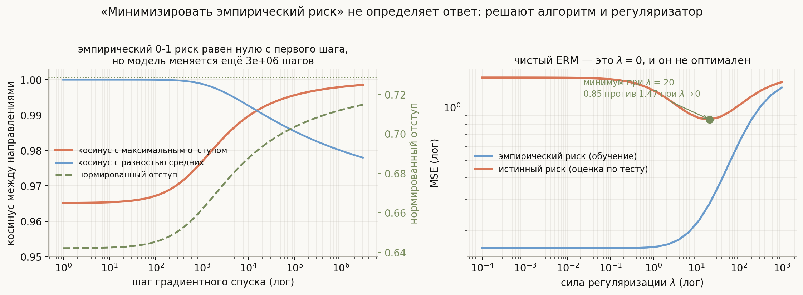
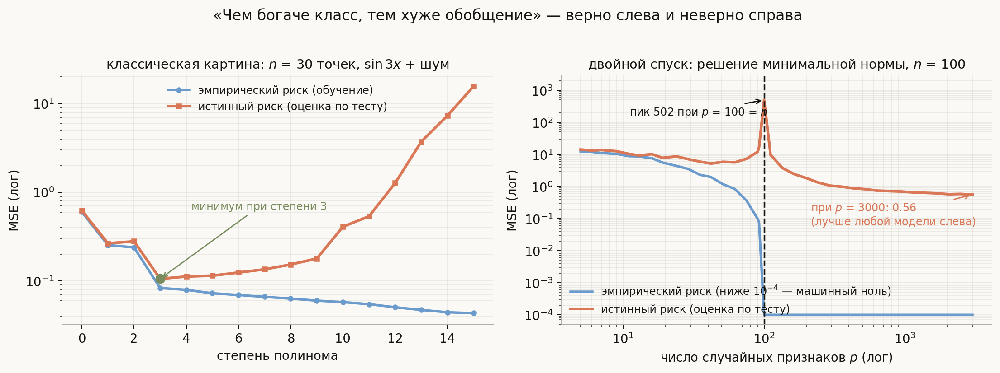

# Минимизация эмпирического риска

**Вопрос (EN)**: Empirical risk minimization — what's the risk? Why is it empirical? How do we minimize that risk?

На этот вопрос легко ответить формулами: риск — это математическое ожидание потерь, эмпирический он потому, что ожидание заменено средним по выборке, а минимизируют его градиентным спуском. Всё верно — и всё это помещается в три строки, после которых начинается настоящий разговор. Почему тогда модель с нулевой ошибкой на обучении бывает бесполезной? Если мы минимизируем именно то, что хотим, откуда берётся переобучение? Почему в классификации никто не минимизирует долю ошибок, хотя именно её и меряют? И почему две модели, обе достигшие нулевого эмпирического риска, ведут себя на новых данных совершенно по-разному?

Все ответы выводятся из одной мысли: **ERM — это цепочка подмен, и каждая из них где-нибудь да протекает.**

1. Вместо неизвестного распределения подставляется **выборка** — отсюда переобучение и оптимистичность любой оценки, по которой вы выбирали.
2. Вместо потери, которая вам нужна, подставляется та, которую можно **оптимизировать** — отсюда суррогаты, калибровка и «оптимизируем не то, что меряем».
3. Вместо минимума подставляется **то, куда пришёл алгоритм** — и в современных переопределённых моделях именно это, а не постановка задачи, определяет ответ.

Дальше — по одной подмене на раздел, и каждая проверена прогоном: код в [`generate_visuals.py`](generate_visuals.py) и [`notebook.ipynb`](notebook.ipynb).

## План

1. Риск: что именно мы хотели бы минимизировать
2. Первая подмена: выборка вместо распределения
3. Почему минимум эмпирического риска смещён
4. Две части ошибки: аппроксимация и оценивание
5. Вторая подмена: суррогатные потери
6. Регуляризованный ERM: почему $\lambda = 0$ не оптимален
7. Классическая картина сложности — и двойной спуск
8. Третья подмена: «минимизировать» ≠ «получить минимум»
9. Что из этого следует на практике
10. Что спрашивают на собеседовании
11. Типичные ошибки
12. Итог

---

## 1. Риск: что именно мы хотели бы минимизировать

Есть неизвестное распределение $P$ на парах $(x, y)$, из которого приходят и обучающие данные, и будущие запросы. Есть функция потерь $L(\hat y, y)$ — цена одной ошибки. **Риск** модели $f$ — это средняя цена ошибки на всём распределении:

$$R(f) = \mathbb{E}_{(x, y) \sim P}\big[L(f(x),\, y)\big].$$

Это единственная величина, которая нас интересует по-настоящему: качество модели на данных, которых она не видела. Минимум риска по **всем** мыслимым функциям называется **байесовским риском**:

$$R^{*} = \inf_{f}\, R(f).$$

Он почти никогда не равен нулю: если при одном и том же $x$ встречаются разные $y$, никакая функция от $x$ не угадает их все. Это неустранимая часть ошибки, и бороться с ней можно только новыми признаками, а не моделями.

Два важных уточнения к определению.

**Риск определён относительно $P$** — конкретного распределения. Модель с отличным риском на распределении «транзакции за прошлый год» может иметь ужасный риск на распределении «транзакции за этот год». Формально сдвиг распределения — это смена $P$, а значит, смена самой задачи; отсюда и деградация моделей в проде.

**Риск определён относительно $L$.** Пара «пространство ответов и функция потерь» — это и есть постановка задачи (подробно — в [Классификация и регрессия](../classification-vs-regression/lesson.md)). Поменяли цену ошибки — поменяли оптимальную модель, не тронув данные. В [детекции мошенничества](../../../ml-algorithms/classical-ml/fraud-detection/lesson.md) это видно буквально: с ценой ложной тревоги 4 у. е. оптимальный порог оказывается 0.025, а не 0.5.

## 2. Первая подмена: выборка вместо распределения

Считать $R(f)$ мы не умеем — $P$ неизвестно. Зато у нас есть $n$ независимых наблюдений из этого же $P$, и математическое ожидание заменяется средним:

$$\hat R_n(f) = \frac{1}{n}\sum_{i=1}^{n} L(f(x_i),\, y_i).$$

Вот это и есть **эмпирический** риск: «по наблюдениям», а не «по распределению». Дальше **ERM** — выбрать из класса моделей $\mathcal{F}$ ту, у которой он минимален: $\hat f = \arg\min_{f \in \mathcal{F}} \hat R_n(f)$.

Для **одной заранее зафиксированной** модели эта замена безупречна. Слагаемые независимы и одинаково распределены, поэтому

$$\mathbb{E}\,\hat R_n(f) = R(f), \qquad \operatorname{Var} \hat R_n(f) = \frac{\operatorname{Var} L}{n},$$

то есть оценка несмещена, а её разброс падает как $1/\sqrt{n}$. Для ограниченной потери работает и неравенство Хёфдинга: $\Pr\big(|\hat R_n - R| \ge t\big) \le 2e^{-2nt^2}$.

Левая панель — проверка. Фиксированная модель с истинным риском $R = 0.561$; для каждого $n$ измерен разброс $\hat R_n - R$ по 400 подвыборкам. Измеренный разброс ложится **точно** на теоретический $\sqrt{R(1-R)/n}$: 0.161 против 0.157 при $n = 10$, 0.047 против 0.050 при $n = 100$, 0.0051 против 0.0050 при $n = 10\,000$. Смещение при этом болтается около нуля (синяя линия внизу) — никакого систематического сдвига.

Казалось бы, вопрос закрыт: берём побольше данных, и эмпирический риск сколь угодно близок к истинному. Но в этом рассуждении спрятана оговорка «для **одной заранее зафиксированной** модели». А ERM выбирает модель **по тем же самым данным**.

## 3. Почему минимум эмпирического риска смещён

Правая панель той же картинки — самый полезный эксперимент темы. Данные, в которых **нет никакого сигнала**: 50 объектов, 10 случайных признаков, метки — честная монетка. Истинный риск любой модели здесь ровно 0.5. Берём $K$ случайных линейных классификаторов, выбираем лучший по эмпирическому риску и смотрим на оба его риска:

| $K$ | эмпирический риск победителя | его истинный риск |
|---|---|---|
| 1 | 0.504 | 0.499 |
| 10 | 0.391 | 0.499 |
| 100 | 0.328 | 0.500 |
| 1000 | 0.294 | 0.499 |
| 10 000 | **0.260** | **0.500** |

Ни одна модель ничему не училась. Но стоит перебрать десять тысяч случайных моделей и выбрать лучшую — и она показывает 26% ошибок там, где честные 50%. Разрыв 0.24 при границе Хёфдинга с поправкой на перебор $\sqrt{\ln K / 2n} = 0.30$.

Это и есть механизм переобучения в чистом виде, **без всякой оптимизации**: $\hat R_n(\hat f)$ смещён вниз, потому что $\hat f$ выбран по тому же шуму, который он и подгоняет. Отсюда — привычная теоретическая конструкция: чтобы гарантировать качество, нужна равномерная по классу оценка

$$R(\hat f) - \inf_{f \in \mathcal{F}} R(f) \;\le\; 2\sup_{f \in \mathcal{F}} \big|\hat R_n(f) - R(f)\big|,$$

а правая часть уже зависит от **богатства класса**: для конечного класса она порядка $\sqrt{\ln K / n}$, для бесконечных классов вместо $\ln K$ встают VC-размерность или радемахеровская сложность, и скорость остаётся $\sqrt{\text{сложность} / n}$.

> Практический перевод: каждое решение, принятое **по данным**, — это ещё один перебранный вариант. Выбор архитектуры, порога, набора признаков, гиперпараметров — всё это расширяет эффективный класс $\mathcal{F}$ и делает итоговую метрику оптимистичной. Ровно по этой причине [отбор признаков до валидации](../../../ml-algorithms/classical-ml/feature-selection/lesson.md) даёт accuracy 0.90 на данных без сигнала, а честный протокол — 0.53.

## 4. Две части ошибки: аппроксимация и оценивание

Разницу между тем, что мы получили, и тем, что было бы идеально, принято раскладывать так:

$$\underbrace{R(\hat f) - R^{*}}_{\text{полный проигрыш}} = \underbrace{\Big(R(\hat f) - \inf_{f\in\mathcal{F}} R(f)\Big)}_{\text{ошибка оценивания}} + \underbrace{\Big(\inf_{f\in\mathcal{F}} R(f) - R^{*}\Big)}_{\text{ошибка аппроксимации}}.$$

**Ошибка аппроксимации** — насколько выбранный класс вообще способен приблизить правду; она падает с ростом класса. **Ошибка оценивания** — насколько мы промахнулись, выбирая по конечной выборке; она растёт с ростом класса. Это тот же компромисс, что bias–variance в [теме про ансамбли](../../../ml-algorithms/classical-ml/bagging-vs-boosting/lesson.md), только сформулированный не через модель, а через класс моделей.

Отсюда следует правило, которое звучит на собеседовании убедительнее любых формул: **ERM без ограничения на класс бессмыслен**. Возьмите $\mathcal{F}$ = все функции — и модель, запоминающая обучающую таблицу наизусть, даст $\hat R_n = 0$ при истинном риске на уровне случайного угадывания. Осмысленный ERM всегда идёт в комплекте с чем-то, что ограничивает класс: параметризацией, регуляризацией, ранней остановкой.

## 5. Вторая подмена: суррогатные потери

Теперь про «как минимизируем». В классификации нас интересует доля ошибок, то есть потеря $\mathbf{1}[\,y f(x) \le 0\,]$. Её **никто не минимизирует напрямую**, и на то есть причина.

Правая панель: берём 60 точек, фиксируем длину вектора весов и смотрим на эмпирический риск вдоль одного параметра — угла $\theta$. 0-1 риск оказывается **лестницей из 47 ступенек с 8 локальными минимумами**: он кусочно-постоянен, его градиент равен нулю всюду, где он определён, и любой градиентный метод стоит на месте. Логистический риск на тех же данных — гладкая выпуклая кривая с единственным минимумом. (Задача минимизации 0-1 потери для линейных классификаторов в общем случае NP-трудна — это не вычислительная лень, а теорема.)

Отсюда конструкция: минимизируем **выпуклую мажоранту** 0-1 потери как функцию отступа $m = y f(x)$ (левая панель):

| потеря | формула | кто использует | характер |
|---|---|---|---|
| hinge | $\max(0,\ 1 - m)$ | SVM | ноль за краем полосы, линейный рост |
| логистическая | $\log(1 + e^{-m})$ | логрегрессия, бустинг | всюду положительна, даёт вероятности |
| экспоненциальная | $e^{-m}$ | AdaBoost | растёт быстрее всех, чувствительна к выбросам |
| квадратичная | $(1 - m)^2$ | МНК-классификаторы | штрафует и за «слишком правильный» ответ |

Почему это законно: суррогаты **классификационно калиброваны** (Bartlett, Jordan, McAuliffe, 2006) — минимизация суррогатного риска по всем функциям приводит 0-1 риск к байесовскому. Но на конечной выборке и внутри ограниченного класса минимумы не совпадают: в прогоне выше минимум 0-1 риска лежит на 16°, а логистического — на 26°.

Из этой подмены растут практические следствия, о которых спрашивают:

- **Оптимизируем не то, что докладываем.** Модель учится на логлоссе, а бизнесу показывают recall при фиксированном бюджете алертов. Между ними — выбор порога, отдельное решение (см. тему про фрод).
- **Выбор суррогата — это выбор поведения на выбросах.** Экспоненциальная потеря даёт неисправимому объекту неограниченный вес, hinge не даёт ничего за уже уверенно правильные объекты. Подробное сравнение — в теме [SVM и градиентный бустинг](../../../ml-algorithms/classical-ml/svm-and-gradient-boosting/lesson.md).
- **Калибровка вероятностей — отдельное свойство.** Логлосс даёт вероятности, hinge — нет; после пересэмплирования вероятности ломаются даже у логлосса.

## 6. Регуляризованный ERM: почему $\lambda = 0$ не оптимален

Если чистый ERM смещён, самое простое лекарство — добавить к нему штраф за сложность:

$$\hat f = \arg\min_{f \in \mathcal{F}}\ \Big[\hat R_n(f) + \lambda\,\Omega(f)\Big].$$

Это **регуляризованный ERM**; в статистической теории обучения его обобщение называют структурной минимизацией риска (SRM): класс разбивают на вложенные подклассы и платят за переход в более богатый.

У штрафа есть точная байесовская интерпретация. Минимизация $-\log p(D \mid w) - \log p(w)$ — это MAP-оценка, и если правдоподобие гауссово с дисперсией $\sigma^2$, а априорное распределение весов — $\mathcal{N}(0, \tau^2)$, то получается ровно гребневая регрессия с $\lambda = \sigma^2/\tau^2$ (численная проверка — в ноутбуке). $L_1$-штраф отвечает лапласовскому априорному распределению и зануляет коэффициенты.

Правая панель следующей картинки показывает, что $\lambda = 0$ — не просто «менее удачный выбор», а систематически плохой. Гребневая регрессия, $n = 60$, $p = 40$, усреднение по 200 выборкам: эмпирический риск при $\lambda \to 0$ равен 0.159 (почти идеально), истинный — **1.47**. При $\lambda = 20$ эмпирический риск заметно хуже, а истинный — **0.85**, почти вдвое лучше.

Сознательно ухудшая то, что мы якобы минимизируем, мы улучшаем то, что нам нужно. Это и есть самый короткий ответ на вопрос «почему ERM приводит к переобучению»: потому что минимизируется не та функция.

## 7. Классическая картина сложности — и двойной спуск

Стандартная иллюстрация к ERM — U-образная кривая: с ростом сложности класса эмпирический риск падает монотонно, истинный сначала падает, потом растёт.

Левая панель её воспроизводит: полиномиальная регрессия на 30 точках из $\sin 3x$ с шумом, минимум истинного риска 0.106 при степени 3, дальше — рост на два порядка к пятнадцатой степени. Эмпирический риск при этом монотонно убывает и ничего не подсказывает.

Правая панель показывает, что этой картиной дело не исчерпывается. Случайные ReLU-признаки, $n = 100$ обучающих точек, решение **минимальной нормы** (псевдообратная матрица), $p$ признаков от 5 до 3000:

- при $p < n$ всё как в учебнике: истинный риск сначала падает, потом растёт (5.9 при $p = 50$);
- при $p = n = 100$ — **пик 502**: параметров ровно столько, сколько уравнений, единственное решение проходит через все точки и дико осциллирует;
- при $p > n$ решений бесконечно много, псевдообратная выбирает из них **минимальное по норме** — и истинный риск снова падает, до **0.56** при $p = 3000$, то есть лучше, чем у любой модели слева от пика.

Это **двойной спуск** (Belkin et al., 2019). Он не отменяет классическую картину, а уточняет её: вредна не сложность сама по себе, а сложность **без механизма выбора среди одинаково хороших решений**. Как только такой механизм появляется — минимальная норма, регуляризация, неявное смещение алгоритма — богатый класс перестаёт быть проблемой. Ровно поэтому огромные нейросети с нулевым эмпирическим риском не обязаны обобщаться плохо.

## 8. Третья подмена: «минимизировать» ≠ «получить минимум»

В переопределённых моделях $\hat R_n = 0$ достигается на **множестве** параметров, и постановка «минимизируй эмпирический риск» не говорит, какой из них взять. Выбирает — алгоритм.

Левая панель предыдущей картинки: линейно разделимые данные, логистическая регрессия, полный градиентный спуск без всякой регуляризации. Эмпирический 0-1 риск равен нулю **с первого шага** — формально ERM решён сразу. Но модель продолжает меняться:

| шаг | $\|w\|$ | косинус с максимальным отступом | нормированный отступ |
|---|---|---|---|
| 1 | 5.86 | 0.9652 | 0.642 |
| $2\cdot10^{2}$ | 6.12 | 0.9689 | 0.648 |
| $2.5\cdot10^{4}$ | 10.31 | 0.9927 | 0.695 |
| $3\cdot10^{6}$ | 16.75 | **0.9985** | **0.715** |

В начале направление совпадает с разностью средних (туда тянет масса данных), а за шесть порядков по числу шагов оно доворачивается к направлению **максимального отступа** (предельный отступ 0.729). Норма весов при этом растёт логарифмически и никуда не сходится — минимума логистической потери на разделимых данных попросту не существует.

Это **неявная регуляризация** градиентного спуска (Soudry et al., 2018): среди бесконечного множества решений с нулевой ошибкой он выбирает то же, что выбрал бы [SVM с максимальным отступом](../../../ml-algorithms/classical-ml/svm-and-gradient-boosting/lesson.md). Аналогичные эффекты известны для SGD, для инициализации и для ранней остановки — последняя вообще эквивалентна неявному ограничению нормы.

Практический вывод: если две модели показали одинаковый эмпирический риск, это **не одна и та же модель**. Оптимизатор, темп обучения, размер батча, число шагов и инициализация — часть постановки задачи, а не деталь реализации.

## 9. Что из этого следует на практике

- **Всё, что выбрано по данным, должно оцениваться на данных, по которым не выбирали.** Отложенная выборка, вложенная кросс-валидация, зазор по времени там, где есть дрейф.
- **Считайте перебор.** Сто конфигураций гиперпараметров на одной валидации — это $K = 100$ из эксперимента выше. Лучшая из них оптимистична предсказуемым образом; финальную цифру берите с отложенного теста.
- **Регуляризация — часть постановки, а не «улучшение потом».** Чистый ERM почти никогда не оптимален (0.85 против 1.47 в прогоне).
- **Отделяйте потерю для обучения от метрики для решения.** Первая обязана быть гладкой, вторая — осмысленной для бизнеса; между ними порог и калибровка.
- **Фиксируйте процедуру, а не только модель.** Оптимизатор и число шагов определяют, какое из множества решений вы получите.
- **Следите за $P$.** Риск определён относительно распределения; в проде оно меняется, и метрика, честно измеренная вчера, сегодня относится к другой задаче.

## 10. Что спрашивают на собеседовании

**Что такое риск в ERM?** Ожидание потери по истинному распределению данных, $R(f) = \mathbb{E}_P L(f(x), y)$. Его минимум по всем функциям — байесовский риск, и он обычно не равен нулю: при одном $x$ бывают разные $y$.

**Почему риск «эмпирический»?** Потому что $P$ неизвестно и ожидание заменяется средним по выборке. Для фиксированной модели это несмещённая оценка с разбросом $\sqrt{\operatorname{Var}L/n}$ — в прогоне измеренный разброс совпал с $\sqrt{R(1-R)/n}$ до третьего знака.

**Если оценка несмещённая, откуда переобучение?** Несмещённость верна для **заранее зафиксированной** модели. Как только модель выбрана по этим же данным, её эмпирический риск смещён вниз. На данных без сигнала выбор лучшей из 10 000 случайных моделей даёт 26% ошибок при истинных 50%.

**Как это формализуют?** Через равномерные оценки: $R(\hat f) - \inf_\mathcal{F} R \le 2\sup_\mathcal{F}|\hat R_n - R|$, а правая часть растёт с богатством класса — как $\sqrt{\ln K/n}$ для конечного класса и как $\sqrt{\text{VC}/n}$ в общем случае.

**Из чего складывается ошибка ERM?** Из ошибки аппроксимации (класс не содержит правды; падает с ростом класса) и ошибки оценивания (выбор по конечной выборке; растёт с ростом класса). Это тот же компромисс, что bias–variance.

**Почему не минимизируют долю ошибок напрямую?** Она кусочно-постоянна: в прогоне вдоль одного параметра — 47 ступенек и 8 локальных минимумов, а численная производная между ступеньками равна ровно нулю. Задача NP-трудна, поэтому минимизируют выпуклые мажоранты: hinge, логистическую, экспоненциальную.

**Чем оправдана замена потери?** Классификационной калиброванностью: минимизация суррогатного риска по всем функциям приводит 0-1 риск к байесовскому. На конечной выборке минимумы не совпадают — в прогоне 16° против 26°.

**Как минимизируют эмпирический риск на практике?** Градиентным спуском и его вариантами (SGD, Adam); для выпуклых задач есть гарантии сходимости к глобальному минимуму, для нейросетей — нет, и это не мешает. Плюс регуляризация, ранняя остановка, ограничение класса.

**Регуляризованный ERM — это что?** Минимизация $\hat R_n + \lambda\Omega$; байесовски — MAP с априорным распределением на веса ($L_2$ ↔ гауссово, $\lambda = \sigma^2/\tau^2$; $L_1$ ↔ лапласово). В прогоне оптимум при $\lambda = 20$ даёт истинный риск 0.85 против 1.47 у чистого ERM.

**Правда ли, что чем богаче класс, тем хуже обобщение?** Только слева от точки интерполяции. В прогоне на случайных признаках истинный риск даёт пик 502 ровно при $p = n = 100$, а дальше падает до 0.56 при $p = 3000$ — лучше любой модели слева. Решает не размер класса, а наличие механизма выбора среди решений с нулевой ошибкой.

**Две модели с нулевым эмпирическим риском одинаковы?** Нет. ERM недоопределён, и выбирает алгоритм: градиентный спуск на разделимых данных за миллионы шагов доворачивает решение к максимальному отступу (косинус 0.965 → 0.9985), хотя 0-1 риск равен нулю с первого шага.

## 11. Типичные ошибки

- **Считать эмпирический риск оценкой качества модели, выбранной по этому же риску.** Он смещён вниз ровно настолько, насколько велик был перебор.
- **Забывать, что перебор гиперпараметров — тоже перебор моделей.** Лучшая из ста конфигураций на валидации оптимистична; финальная цифра — только с отложенного теста.
- **Говорить «ERM ведёт к переобучению» без уточнения.** ERM внутри ограниченного класса с регуляризацией — рабочая постановка; переобучает ERM по слишком богатому классу без механизма выбора.
- **Путать байесовский риск с нулём.** Неустранимая ошибка есть почти всегда; модель, показывающая ноль на обучении, просто запомнила выборку.
- **Пытаться оптимизировать accuracy градиентом.** Градиент 0-1 потери равен нулю почти всюду; нужна гладкая мажоранта, а accuracy остаётся метрикой отчётности.
- **Считать, что суррогат и целевая метрика достигают минимума в одной точке.** Они согласованы в пределе, но не на конечной выборке: в прогоне минимумы разошлись на 10°.
- **Считать $\lambda = 0$ «честным» ERM.** Это частный случай, и обычно не лучший: 1.47 против 0.85 в измерении.
- **Верить, что нулевая ошибка на обучении означает переобучение.** Современные переопределённые модели интерполируют данные и при этом обобщаются — вопрос в том, какое из решений выбрано.
- **Считать оптимизатор деталью реализации.** Он выбирает конкретное решение из множества минимумов; смена оптимизатора или числа шагов меняет модель.
- **Считать риск свойством модели.** Он определён относительно пары «распределение, функция потерь»: сменилось распределение или цена ошибки — число перестало значить то, что значило.

## 12. Итог

Риск — это ожидание потери по истинному распределению данных, и именно его мы хотели бы минимизировать; его недостижимый минимум по всем функциям, байесовский риск, обычно не равен нулю. Поскольку распределение неизвестно, ожидание заменяют средним по выборке — так получается эмпирический риск, несмещённая оценка с разбросом порядка $1/\sqrt{n}$ (измерение совпало с $\sqrt{R(1-R)/n}$ на всём диапазоне $n$ от 10 до 10 000). Но несмещённость держится только для заранее зафиксированной модели: минимум по классу смещён вниз тем сильнее, чем шире перебор, и на данных без сигнала лучшая из 10 000 случайных моделей показывает 26% ошибок при истинных 50% — это переобучение без всякой оптимизации, а формализуется оно равномерными оценками, где вместо числа моделей встают VC-размерность или радемахеровская сложность. Вторая подмена происходит в самой потере: 0-1 риск кусочно-постоянен (47 ступенек и 8 локальных минимумов вдоль одного параметра) и NP-труден, поэтому минимизируют выпуклые мажоранты — hinge, логистическую, экспоненциальную, — которые согласованы с целевой метрикой в пределе, но не на конечной выборке. Отсюда же и регуляризованный ERM, он же MAP: сознательно ухудшая эмпирический риск, мы улучшаем истинный (0.85 против 1.47 при $\lambda \to 0$). Наконец, классическая U-образная картина сложности верна лишь до точки интерполяции: за ней истинный риск снова падает (пик 502 при $p = n = 100$, 0.56 при $p = 3000$), потому что решает не богатство класса, а механизм выбора среди решений с нулевой ошибкой — и этим механизмом часто оказывается сам алгоритм: градиентный спуск на разделимых данных доворачивает решение к максимальному отступу миллионы шагов после того, как эмпирический риск стал нулевым.

## Что рядом

- [`notebook.ipynb`](notebook.ipynb) — риск и эмпирический риск с нуля: несмещённость и концентрация, проклятие победителя и граница Хёфдинга, лестница 0-1 потери и её нулевой градиент, суррогаты и калибровка, гребневая регрессия как MAP с проверкой $\lambda = \sigma^2/\tau^2$, двойной спуск, неявное смещение градиентного спуска
- [`generate_visuals.py`](generate_visuals.py) — код всех диаграмм; концентрация сверяется с формулой, оптимистичность победителя — с границей Хёфдинга, всё остальное меряется прогоном
- [Классификация и регрессия](../classification-vs-regression/lesson.md) — как пара «пространство ответов, функция потерь» задаёт задачу
- [Bagging и Boosting](../../../ml-algorithms/classical-ml/bagging-vs-boosting/lesson.md) — тот же компромисс в терминах bias и variance
- [SVM и градиентный бустинг](../../../ml-algorithms/classical-ml/svm-and-gradient-boosting/lesson.md) — суррогатные потери, отступы и максимальный отступ, к которому приходит градиентный спуск
- [Выбор признаков](../../../ml-algorithms/classical-ml/feature-selection/lesson.md) — проклятие победителя в самом дорогом его виде
- [Детекция мошенничества](../../../ml-algorithms/classical-ml/fraud-detection/lesson.md) — что бывает, когда функция потерь на обучении и цена ошибки в проде — разные вещи

---
*Источник вопроса: [Introduction to Machine Learning Interviews](https://huyenchip.com/ml-interviews-book/)*
