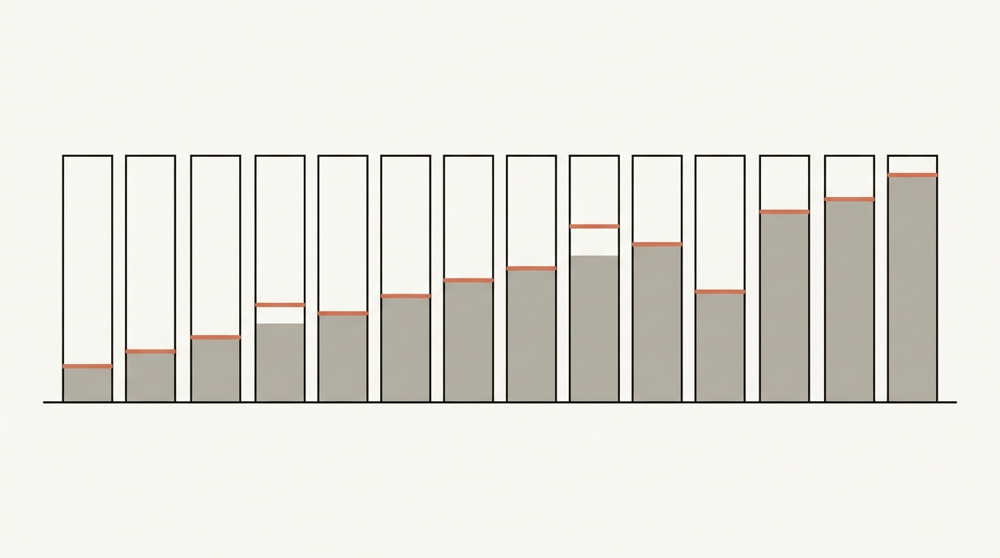
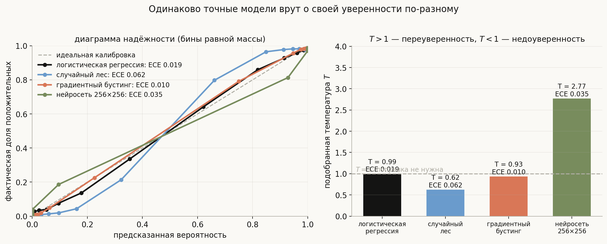
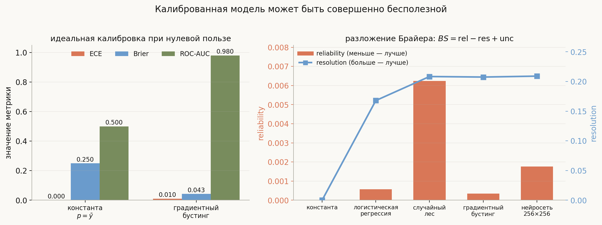
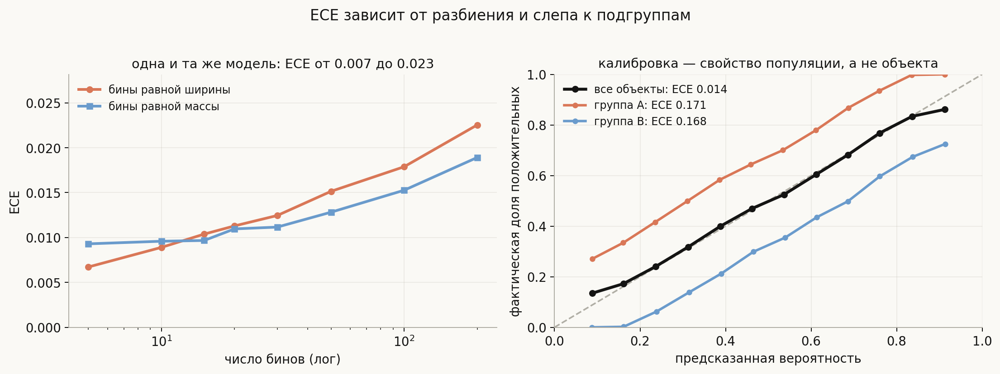
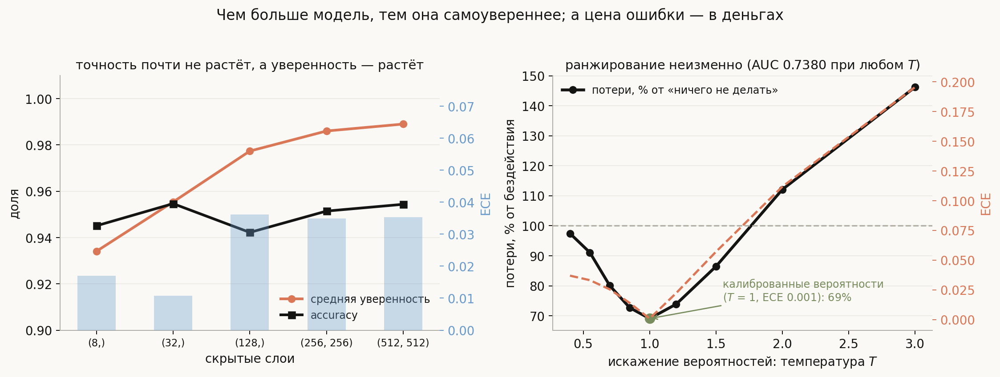
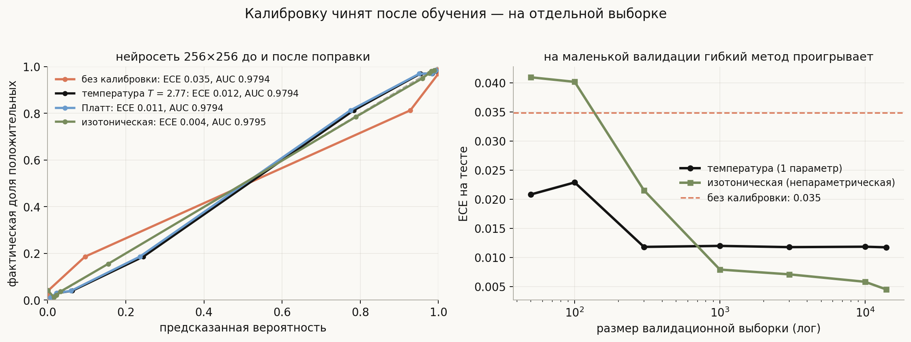

# Калибровка вероятностей: когда 0.8 значит 80%

**Вопрос (EN)**: What does it mean for a model to be calibrated? How do you measure and fix calibration, and when does it matter more than accuracy?

Почти любая модель классификации выдаёт не только метку, но и число от нуля до единицы. Это число печатают в отчёты, кладут в пороги, показывают операторам и умножают на суммы — то есть обращаются с ним как с **вероятностью**. Вопрос, который при этом почти никогда не задают: а оно вообще вероятность? Если модель сказала 0.8 на тысяче транзакций, сбылось ли примерно восемьсот?

Проверка бывает неприятной. Модель с прекрасной accuracy и ROC-AUC 0.98 может систематически заявлять 0.99 там, где на деле 0.85 — и обе метрики этого **не заметят**, потому что обе смотрят только на порядок объектов, а не на сами числа. А как только вероятность попадает в формулу принятия решения — «блокировать, если $p \cdot \text{сумма} > C$», «передать человеку, если модель не уверена», «объединить с другим источником» — соврамшее число превращается в деньги.

Эта лекция — про свойство, которое отвечает за честность этих чисел: **калибровку**. Что это, чем её меряют, почему популярная метрика ECE обманчива, откуда берётся переуверенность, чем её чинят и почему в 2026 году появились модели, у которых калибровка — не постобработка, а цель обучения. Все числа ниже посчитаны прогоном: код в [`generate_visuals.py`](generate_visuals.py) и [`notebook.ipynb`](notebook.ipynb).

## План

1. Что такое калибровка
2. Диаграмма надёжности: кто и как врёт
3. Чем меряют: ECE, Брайер, логлосс
4. Калибровка — не полезность
5. Чему ECE не научит
6. Откуда берётся плохая калибровка
7. Как чинят
8. Зачем она нужна: деньги, каскады, воздержание
9. Современный поворот: калибровка как цель обучения
10. Что спрашивают на собеседовании
11. Типичные ошибки
12. Итог

---

## 1. Что такое калибровка

Модель **калибрована**, если среди объектов, которым она приписала вероятность $p$, доля положительных равна $p$:

$$\Pr\big(y = 1 \;\big|\; \hat p(x) = p\big) = p \qquad \text{для всех } p \in [0, 1].$$

Это условие про **самооценку**, а не про качество: оно требует, чтобы заявленная уверенность совпадала с фактической частотой. Отсюда сразу три следствия, которые стоит проговорить.

- **Калибровка не про порядок.** Любое монотонное преобразование $\hat p$ оставляет ROC-AUC неизменной, но может полностью разрушить калибровку. Значит, AUC её не видит — вообще.
- **Калибровка не про точность.** Модель, всегда предсказывающая базовую частоту, идеально калибрована и совершенно бесполезна (раздел 4).
- **Калибровка — свойство популяции.** Условие выше — про группы объектов с одинаковым $\hat p$, а не про отдельный объект. Оно может выполняться в среднем и нарушаться на каждой подгруппе (раздел 5).

Полезная бытовая аналогия — прогноз погоды. Синоптик, который в 70% случаев из тех, где он обещал 70% дождя, действительно получает дождь, калиброван. Он может при этом обещать 70% каждый день и быть бесполезным — вот вам и разница между калибровкой и умением различать.

## 2. Диаграмма надёжности: кто и как врёт

Главный инструмент диагностики — **диаграмма надёжности**: объекты бьются на бины по предсказанной вероятности, и для каждого бина рисуется точка «средняя предсказанная вероятность против фактической доли положительных». Идеал — диагональ.

Прогон на синтетической задаче (40 000 объектов, 20 признаков, три доли на обучение, валидацию и тест):

| модель | accuracy | ROC-AUC | Brier | ECE | температура $T$ |
|---|---|---|---|---|---|
| логистическая регрессия | 0.893 | 0.949 | 0.0825 | 0.019 | 0.99 |
| случайный лес | 0.948 | 0.979 | 0.0480 | **0.062** | **0.62** |
| градиентный бустинг | 0.946 | 0.980 | 0.0427 | 0.010 | 0.93 |
| нейросеть 256×256 | 0.951 | 0.979 | 0.0422 | 0.035 | **2.77** |

Три модели имеют практически одинаковые accuracy и AUC — и **совершенно разную честность**:

- **Случайный лес недоуверен.** Его вероятность — это доля проголосовавших деревьев, а усреднение стягивает оценки к середине: там, где надо сказать 0.95, лес говорит 0.8. На диаграмме его кривая идёт круче диагонали.
- **Нейросеть переуверена.** Обученная до упора на кросс-энтропии, она выдаёт 0.99 там, где правда 0.9. Кривая провисает под диагональю.
- **Логрегрессия и бустинг** на логлоссе близки к диагонали: обе оптимизируют собственно правдоподобие.

Правая панель показывает удобный однопараметрический диагноз — **температуру** $T$, подобранную на валидации так, чтобы $\sigma(z/T)$ давало минимальный логлосс. $T > 1$ означает «надо охладить, модель переуверена» (нейросеть: 2.77), $T < 1$ — «надо обострить, модель недоуверена» (лес: 0.62), $T \approx 1$ — поправка не нужна.

## 3. Чем меряют: ECE, Брайер, логлосс

**ECE (Expected Calibration Error)** — средневзвешенный по бинам разрыв между уверенностью и фактической долей:

$$\mathrm{ECE} = \sum_{b=1}^{B} \frac{n_b}{n}\,\big|\,\mathrm{acc}(b) - \mathrm{conf}(b)\,\big|.$$

Просто, наглядно и — как мы увидим в разделе 5 — полно ловушек.

**Brier score** — обычная квадратичная ошибка по вероятностям, $\mathrm{BS} = \frac{1}{n}\sum (\hat p_i - y_i)^2$. У неё есть разложение Мёрфи, которое объясняет, что вообще меряется:

$$\mathrm{BS} = \underbrace{\mathrm{reliability}}_{\text{штраф за калибровку}} - \underbrace{\mathrm{resolution}}_{\text{умение различать}} + \underbrace{\mathrm{uncertainty}}_{\text{сложность задачи}}.$$

**Логлосс** — тоже строго правильная функция (proper scoring rule): её минимум по всем предсказаниям достигается ровно на истинных вероятностях. Это и есть формальная причина, по которой логлосс и Брайер «поощряют честность», а accuracy — нет.

Ключевое различение для собеседования: **строго правильная функция потерь меряет калибровку и различающую способность одновременно**, а ECE — только калибровку. Поэтому Brier/логлосс годятся как цель обучения, а ECE — только как диагностика.

## 4. Калибровка — не полезность

Самый быстрый способ убедиться, что калибровка ничего не говорит о пользе, — построить идеально калиброванную и абсолютно бесполезную модель. Предсказываем всем одну и ту же базовую частоту:

| | ECE | Brier | ROC-AUC | reliability | resolution |
|---|---|---|---|---|---|
| константа $p = \bar y$ | **0.0001** | 0.2500 | **0.500** | 0.0000 | **0.0000** |
| градиентный бустинг | 0.0104 | 0.0427 | 0.980 | 0.0004 | 0.2075 |

Константа калибрована **лучше** бустинга по ECE — и при этом бесполезна: AUC 0.5, resolution ровно ноль. Разложение Брайера расставляет всё по местам: у константы нулевой штраф за калибровку и нулевое умение различать, у бустинга — мизерный штраф и resolution 0.21.

> Формулировка, которую стоит запомнить: **калибровка — необходимое, но не достаточное свойство**. Сначала добейтесь различающей способности (resolution), потом чините калибровку (reliability). Обратный порядок даёт честную бесполезность.

## 5. Чему ECE не научит

У популярной метрики две неприятные особенности, и обе легко показать прогоном.

**ECE зависит от разбиения.** Одна и та же модель, один и тот же тест: при бинах равной ширины ECE растёт с 0.007 (5 бинов) до 0.023 (200 бинов) — втрое. При бинах равной массы разброс меньше (0.009 → 0.019), но он есть. Причина проста: с ростом числа бинов в каждом остаётся мало объектов, оценка фактической доли шумит, и шум прибавляется к метрике. Отсюда правило: **число и тип бинов — часть определения ECE**, и сравнивать ECE, посчитанные по-разному, нельзя.

**ECE слепа к подгруппам.** Правая панель: модель, чьи предсказания в среднем безупречны (общий ECE 0.014), но на группе A она систематически занижает, а на группе B — завышает, и каждая ошибка по 0.17. В сумме ошибки взаимно уничтожаются. Это не искусственная конструкция: ровно так выглядит модель, откалиброванная на всей популяции и применяемая к сегментам — по регионам, каналам, типам клиентов. Лечится это не метрикой, а **проверкой калибровки по срезам** (и её обобщениями вроде мультикалибровки).

## 6. Откуда берётся плохая калибровка

Полезно знать типичные механизмы — вопрос «почему ваша модель переуверена» на собеседовании звучит часто.

- **Усреднение стягивает к середине.** Бэггинг и случайный лес усредняют голоса, и крайние вероятности почти недостижимы: отсюда недоуверенность и $T < 1$.
- **Ёмкость и длительное обучение дают переуверенность.** Классический результат (Guo et al., 2017) воспроизводится:

| скрытые слои | accuracy | средняя уверенность | ECE | $T$ |
|---|---|---|---|---|
| (8,) | 0.945 | 0.934 | 0.017 | 1.00 |
| (32,) | 0.955 | 0.955 | 0.011 | 1.16 |
| (128,) | 0.942 | 0.977 | 0.036 | 2.41 |
| (256, 256) | 0.951 | 0.986 | 0.035 | 2.77 |
| (512, 512) | 0.954 | 0.989 | 0.035 | 2.98 |

Точность гуляет в пределах процента, а средняя уверенность растёт с 0.93 до 0.99, и температура — с 1.00 до 2.98. Сеть учится не столько быть правой, сколько быть громкой: кросс-энтропия продолжает выталкивать логиты наружу и после того, как ошибки закончились.

- **Пересэмплирование и веса классов.** Любая правка баланса сдвигает апостериорные вероятности: в [теме про фрод](../../../ml-algorithms/classical-ml/fraud-detection/lesson.md) это измерено — Brier ухудшается на порядок, а средний скор улетает с 0.006 до 0.17. После андерсэмплинга нужна обратная коррекция сдвига.
- **Сдвиг распределения.** Калибровка определена относительно распределения; сменилось оно — числа перестали значить то, что значили. Это самая частая причина, по которой «вчера было хорошо, сегодня плохо».
- **Модели, у которых вероятностей нет вовсе.** SVM выдаёт расстояние до границы; `probability=True` в sklearn — это отдельная калибровка Платта на внутренней кросс-валидации, а не свойство метода.

## 7. Как чинят

Калибровку чинят **после обучения, на отдельной выборке**, которую модель не видела. Три стандартных способа:

| метод | параметров | сохраняет ранжирование | когда брать |
|---|---|---|---|
| температурная шкала | 1 | да, строго | мало валидации, нужна безопасность |
| Платт (сигмоида по логиту) | 2 | да, строго | классика для SVM и бустинга |
| изотоническая регрессия | непараметрическая | да, нестрого (ступеньки склеивают) | много валидации, сложная форма искажения |

Левая панель — та самая переуверенная нейросеть:

| | ECE | ROC-AUC | Brier |
|---|---|---|---|
| без калибровки | 0.0349 | 0.9794 | 0.0422 |
| температура $T = 2.77$ | 0.0117 | **0.9794** | 0.0402 |
| Платт | 0.0114 | **0.9794** | 0.0402 |
| изотоническая | **0.0045** | 0.9795 | 0.0399 |

Два вывода. Во-первых, ECE падает втрое от одного-единственного параметра. Во-вторых — и это любимый уточняющий вопрос — **AUC не меняется вообще** (0.9794 до четвёртого знака): температурная шкала монотонна, порядок объектов она не трогает. Значит, калибровка ничего не ломает и ничего не «улучшает» в ранжировании; она чинит ровно одно свойство.

Правая панель отвечает на вопрос «какой метод выбрать». Изотоническая регрессия гибче и в пределе лучше (ECE 0.0045 на полной валидации), но она непараметрическая и на маленькой выборке **переобучается**: при 50 объектах валидации она даёт ECE 0.041 — хуже, чем вообще ничего не делать (0.035), тогда как температура уже даёт 0.021. Перелом наступает в районе тысячи объектов. Правило: мало валидации — температура, много — изотоническая.

Отдельно стоит назвать **конформное предсказание**: оно решает смежную задачу иначе — не обещает честную вероятность, а даёт множество ответов с гарантией покрытия («истинный класс попадёт сюда в 90% случаев») при минимальных предположениях. Когда нужна гарантия, а не число, это более надёжный инструмент.

## 8. Зачем она нужна: деньги, каскады, воздержание

Самый убедительный аргумент — денежный, и он же показывает, почему AUC недостаточно. Правая панель картинки из раздела 6: задача с редким событием (3.8%), правило «блокировать, если $\hat p \cdot \text{сумма} > C$», и **монотонное искажение вероятностей**, которое не меняет ранжирование вообще.

| искажение | ECE | ROC-AUC | доля алертов | потери, % от бездействия |
|---|---|---|---|---|
| $T = 0.4$ (недоуверенность) | 0.037 | 0.7380 | 0.07% | 97% |
| $T = 0.7$ | 0.025 | 0.7380 | 2.3% | 80% |
| **$T = 1$ (калиброванные)** | **0.001** | 0.7380 | 10.2% | **69%** |
| $T = 1.5$ | 0.057 | 0.7380 | 28.9% | 86% |
| $T = 3$ (переуверенность) | 0.196 | 0.7380 | 60.9% | **146%** |

AUC **одинакова во всех строках** — 0.7380. А потери меняются от 69% до 146% от уровня «вообще ничего не делать»: сильно переуверенная модель не просто бесполезна, она хуже бездействия, потому что заливает всё ложными блокировками. Ровно по этой причине в [теме про фрод](../../../ml-algorithms/classical-ml/fraud-detection/lesson.md) правило «$p \cdot$ сумма» требует, чтобы $p$ было настоящей вероятностью.

Где ещё калибровка критична:

- **Любое правило с ожидаемой стоимостью.** Порог $p^* = C_{FP}/(C_{FP}+C_{FN})$ имеет смысл только для честных $p$.
- **Каскады и роутинг.** «Если модель не уверена — спросить модель побольше или человека»: некалиброванная уверенность превращает экономию в лотерею.
- **Воздержание (abstention) и активное обучение.** Обе схемы выбирают объекты по неуверенности.
- **Агрегирование источников.** Складывать и перемножать можно только сопоставимые вероятности.
- **Разговор с людьми.** «Модель уверена на 95%» — утверждение, за которое кто-то отвечает.

А где не критична: если вы принимаете решение **одним фиксированным порогом** и никогда не комбинируете вероятности, монотонное искажение вам безразлично — достаточно подобрать порог. Это честный ответ на вопрос «а нужна ли вообще калибровка»: нужна ровно тогда, когда число используется как число, а не как способ отсортировать.

## 9. Современный поворот: калибровка как цель обучения

Исторически калибровка — постобработка: обучили как получилось, потом поправили температурой. В 2026 году появился заметный контрпример — класс моделей, где честность вероятности сделана **целью обучения**.

TypeSafe AI представила **Jev**, который они называют «System One model»: на вход идёт состояние программы и типизированный вопрос с закрытым множеством вариантов, на выходе — вариант из этого множества и вероятность. Обучение — **RLCD** (Reinforcement Learning for Calibrated Decisions): награда даётся не за то, что ответ понравился человеку (как в RLHF) и не за проверяемую правильность, а за то, что заявленная вероятность соответствует наблюдаемой частоте правильных ответов.

Проверить это можно по независимому лидерборду [Decision Index](https://huggingface.co/spaces/multimodalart/jev-decision-index) (132 422 запроса, 37 бенчмарков, из них 19 в зачёте), где **ECE стоит рядом с точностью как первоклассная метрика**, а не как сноска: лучший результат там — ECE 3.1 при средней уверенности 0.673 и точности 0.675.

Архитектурно эти модели интересны тем, что отказываются от генерации: у открытых воспроизведений (`open-jev-deberta-v3-large` на DeBERTa-v3-large, `openjev` и `decider` на Qwen3.5) ответ получается **за один проход** — логиты в позиции ответа делятся на подобранную температуру и проходят softmax, без декодирования и парсинга. Та же температура, что в разделе 7, только встроенная в модель.

Оговорки, без которых пересказывать это нечестно: веса самого Jev закрыты, архитектура официально не опубликована, «0% галлюцинаций» — это гарантия схемы (нельзя выдать ответ вне множества вариантов), а не измеренная величина, и сравнение «в сто раз быстрее LLM» — заявление вендора. Независимо проверяемая часть — именно лидерборд и открытые воспроизведения.

Для лекции важно другое: это первый заметный случай, когда калибровка перестала быть косметикой и стала тем, ради чего модель обучают. Если вас спросят «а что нового в калибровке за последние годы» — вот это.

## 10. Что спрашивают на собеседовании

**Что значит «модель калибрована»?** Среди объектов с предсказанной вероятностью $p$ доля положительных равна $p$. Это про честность чисел, а не про точность и не про порядок.

**Почему ROC-AUC не видит калибровку?** Она зависит только от порядка объектов, а любое монотонное преобразование вероятностей порядок сохраняет. В прогоне при искажении температурой от 0.4 до 3.0 AUC оставалась 0.7380, а потери менялись от 69% до 146%.

**Чем меряют калибровку?** Диаграммой надёжности как диагностикой, ECE как числом, Брайером и логлоссом как строго правильными функциями. Разложение Мёрфи: $BS = \mathrm{reliability} - \mathrm{resolution} + \mathrm{uncertainty}$.

**Может ли идеально калиброванная модель быть бесполезной?** Да. Константа, равная базовой частоте, даёт ECE 0.0001 и AUC 0.5; resolution у неё ровно ноль. Калибровка необходима, но недостаточна.

**Какие проблемы у ECE?** Она зависит от числа и типа бинов (в прогоне 0.007 против 0.023 на одной и той же модели) и слепа к подгруппам: общий ECE 0.014 при 0.17 на каждой из двух групп. Сравнивать чужие ECE без указания схемы бинов нельзя.

**Почему случайный лес недоуверен, а нейросеть переуверена?** Лес усредняет голоса, и крайние вероятности стягиваются к середине ($T = 0.62$). Нейросеть на кросс-энтропии продолжает раздвигать логиты после того, как ошибки закончились ($T = 2.77$), и чем больше ёмкость, тем сильнее: средняя уверенность растёт с 0.93 до 0.99 при неизменной точности.

**Как чинят калибровку?** Температурной шкалой, Платтом или изотонической регрессией — на отдельной выборке, которую модель не видела. Температура — один параметр и строго монотонна, поэтому не трогает AUC вовсе.

**Что выбрать: температуру или изотоническую?** По размеру валидации. В прогоне при 50 объектах изотоническая дала ECE 0.041 (хуже, чем без калибровки), температура — 0.021; при полной валидации изотоническая выигрывает (0.0045 против 0.0117).

**Когда калибровка не нужна?** Когда решение принимается одним фиксированным порогом и вероятности никуда больше не идут: монотонное искажение тогда компенсируется подбором порога.

**Что ломает калибровку в проде?** Сдвиг распределения (калибровка определена относительно $P$), пересэмплирование и веса классов, дообучение, смена версии модели. Поэтому калибровку перепроверяют вместе с метриками, а не один раз.

**Что нового в теме?** Модели, где калибровка — цель обучения, а не постобработка: RLCD у TypeSafe Jev и лидерборд Decision Index, где ECE — метрика первого класса наравне с точностью.

## 11. Типичные ошибки

- **Считать выход softmax вероятностью по умолчанию.** Это результат нормировки логитов; вероятностью он становится только после проверки.
- **Отчитываться по AUC и делать вывод о вероятностях.** AUC инвариантна к монотонным искажениям и про калибровку не говорит ничего.
- **Калибровать на обучающей выборке.** Модель на ней переобучена, искажение выглядит меньше, чем есть; нужна отдельная валидация.
- **Сравнивать ECE, посчитанные по-разному.** Число бинов и тип разбиения — часть определения.
- **Смотреть только общий ECE.** Ошибки подгрупп взаимно уничтожаются; проверяйте срезы.
- **Брать изотоническую регрессию «потому что она гибче».** На маленькой валидации она проигрывает даже отсутствию калибровки.
- **Думать, что калибровка улучшит качество.** Она не трогает ранжирование: accuracy и AUC останутся теми же, изменится только смысл чисел.
- **Пересэмплировать и забыть про сдвиг.** После андерсэмплинга вероятности завышены во столько раз, во сколько прорежены отрицательные.
- **Считать, что калиброванная модель калибрована навсегда.** Сдвиг распределения ломает калибровку первой — раньше, чем точность.
- **Путать калибровку с гарантией.** Калибровка — утверждение в среднем по популяции; если нужна гарантия на объект, это конформное предсказание.

## 12. Итог

Модель калибрована, если среди объектов, которым она приписала вероятность $p$, доля положительных действительно равна $p$; это свойство самооценки, и ни accuracy, ни ROC-AUC его не видят, потому что обе зависят только от порядка объектов. Диагностируют калибровку диаграммой надёжности и одним числом — подобранной температурой: в прогоне случайный лес оказался недоуверен ($T = 0.62$, усреднение голосов стягивает вероятности к середине), а нейросеть переуверена ($T = 2.77$), причём с ростом ёмкости средняя уверенность поднималась с 0.93 до 0.99 при неизменной точности. Меряют калибровку через ECE, а качество вероятностей целиком — строго правильными функциями: разложение Брайера $BS = \mathrm{reliability} - \mathrm{resolution} + \mathrm{uncertainty}$ прямо показывает, что калибровка необходима, но недостаточна — константа, равная базовой частоте, даёт ECE 0.0001 при AUC 0.5 и нулевой resolution. У самой ECE две ловушки: она зависит от схемы бинов (0.007 против 0.023 на одной модели) и слепа к подгруппам (общий ECE 0.014 при 0.17 на каждой из двух групп). Чинят калибровку после обучения на отдельной выборке — температурной шкалой, Платтом или изотонической регрессией; температура из одного параметра снижает ECE втрое и **не меняет AUC ни на один знак**, а изотоническая выигрывает только при валидации от тысячи объектов, проигрывая на пятидесяти даже отсутствию калибровки. Нужна она ровно тогда, когда вероятность используется как число: в правиле «$p \cdot \text{сумма} > C$» одно и то же ранжирование (AUC 0.7380) при разной калибровке даёт потери от 69% до 146% от уровня бездействия. И самое свежее в теме — модели, где калибровка перестала быть постобработкой и стала целью обучения: RLCD у TypeSafe Jev и лидерборд Decision Index, где ECE стоит рядом с точностью.

## Что рядом

- [`notebook.ipynb`](notebook.ipynb) — калибровка с нуля: диаграмма надёжности руками, ECE и его зависимость от бинов, разложение Брайера, доказательство того, что логлосс минимален на истинных вероятностях, температурная шкала и Платт, коррекция сдвига после андерсэмплинга, денежный эксперимент
- [`generate_visuals.py`](generate_visuals.py) — код всех диаграмм; все величины меряются на обученных моделях, температура подбирается на валидации
- [Детекция мошенничества](../../../ml-algorithms/classical-ml/fraud-detection/lesson.md) — где калибровка превращается в деньги и что с ней делает пересэмплирование
- [Минимизация эмпирического риска](../../basics/empirical-risk-minimization/lesson.md) — почему строго правильные функции потерь вообще работают
- [SVM и градиентный бустинг](../../../ml-algorithms/classical-ml/svm-and-gradient-boosting/lesson.md) — модели, у которых вероятностей нет по построению, и калибровка Платта
- [Типизированные решающие модели](../../../ml-algorithms/deep-learning/architectures/typed-decision-models/lesson.md) — архитектура, где калибровка вынесена в цель обучения, а температуру подбирают отдельно по типам вопросов
- [Классификация и регрессия](../../basics/classification-vs-regression/lesson.md) — про то, что пара «пространство ответов, функция потерь» задаёт задачу
- [Log Loss vs MSE](../Log%20Loss%20vs%20MSE.md) и [Confusion Matrix, Precision, Recall](../Confusion%20Matrix%20Precision%20Recall.md) — соседние вопросы этой же главы

---
*Тема вне списка вопросов книги: выросла из побочных упоминаний калибровки в темах про фрод, бустинг и ERM.*
