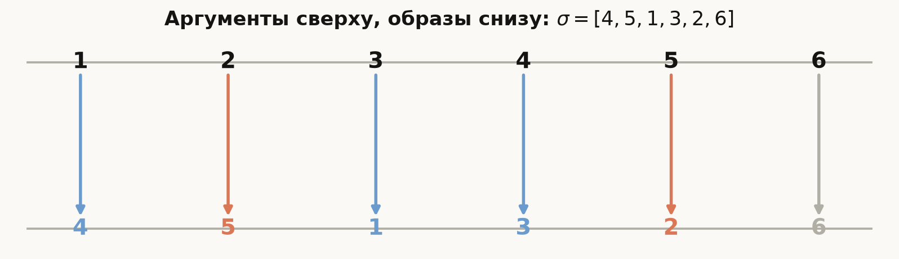
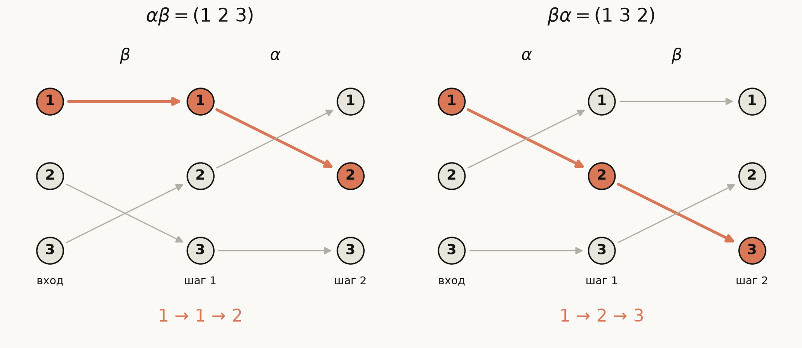
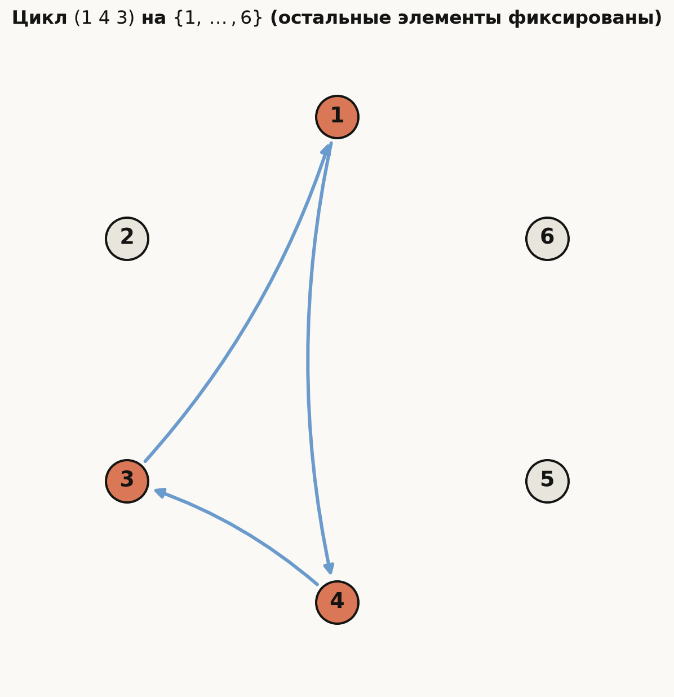
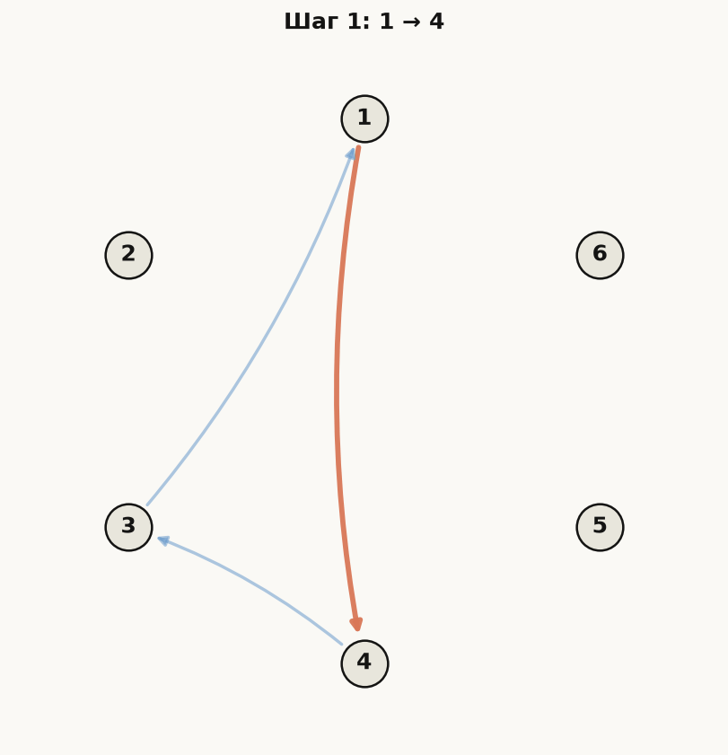
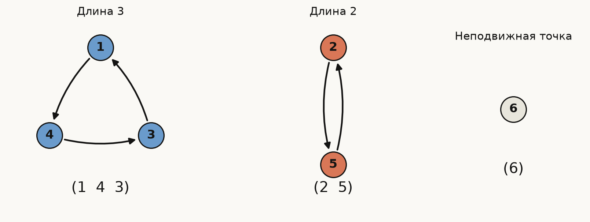
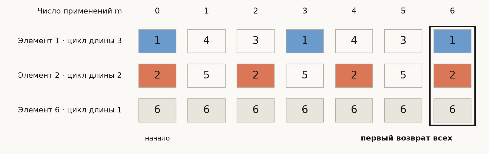
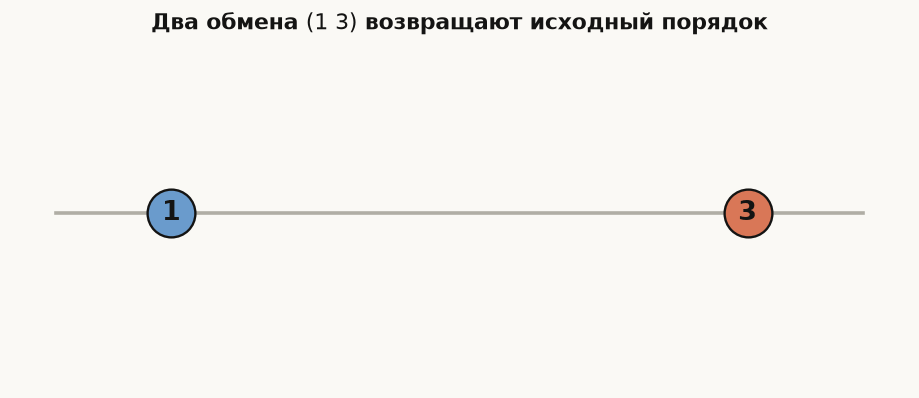
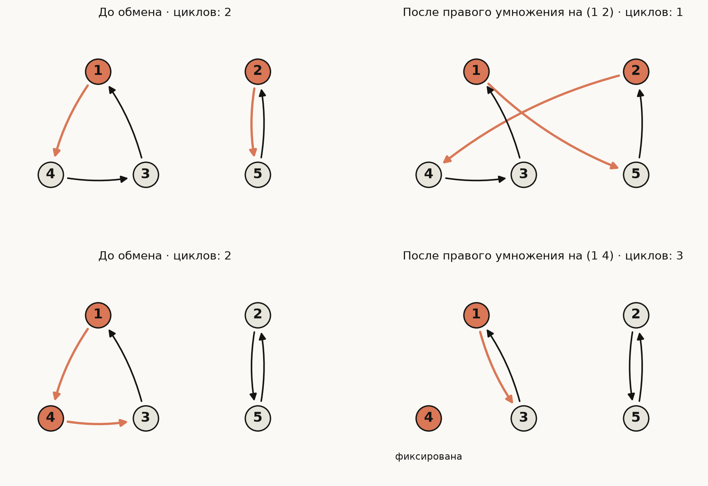
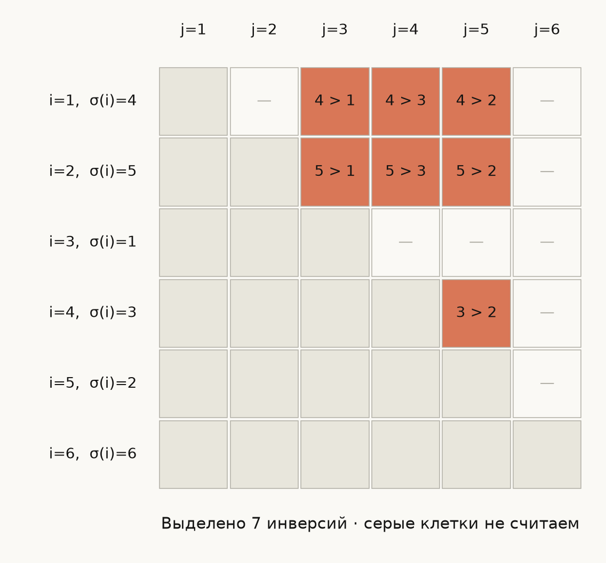

# Лекция: подстановки, циклы, транспозиции и чётность

Подстановка описывает, куда переходит каждый элемент конечного множества. Главная линия этой лекции — научиться переходить от таблицы образов к циклам, а по циклам быстро находить обратную подстановку, большие степени, порядок, знак и минимальное число обменов. Эти приёмы нужны в задачах на перестановки, а знак подстановки позже появится в формуле определителя. Достаточно знать понятие функции, факториал, делимость и НОК; групповые термины мы введём по ходу.

## План

1. [Подстановка и способы записи](#permutation)
2. [Произведение: кто действует первым](#composition)
3. [Циклы и алгоритм разложения](#cycles)
4. [Обратная подстановка, степени и порядок](#powers)
5. [Транспозиции и минимальное число обменов](#transpositions)
6. [Инверсии, чётность и знак](#parity)
7. [Симметрическая и знакопеременная группы](#groups)
8. [Как выбирать приём в задаче](#strategy)
9. [Дополнительные приёмы](#advanced)
10. [Типичные ошибки](#mistakes)
11. [Что важно для поступления в ШАД](#shad)
12. [Итог](#summary)
13. [Вопросы для самопроверки](#self-check)
14. [Упражнения с подсказками и ответами](#exercises)

Для первого прохода достаточно разделов 1–8 и практики в конце. Раздел 9 нужен для более сложных задач из [задачника](qa.md).

---

## 1. Подстановка и способы записи

### 1.1. Определение и сквозной пример

**Подстановка степени $n$** — биекция множества $\{1,\ldots,n\}$ на себя. Это функция $\sigma$, у которой каждое число имеет ровно один образ и ровно один прообраз. В двухстрочной записи сверху стоят аргументы, снизу — их образы:

$$
\sigma=
\begin{pmatrix}
1&2&3&4&5&6\\
4&5&1&3&2&6
\end{pmatrix}.
$$

Эта подстановка будет нашим сквозным примером. Например, $\sigma(1)=4$, $\sigma(4)=3$, а $\sigma(6)=6$. Число $6$ называется **неподвижной точкой**.

В нижней строке каждое число от $1$ до $6$ встречается ровно один раз. Таблица с нижней строкой $[4,5,1,3,2,2]$ подстановку не задаёт: у числа $2$ два прообраза, а у $6$ ни одного.

*Каждый столбец читается отдельно: верхнее число переходит в нижнее. Цвета объединяют элементы, которые окажутся в одном цикле.*

### 1.2. Однострочная запись и запись цикла

Если сверху стоит стандартный ряд $1,\ldots,n$, можно оставить только список образов. В этой лекции для него используем **квадратные скобки**:

$$
\sigma=[4,5,1,3,2,6].
$$

Круглые скобки будут обозначать **цикл**: запись $(1\ 4\ 3)$ означает $1\to4\to3\to1$. Остальные элементы такой цикл оставляет неподвижными. Подробно циклы разберём в разделе 3.

Например, $[3,1,4,2]$ и $(3\ 1\ 4\ 2)$ — разные подстановки: первая переводит $1$ в $3$, вторая — в $4$. Циклическая запись первой подстановки — $(1\ 3\ 4\ 2)$.

> В разных книгах соглашения о скобках отличаются. Всегда уточняй, перед тобой список образов или последовательность обхода цикла.

### 1.3. Сколько существует подстановок

Образ числа $1$ можно выбрать $n$ способами, образ числа $2$ — одним из $n-1$ оставшихся способов, и так далее. Поэтому подстановок ровно $n!$.

Множество всех подстановок степени $n$ обозначают $S_n$. Пока это просто обозначение множества; его групповую структуру обсудим в разделе 7. Например, $S_3$ содержит $3!=6$ подстановок.

---

## 2. Произведение: кто действует первым

### 2.1. Соглашение о порядке

Произведение подстановок — композиция функций:

$$
(\alpha\beta)(i)=\alpha(\beta(i)).
$$

**Первой действует правая подстановка.** Чтобы вычислить образ числа $i$, прослеживаем маршрут

$$
i\xrightarrow{\beta}\beta(i)\xrightarrow{\alpha}\alpha(\beta(i)).
$$

### 2.2. Пример, в котором порядок меняет ответ

Возьмём два обмена: $\alpha=(1\ 2)$ меняет местами $1$ и $2$, а $\beta=(2\ 3)$ — числа $2$ и $3$. Такой обмен двух элементов называется **транспозицией**.

| $i$ | $\beta(i)$ | $\alpha(\beta(i))$ | $\alpha(i)$ | $\beta(\alpha(i))$ |
|---|---|---|---|---|
| 1 | 1 | 2 | 2 | 3 |
| 2 | 3 | 3 | 1 | 1 |
| 3 | 2 | 1 | 3 | 2 |

Итак,

$$
\alpha\beta=[2,3,1]=(1\ 2\ 3),\qquad
\beta\alpha=[3,1,2]=(1\ 3\ 2).
$$

*Проследи выделенный маршрут числа $1$. Уже одного различающегося образа достаточно, чтобы доказать $\alpha\beta\ne\beta\alpha$.*

Это пример **некоммутативности**: переставлять множители произвольно нельзя. При этом группировка множителей не мешает вычислению: композиция ассоциативна, поскольку обе записи $(\alpha\beta)\gamma$ и $\alpha(\beta\gamma)$ переводят $i$ в $\alpha(\beta(\gamma(i)))$.

### 2.3. Тождественная подстановка

Подстановка $e$, для которой $e(i)=i$ при всех $i$, называется **тождественной**. Она играет роль единицы: $e\sigma=\sigma e=\sigma$.

Если выполнить один и тот же обмен дважды, всё вернётся на место: $(1\ 2)^2=e$. Но два разных обмена, как в примере выше, могут дать цикл длины $3$.

**Проверь себя.** Чему равно $(\alpha\beta)(2)$? Ответ должен получиться по маршруту $2\to3\to3$, а не по порядку записи множителей слева направо.

---

## 3. Циклы и алгоритм разложения

### 3.1. Как читать цикл

**Цикл длины $k$** на различных элементах $a_1,\ldots,a_k$ — подстановка

$$
(a_1\ a_2\ \ldots\ a_k):\quad a_1\to a_2\to\cdots\to a_k\to a_1,
$$

которая фиксирует остальные элементы. Например, $(1\ 4\ 3)$ переводит $1$ в $4$, $4$ в $3$, $3$ в $1$.

*Это отдельный цикл $(1\ 4\ 3)$ на шести элементах. У сквозной подстановки дополнительно будут обмениваться $2$ и $5$.*

Начинать запись можно с любой вершины, сохраняя направление:

$$
(1\ 4\ 3)=(4\ 3\ 1)=(3\ 1\ 4).
$$

А $(1\ 3\ 4)$ задаёт обратный обход и является другой подстановкой.

Посмотреть обход цикла по шагам

Каждый шаг показывает очередной образ **одного выбранного элемента** при повторном применении цикла. Сама подстановка задаёт образы всех элементов одновременно.

### 3.2. Сквозной пример: из таблицы в циклы

Вернёмся к $\sigma=[4,5,1,3,2,6]$.

1. Начинаем с $1$: $1\to4\to3\to1$. Получаем $(1\ 4\ 3)$ и отмечаем числа $1,4,3$ как использованные.
2. Берём наименьшее неиспользованное число $2$: $2\to5\to2$. Получаем $(2\ 5)$.
3. Осталось $6$: $6\to6$. Получаем цикл длины $1$.

Следовательно,

$$
\sigma=(1\ 4\ 3)(2\ 5)(6).
$$

*Каждый элемент попал ровно в один цикл. Длины циклов дают проверку: $3+2+1=6$.*

Цикл $(6)$ обычно опускают в записи произведения. Но при подсчёте циклов и указании **циклического типа** его учитывают. Циклический тип — набор длин циклов с учётом повторений; в нашем примере он равен $(3,2,1)$.

### 3.3. Почему независимые циклы коммутируют

Циклы называются **независимыми**, если не имеют общих элементов. Для $(1\ 4\ 3)$ и $(2\ 5)$ порядок применения неважен: на числах $1,4,3$ действует только первый цикл, на $2,5$ — только второй, а $6$ фиксируют оба.

Поэтому $(1\ 4\ 3)(2\ 5)=(2\ 5)(1\ 4\ 3)$.

Это достаточное условие коммутирования. Пересекающиеся циклы тоже иногда коммутируют: например, цикл и обратный к нему дают $e$ в любом порядке. Но в общем случае для пересекающихся циклов порядок важен, как в разделе 2.

### 3.4. Почему разложение существует и единственно

**Теорема.** Всякая подстановка раскладывается в произведение независимых циклов. Разложение единственно с точностью до порядка циклов, циклического сдвига их записей и опускания неподвижных точек.

**Доказательство.** Начнём с элемента $a$ и будем выписывать $a,\sigma(a),\sigma^2(a),\ldots$. Множество конечно, поэтому произойдёт повторение. Первый повтор обязан замкнуть путь в $a$: если $\sigma^j(a)=\sigma^i(a)$ при $0<i<j$, то из инъективности следует $\sigma^{j-1}(a)=\sigma^{i-1}(a)$, а это более раннее повторение. Значит получился цикл.

Возьмём ещё не использованный элемент. Его путь не может войти в прежний цикл: у вершины входа появились бы два разных прообраза. Повторяя процедуру, получим независимые циклы, покрывающие всё множество.

Маршрут каждого элемента полностью определяется функцией $\sigma$, поэтому других наборов циклов быть не может. Именно эти маршруты называют **орбитами** элементов.

---

## 4. Обратная подстановка, степени и порядок

### 4.1. Как найти обратную

**Обратная подстановка** $\sigma^{-1}$ возвращает каждый образ к его прообразу: если $\sigma(i)=j$, то $\sigma^{-1}(j)=i$. Поэтому $\sigma\sigma^{-1}=\sigma^{-1}\sigma=e$.

В таблице достаточно поменять строки местами, а затем переставить **целые столбцы**, чтобы сверху снова стоял стандартный ряд:

$$
\sigma^{-1}=
\begin{pmatrix}
4&5&1&3&2&6\\
1&2&3&4&5&6
\end{pmatrix}
=
\begin{pmatrix}
1&2&3&4&5&6\\
3&5&4&1&2&6
\end{pmatrix}.
$$

В циклах ещё проще: развернуть направление обхода каждого цикла. В частности,

$$
(a_1\ a_2\ \ldots\ a_k)^{-1}=(a_1\ a_k\ \ldots\ a_2),\qquad
\sigma^{-1}=(1\ 3\ 4)(2\ 5)(6).
$$

Проверка на одном элементе: $1\xrightarrow{\sigma}4\xrightarrow{\sigma^{-1}}1$. Транспозиция обратна самой себе.

Для произвольного произведения порядок множителей при обращении меняется:

$$
(\alpha\beta)^{-1}=\beta^{-1}\alpha^{-1}.
$$

Действительно, сначала нужно отменить последнее выполненное действие. У независимых циклов обращённые множители можно затем переставить, поскольку они коммутируют.

### 4.2. Степени: шаги по циклу

$\sigma^m$ при $m>0$ означает $m$ последовательных применений $\sigma$, а $\sigma^0=e$. Для отрицательных степеней полагаем $\sigma^{-m}=(\sigma^{-1})^m$ при $m>0$. Для цикла $c$ длины $k$ верно $c^k=e$: после $k$ шагов каждая вершина возвращается к себе. Поэтому показатель можно сокращать по модулю $k$.

Для сквозного примера:

$$
\sigma^2=(1\ 3\ 4)(2)(5)(6).
$$

В первом цикле делаем по два шага, а обмен $(2\ 5)$, выполненный дважды, исчезает. Поскольку независимые циклы коммутируют, их можно возводить в степень по отдельности.

Например, $2026\equiv1\pmod3$ и $2026\equiv0\pmod2$, поэтому

$$
\sigma^{2026}=(1\ 4\ 3).
$$

Числа $2,5,6$ здесь неподвижны.

### 4.3. Порядок: когда одновременно вернутся все элементы

**Порядок подстановки** — наименьшее положительное целое $m$, для которого $\sigma^m=e$.

Цикл длины $k$ возвращает все свои элементы на место тогда и только тогда, когда $k\mid m$. Если длины независимых циклов равны $k_1,\ldots,k_r$, нужно одновременно выполнить все условия $k_j\mid m$. Наименьшее такое число — НОК:

$$
\operatorname{ord}(\sigma)=\operatorname{lcm}(k_1,\ldots,k_r).
$$

*В сквозном примере $1$ возвращается каждые три шага, $2$ — каждые два, а $6$ неподвижно. Первое совместное возвращение при $m>0$ происходит на шаге $6$.*

Следовательно, $\operatorname{ord}(\sigma)=\operatorname{lcm}(3,2,1)=6$. У тождественной подстановки порядок $1$.

Не заменяй НОК произведением длин: у $(1\ 2\ 3)(4\ 5\ 6)$ порядок равен $3$, а не $9$.

---

## 5. Транспозиции и минимальное число обменов

### 5.1. Разложение цикла

Транспозиция $(a\ b)$ меняет местами два различных элемента и фиксирует остальные.

Посмотреть два последовательных обмена

Один проход меняет метки местами, второй восстанавливает исходное расположение: $(1\ 3)^2=e$. Позиции остаются фиксированными, движутся метки.

Любой цикл длины $k$ раскладывается в $k-1$ транспозиций:

$$
(a_1\ a_2\ \ldots\ a_k)=(a_1\ a_k)(a_1\ a_{k-1})\cdots(a_1\ a_2).
$$

При $k=1$ справа понимается пустое произведение: неподвижная точка не требует обменов.

Проверим короткий пример с учётом действия справа налево:

$$
(1\ 4\ 3)=(1\ 3)(1\ 4).
$$

| Начальный элемент | После правого обмена $(1\ 4)$ | После левого обмена $(1\ 3)$ |
|---|---|---|
| 1 | 4 | 4 |
| 4 | 1 | 3 |
| 3 | 3 | 1 |

Получились нужные переходы $1\to4$, $4\to3$, $3\to1$.

Общая формула проверяется так же: $a_1$ переходит в $a_2$; элемент $a_j$ при $2\le j<k$ сначала попадает в $a_1$, затем в $a_{j+1}$; $a_k$ переходит в $a_1$. Все остальные элементы остаются на месте.

Разложив каждый независимый цикл, получаем разложение любой подстановки в транспозиции. Для нашего примера:

$$
\sigma=(1\ 3)(1\ 4)(2\ 5).
$$

### 5.2. Как обмен меняет число циклов

Сначала уточним, **что именно мы будем считать**. Вернёмся к разложению нашей подстановки на независимые циклы:

$$
\sigma=(1\ 4\ 3)(2\ 5)(6).
$$

Здесь три отдельных замкнутых маршрута:

| Цикл | Маршрут | Число элементов в нём |
|---|---|---|
| $(1\ 4\ 3)$ | $1\to4\to3\to1$ | 3 |
| $(2\ 5)$ | $2\to5\to2$ | 2 |
| $(6)$ | $6\to6$ | 1 |

В последней строке число $6$ остаётся на месте. Это тоже замкнутый маршрут, только из одной вершины, — **цикл длины $1$**. Поэтому всего у подстановки **6 элементов, но 3 независимых цикла**: по одному на каждую строку таблицы.

Число таких циклов обозначают $c(\sigma)$. Буква $c$ здесь — обозначение счётчика циклов; запись $c(\sigma)=3$ читается как «у подстановки $\sigma$ три независимых цикла». Даже если $(6)$ опущен в записи подстановки, при подсчёте его нужно восстановить.

> Считаем циклы в **независимом разложении**. В предыдущем разделе мы также записали $\sigma=(1\ 3)(1\ 4)(2\ 5)$, но первые две транспозиции имеют общий элемент. Число множителей в таком произведении не определяет $c(\sigma)$.

Теперь рассмотрим тождественную подстановку $e$ на тех же шести элементах. Она вообще ничего не перемещает: $1\to1$, $2\to2$, …, $6\to6$. Каждый элемент образует свой отдельный цикл:

$$
e=(1)(2)(3)(4)(5)(6),\qquad c(e)=6.
$$

На множестве из $n$ элементов точно так же получится $n$ одноэлементных циклов:

$$
e=(1)(2)\cdots(n),\qquad c(e)=n.
$$

Именно это означает фраза «у $e\in S_n$ число циклов равно $n$». Запись $e\in S_n$ лишь уточняет, что тождественная подстановка рассматривается на $n$ элементах.

Например, если в $e\in S_6$ обменять $1$ и $2$, получится $(1\ 2)(3)(4)(5)(6)$. Два одноэлементных цикла соединились в один двухэлементный, поэтому число циклов уменьшилось с $6$ до $5$. Число самих элементов осталось равным $6$.

**Лемма.** Умножение на одну транспозицию меняет число циклов ровно на $1$.

Посмотрим на правое умножение $\sigma(a\ b)$. Оно меняет только два образа: теперь $a$ переходит в прежний образ $b$, а $b$ — в прежний образ $a$. То есть в ориентированном графе мы меняем местами две выходящие стрелки.

- Если $a$ и $b$ лежали в разных циклах, их маршруты соединяются в один: число циклов уменьшается на $1$.
- Если они лежали в одном цикле, два участка прежнего маршрута замыкаются отдельно: число циклов увеличивается на $1$. Один из новых циклов может быть неподвижной точкой.

*На рисунке все подстановки действуют на пяти элементах. В верхней строке $2$ цикла превращаются в $1$, в нижней — в $3$.*

### 5.3. Почему минимум равен $n-c(\sigma)$

**Теорема.** Минимальное число произвольных транспозиций в разложении $\sigma\in S_n$ равно

$$
\boxed{n-c(\sigma)}.
$$

**Достаточность.** Для циклов длины $k_1,\ldots,k_c$ наша формула использует

$$
(k_1-1)+\cdots+(k_c-1)=(k_1+\cdots+k_c)-c=n-c
$$

транспозиций. Цикл длины $1$ требует $0$ обменов.

**Необходимость.** Начнём с $e$, у которого $n$ циклов, и будем домножать справа на транспозиции некоторого разложения. В конце должно остаться $c(\sigma)$ циклов. За один обмен число циклов уменьшается не более чем на $1$, поэтому меньше $n-c(\sigma)$ обменов не хватит.

У сквозного примера минимум равен $6-3=3$. В разделе 5.1 мы уже построили разложение из трёх обменов, так что нижняя оценка достигается.

Это также минимум обменов для сортировки списка образов до $[1,\ldots,n]$: сортирующие обмены задают обратную подстановку, у которой те же длины и число циклов.

> Условие «обменивать любые две позиции» существенно. Если разрешены только соседние позиции, минимум может быть больше; его найдём через инверсии.

---

## 6. Инверсии, чётность и знак

### 6.1. Инверсии: какие пары нарушают порядок

Для однострочной записи $[\sigma(1),\ldots,\sigma(n)]$ **инверсия** — пара индексов $(i,j)$, для которой

$$
i<j,\qquad \sigma(i)>\sigma(j).
$$

Иными словами, большее значение стоит левее меньшего. Число инверсий обозначим $N(\sigma)$. Важно различать индексы $(i,j)$ и значения $(\sigma(i),\sigma(j))$.

Для $\sigma=[4,5,1,3,2,6]$ считаем меньшие элементы справа от каждого значения:

| Позиция $i$ | Значение $\sigma(i)$ | Меньшие значения справа | Вклад в $N(\sigma)$ |
|---|---|---|---|
| 1 | 4 | 1, 3, 2 | 3 |
| 2 | 5 | 1, 3, 2 | 3 |
| 3 | 1 | нет | 0 |
| 4 | 3 | 2 | 1 |
| 5 | 2 | нет | 0 |
| 6 | 6 | нет | 0 |

Итого $N(\sigma)=3+3+0+1+0+0=7$.

*Каждая пара учитывается один раз — только выше диагонали. Например, клетка $(1,3)$ выделена, потому что $4>1$.*

### 6.2. Почему чётность не зависит от разложения

Разложение в транспозиции не единственно: к любому произведению можно приписать $(1\ 2)(1\ 2)=e$. Число множителей увеличится на $2$, но подстановка останется той же. Оказывается, изменить число множителей на нечётное число невозможно.

**Шаг 1. Соседний обмен меняет число инверсий на $1$ или $-1$.** Пусть соседние значения $a,b$ поменялись местами. Их взаимный порядок изменился. Для любого третьего значения суммарное число инверсий с $a$ и $b$ прежнее: оно расположено либо слева от обоих, либо справа от обоих. Значит изменилась только одна инверсия.

**Шаг 2. Произвольный обмен меняет чётность числа инверсий.** Обмен позиций $p<q$ можно выполнить за нечётное число соседних обменов. Сначала передвинем значение из позиции $p$ вправо до $q$ за $q-p$ шагов, затем прежнее значение из $q$ вернём из позиции $q-1$ в $p$ за $q-p-1$ шагов. Промежуточные значения вернутся на свои позиции. Всего

$$
(q-p)+(q-p-1)=2(q-p)-1
$$

соседних обменов. Каждый переключает чётность, значит произвольная транспозиция тоже её переключает. Само число инверсий при этом может измениться больше чем на $1$.

**Шаг 3. Сравним любые разложения.** Пусть $\sigma=t_1\cdots t_m$, где $t_j$ — транспозиции. Начнём с $e$ и последовательно домножим справа на $t_1,\ldots,t_m$. Правое умножение на $(p\ q)$ меняет местами значения на позициях $p$ и $q$ в текущем списке образов. Поэтому на каждом шаге чётность $N$ переключается. Так как $N(e)=0$, получаем

$$
N(\sigma)\equiv m\pmod2.
$$

Левая часть зависит только от $\sigma$, поэтому длины **всех** её разложений имеют одинаковую чётность. Теорема доказана.

Здесь мы строили последовательность произведений $e,t_1,t_1t_2,\ldots$, а не вычисляли их действие на одном элементе. Внутри готового произведения по-прежнему первым действует правый множитель.

### 6.3. Знак и быстрые формулы

Подстановка называется **чётной**, если число транспозиций в её разложении чётно, и **нечётной** — если нечётно. Её **знак** равен соответственно $+1$ или $-1$:

$$
\operatorname{sgn}(\sigma)=(-1)^{N(\sigma)}.
$$

Пустое произведение задаёт $e$, поэтому тождественная подстановка чётна. Для произведения подстановок можно соединить два разложения в транспозиции, откуда

$$
\operatorname{sgn}(\alpha\beta)=\operatorname{sgn}(\alpha)\operatorname{sgn}(\beta).
$$

Для цикла длины $k$ и для произвольной подстановки получаем:

$$
\operatorname{sgn}(a_1\ldots a_k)=(-1)^{k-1},\qquad
\boxed{\operatorname{sgn}(\sigma)=(-1)^{n-c(\sigma)}}.
$$

Последняя формула следует из построенного разложения длины $n-c(\sigma)$. В частности, **цикл нечётной длины чётен**, а цикл чётной длины нечётен.

Для сквозного примера все способы согласуются:

$$
(-1)^{N(\sigma)}=(-1)^7=-1,\qquad
(-1)^{6-3}=-1,\qquad
(-1)^{3-1}(-1)^{2-1}(-1)^{1-1}=-1.
$$

Полезные следствия: $\operatorname{sgn}(\sigma^{-1})=\operatorname{sgn}(\sigma)$ и $\operatorname{sgn}(\sigma^m)=\operatorname{sgn}(\sigma)^m$ для целых $m$. Например, квадрат любой подстановки чётен. Поэтому уравнение $x^2=(1\ 2)$ решений не имеет.

### 6.4. Минимум соседних обменов

Чтобы отсортировать список образов, нужно убрать все его инверсии. Один соседний обмен убирает не более одной, поэтому требуется хотя бы $N(\sigma)$ обменов.

Эта оценка достигается: пока список не отсортирован, в нём есть соседняя пара, стоящая в неправильном порядке. Меняем её местами и уменьшаем $N$ ровно на $1$. После $N(\sigma)$ шагов инверсий не останется, то есть список будет отсортирован.

| Разрешённые обмены при сортировке | Минимум | Для $[4,5,1,3,2,6]$ |
|---|---|---|
| Любые две позиции | $n-c(\sigma)$ | 3 |
| Только соседние позиции | $N(\sigma)$ | 7 |

Эти числа могут различаться, но их чётность всегда совпадает.

---

## 7. Симметрическая и знакопеременная группы

### 7.1. Почему $S_n$ — группа

**Группа** — множество с ассоциативной операцией, единицей и обратным элементом для каждого элемента. Результат операции должен оставаться в том же множестве.

Для $S_n$ операция — композиция. Композиция двух биекций снова биекция; ассоциативность проверили в разделе 2; единица — $e$; обратная к каждой подстановке существует по разделу 4. Поэтому $S_n$ называется **симметрической группой**.

Число её элементов $|S_n|=n!$ называют **порядком группы**. Не путай его с порядком отдельной подстановки: у нашего $\sigma\in S_6$ порядок $6$, а у группы $S_6$ — $720$ элементов.

Например,

$$
S_3=\{e,(1\ 2),(1\ 3),(2\ 3),(1\ 2\ 3),(1\ 3\ 2)\}.
$$

$S_1$ и $S_2$ коммутативны, а при $n\ge3$ — нет: пример $(1\ 2)$ и $(2\ 3)$ работает и в $S_n$, если остальные элементы оставить неподвижными.

### 7.2. Чётные подстановки и группа $A_n$

**Подгруппа** — подмножество группы, которое с той же операцией само образует группу. Чётные подстановки образуют подгруппу $A_n$: произведение двух чётных чётно, $e$ чётна, обратная к чётной тоже чётна. Она называется **знакопеременной группой**.

При $n\ge2$ чётных и нечётных подстановок поровну. Чтобы это доказать, сопоставим каждой $\sigma$ подстановку $\sigma(1\ 2)$. Знак меняется, а повторное применение такого соответствия возвращает $\sigma$. Значит все подстановки разбиты на пары «чётная — нечётная» и

$$
|A_n|=\frac{n!}{2}\quad(n\ge2).
$$

Например, $A_3=\{e,(1\ 2\ 3),(1\ 3\ 2)\}$ содержит $3$ элемента. При $n=1$ имеем $A_1=S_1=\{e\}$, поэтому формулу $n!/2$ применять нельзя.

На языке групп знак — **гомоморфизм** $S_n\to\{+1,-1\}$: он сохраняет операцию, переводя композицию в умножение знаков. **Ядро** гомоморфизма — элементы, переходящие в единицу; здесь это $A_n$. Фраза «$A_n$ имеет индекс $2$ в $S_n$» при $n\ge2$ означает, что $|S_n|/|A_n|=2$.

### 7.3. Зачем знак понадобится дальше

В формуле определителя подстановка выбирает по одному элементу из каждой строки и каждого столбца, а её знак задаёт знак слагаемого:

$$
\det A=\sum_{\sigma\in S_n}\operatorname{sgn}(\sigma)\prod_{i=1}^n a_{i,\sigma(i)}.
$$

Для матрицы $2\times2$ есть только $e$ со знаком $+1$ и $(1\ 2)$ со знаком $-1$, поэтому получается знакомое $\det A=a_{11}a_{22}-a_{12}a_{21}$. Подробности — в [лекции об определителях](../5_Det/lesson.md).

---

## 8. Как выбирать приём в задаче

Сначала выясни, что требуется найти. Для знака произведения часто достаточно знаков множителей; вычислять все образы не нужно. Для порядка и больших степеней удобнее независимые циклы.

| Что требуется | Рабочий приём | Быстрая проверка |
|---|---|---|
| Произведение | Для каждого $i$ применить правый множитель, затем левый | В списке образов нет повторений |
| Независимые циклы | Идти по образам до возврата; отмечать использованные элементы | Каждый элемент встречается один раз, сумма длин равна $n$ |
| Обратная | Развернуть каждый цикл или переставить строки таблицы | $\sigma^{-1}(\sigma(i))=i$ |
| Порядок и большая степень | НОК длин; остаток показателя по каждой длине | Порядок кратен каждой длине |
| Знак | $(-1)^{n-c}$, инверсии или произведение знаков | Независимый способ даёт тот же знак |
| Минимум обменов | Уточнить: произвольные или соседние позиции | $n-c$ или $N$ соответственно |

Для сквозного примера весь расчёт помещается в одну таблицу:

| Характеристика | Результат |
|---|---|
| Список образов | $[4,5,1,3,2,6]$ |
| Циклы и тип | $(1\ 4\ 3)(2\ 5)(6)$; тип $(3,2,1)$ |
| Обратная | $(1\ 3\ 4)(2\ 5)(6)=[3,5,4,1,2,6]$ |
| Порядок | $\operatorname{lcm}(3,2,1)=6$ |
| Степень $2026$ | $(1\ 4\ 3)$ |
| Инверсии и знак | $N=7$; знак $-1$ |
| Минимум произвольных / соседних обменов | $3$ / $7$ |

Попробуй восстановить эту таблицу без подсказки. Главное — объяснить каждый переход, включая обе оценки в задаче о минимуме.

---

## 9. Дополнительные приёмы

Эти блоки расширяют базовые вычисления. Открывай их по мере перехода к соответствующим задачам в `qa.md`.

<strong>9.1. Сопряжение: переименование элементов и подсчёт циклических типов</strong>

Подстановки $\sigma,\tau\in S_n$ **сопряжены**, если $\tau=\pi\sigma\pi^{-1}$ для некоторой $\pi$. Сопряжение переименовывает элементы:

$$
\pi(a_1\ldots a_k)\pi^{-1}=(\pi(a_1)\ldots\pi(a_k)).
$$

Чтобы понять формулу, проследим образ $\pi(a_i)$: сначала $\pi^{-1}$ возвращает $a_i$, затем цикл переводит его в $a_{i+1}$, затем $\pi$ даёт $\pi(a_{i+1})$.

Например, при $\pi=(1\ 2)$ сквозная подстановка переходит в $(2\ 4\ 3)(1\ 5)(6)$. Длины циклов не изменились. Обратно, при одинаковом циклическом типе можно сопоставить циклы одинаковой длины и переименовать их вершины по порядку. Поэтому подстановки в $S_n$ сопряжены тогда и только тогда, когда имеют одинаковый циклический тип.

Если циклов длины $k$ ровно $m_k$, причём $\sum k m_k=n$, число подстановок такого типа равно

$$
\frac{n!}{\prod_{k=1}^n k^{m_k}m_k!}.
$$

Начинаем с $n!$ размещений меток по местам циклов. Делим на $k$ за каждый цикл, поскольку выбор начальной вершины не меняет цикл; делим на $m_k!$, поскольку перестановка циклов одинаковой длины не меняет подстановку. Для типа $(3,2,1)$ в $S_6$ ответ $6!/(3\cdot2)=120$; для типа $(2,2,1,1)$ — $6!/(2^2\cdot2!\cdot2!)=45$.

Практика: задачи [7](qa.md#задача-7), [10](qa.md#задача-10), [14](qa.md#задача-14), [17](qa.md#задача-17).

<strong>9.2. Инволюции и разбиения на пары</strong>

В этой лекции называем **инволюцией** любую подстановку с $\sigma^2=e$, включая $e$. Иногда термин используют только для элементов порядка ровно $2$; в задачах это нужно различать.

Условие $\sigma^2=e$ означает, что длина каждого цикла делит $2$. Значит возможны только неподвижные точки и независимые транспозиции.

Для подсчёта инволюций с ровно $k$ транспозициями сначала выбираем $2k$ подвижных элементов, затем разбиваем их на неупорядоченные пары:

$$
\binom n{2k}\frac{(2k)!}{2^k k!}=\frac{n!}{2^k k!(n-2k)!},\qquad 0\le k\le\lfloor n/2\rfloor.
$$

В знаменателе $2^k$ убирает порядок внутри пар, а $k!$ — порядок самих пар. Для ровно двух транспозиций в $S_5$ получается $5!/(2^2\cdot2!\cdot1!)=15$.

Чтобы найти все решения $x^2=e$, суммируем по $k$, включая $k=0$. Чтобы найти элементы порядка ровно $2$, исключаем единственное решение $e$. Например, в $S_5$ таких элементов $10+15=25$.

Практика: задачи [6](qa.md#задача-6), [8](qa.md#задача-8), [16](qa.md#задача-16), [19](qa.md#задача-19), [21](qa.md#задача-21).

<strong>9.3. Как степень разбивает цикл</strong>

Если $c$ — цикл длины $k$, то $c^m$ при $m\ge0$ разбивается на $\gcd(k,m)$ циклов длины $k/\gcd(k,m)$. Нумеруем позиции остатками по модулю $k$: применение $c^m$ прибавляет $m$. Возврат после $t$ шагов означает $k\mid tm$; наименьшее положительное $t$ равно $k/\gcd(k,m)$. Разделив $k$ вершин на эту длину, получаем число новых циклов.

Например,

$$
(1\ 2\ 3\ 4\ 5\ 6)^2=(1\ 3\ 5)(2\ 4\ 6),\qquad
(1\ 2\ 3\ 4)^2=(1\ 3)(2\ 4).
$$

Последнее равенство даёт способ строить квадратный корень из двух независимых транспозиций. Практика: [задача 18](qa.md#задача-18).

<strong>9.4. Коммутирование, централизатор и центр</strong>

**Централизатор** (или коммутант элемента) $\tau$ — множество $C_{S_n}(\tau)=\{\rho:\rho\tau=\tau\rho\}$. Например, с полным циклом $c=(1\ 2\ \ldots\ n)$ коммутируют ровно $e,c,\ldots,c^{n-1}$.

Действительно, из $\rho c=c\rho$ следует $\rho(c^j(1))=c^j(\rho(1))$. Значение $\rho(1)$ определяет все остальные образы. Возможных значений $n$, и каждое реализуется одной из степеней $c$.

С транспозицией $(a\ b)$ подстановка $\rho$ коммутирует тогда и только тогда, когда сохраняет множество $\{a,b\}$. Это следует из $\rho(a\ b)\rho^{-1}=(\rho(a)\ \rho(b))$. Например, с $(1\ 2)$ в $S_4$ коммутируют $e,(1\ 2),(3\ 4),(1\ 2)(3\ 4)$.

**Центр** группы — элементы, коммутирующие со всеми её элементами. При $n\ge3$ центр $S_n$ состоит только из $e$: центральная подстановка должна сохранять каждую двухэлементную пару. Для различных $a,b,c$ она сохраняет и $\{a,b\}$, и $\{a,c\}$, а значит фиксирует их пересечение $\{a\}$. Так фиксируются все элементы.

Практика: задачи [9](qa.md#задача-9), [22](qa.md#задача-22), [23](qa.md#задача-23).

<strong>9.5. Порождающие: соседние транспозиции и 3-циклы</strong>

Набор подстановок **порождает** группу, если каждый её элемент можно выразить произведением элементов набора и их обратных.

Соседние транспозиции $(1\ 2),\ldots,(n-1\ n)$ порождают $S_n$: алгоритм сортировки из раздела 6.4 превращает любую подстановку в $e$ соседними обменами, а обратная последовательность восстанавливает её. Например, $(1\ 3)=(1\ 2)(2\ 3)(1\ 2)$.

При $n\ge3$ группа $A_n$ порождается 3-циклами. Разобьём чётное число транспозиций на пары. Одинаковые транспозиции сокращаются; для пары с одним общим элементом и для непересекающейся пары соответственно используем

$$
(a\ b)(b\ c)=(a\ b\ c),\qquad
(a\ b)(c\ d)=(a\ c\ b)(a\ c\ d).
$$

В первой формуле $a,b,c$ различны, во второй различны все четыре элемента. Например, $(1\ 2)(3\ 4)=(1\ 3\ 2)(1\ 3\ 4)$. Каждый 3-цикл чётен, поэтому полученные произведения действительно остаются в $A_n$.

Практика: задачи [24](qa.md#задача-24), [25](qa.md#задача-25).

<strong>9.6. Среднее число неподвижных точек</strong>

Для равномерно выбранной подстановки положим $X_i=1$, если $\sigma(i)=i$, и $X_i=0$ иначе. Тогда число неподвижных точек равно $X=\sum_i X_i$.

Из $n!$ подстановок ровно $(n-1)!$ фиксируют заданный элемент, поэтому $\mathbb P(\sigma(i)=i)=1/n$. По линейности математического ожидания

$$
\mathbb E X=\sum_{i=1}^n\mathbb E X_i=n\cdot\frac1n=1.
$$

Независимость индикаторов для этого равенства не нужна. Например, даже в $S_{100}$ среднее число неподвижных точек равно $1$. Практика: [задача 20](qa.md#задача-20); определения ожидания — в [лекции по вероятности](../../probability_theory/5_Expectation_variance/lesson.md).

---

## 10. Типичные ошибки

1. **Читать произведение слева направо.** В $\alpha\beta$ первой действует $\beta$. Выпиши маршрут одного элемента; пример из раздела 2 сразу обнаруживает ошибку.
2. **Путать список образов с циклом.** $[3,1,4,2]$ — четыре образа, а $(3\ 1\ 4\ 2)$ — обход. Сравни хотя бы образы числа $1$.
3. **Переворачивать цикл при циклическом сдвиге.** $(1\ 4\ 3)=(4\ 3\ 1)$, но $(1\ 3\ 4)$ — обратный цикл.
4. **Не учитывать неподвижные точки в $c(\sigma)$.** Для $(1\ 2\ 3)\in S_6$ число циклов равно $4$, а минимум обменов — $6-4=2$.
5. **Путать длину цикла и его чётность.** У 3-цикла знак $+1$, поскольку он раскладывается в две транспозиции.
6. **Считать порядок произведением длин.** Два независимых 3-цикла имеют порядок $3$. Нужен НОК, а не произведение.
7. **Считать независимость необходимой для коммутирования.** Независимые циклы всегда коммутируют; пересекающиеся требуют проверки. Цикл и его обратный коммутируют.
8. **Доказывать только достаточность в задаче о минимуме.** Построить $k-1$ обменов для $k$-цикла недостаточно: нужна нижняя оценка через изменение числа циклов.
9. **Смешивать произвольные и соседние обмены.** Для $[3,2,1]$ достаточно одного произвольного обмена крайних позиций, а соседних потребуется три.

---

## 11. Что важно для поступления в ШАД

После лекции нужно уметь:

- читать таблицу и циклическую запись, вычислять произведение с указанным соглашением;
- раскладывать подстановку в независимые циклы и транспозиции;
- находить обратную, порядок и большую степень через циклы;
- вычислять знак разными способами и использовать его как препятствие, например в уравнении $x^2=\tau$;
- объяснять корректность чётности и доказывать минимальность числа обменов;
- различать порядок группы, порядок элемента, длину цикла и степень подстановки;
- записывать решение так, чтобы было понятно, почему полученный результат верен.

### Маршрут по задачнику

В [qa.md](qa.md) — 25 задач с решениями. Сначала решай условие самостоятельно, затем сравнивай **обоснование**, а не только ответ.

| Этап | Задачи | Что должно получаться |
|---|---|---|
| Базовые вычисления | [1](qa.md#задача-1), [3](qa.md#задача-3), [4](qa.md#задача-4), [11](qa.md#задача-11) | Циклы, порядок, минимальность, знак произведения |
| Свойства и доказательства | [2](qa.md#задача-2), [5](qa.md#задача-5), [12](qa.md#задача-12), [13](qa.md#задача-13), [15](qa.md#задача-15) | Объяснять формулы и ограничения |
| Подсчёт и степени | [6](qa.md#задача-6), [7](qa.md#задача-7), [8](qa.md#задача-8), [18](qa.md#задача-18), [19](qa.md#задача-19), [21](qa.md#задача-21) | Выбирать элементы, убирать повторный подсчёт, работать с корнями |
| Углубление | Остальные задачи; соответствующие блоки раздела 9 | Сопряжение, коммутирование, порождающие и ожидания |

### Интерактивная практика

В миссии «Цех перестановок» можно собирать целевую подстановку обменами. Для локального запуска из корня репозитория выполни `make interactive-dev`, затем [открой миссию](http://127.0.0.1:5173/#/algebra/substitutions/workshop).

Перед каждым обменом предсказывай, соединятся ли два цикла или разделится один, и как изменится знак. Для выбранной цели сначала рассчитай минимум $n-c$, затем попробуй его достичь. Если интерфейс показывает список значений в позициях, обмен плиток соответствует обмену позиций в однострочной записи.

---

## 12. Итог

Подстановка — биекция конечного множества, и её действие удобно читать через независимые циклы. Композиция применяется справа налево, обратная подстановка разворачивает обходы, а порядок равен НОК длин циклов. Цикл длины $k$ раскладывается в $k-1$ транспозиций, и минимальное число произвольных обменов для всей подстановки равно $n-c$. Чётность любого разложения совпадает с чётностью числа инверсий, поэтому знак определён однозначно и равен $(-1)^{n-c}$. Для соседних обменов минимальное число шагов равно уже числу инверсий. Все подстановки образуют $S_n$, а чётные — её подгруппу $A_n$; эти свойства дают как вычислительные приёмы, так и короткие доказательства невозможности.

---

## 13. Вопросы для самопроверки

1. Как проверить по таблице, что отображение является подстановкой?
2. Какую подстановку первой применять в $\alpha\beta$ и как обнаружить ошибку в порядке?
3. Почему путь по образам обязан замкнуться именно в начальной точке?
4. Что можно менять в записи разложения на независимые циклы, не меняя подстановку?
5. Почему при обращении произвольного произведения меняется порядок множителей?
6. Почему порядок подстановки равен НОК длин циклов?
7. Почему для минимума $n-c$ нужно считать неподвижные точки?
8. Как доказать, что любой обмен меняет чётность числа инверсий?
9. Почему число инверсий и минимум произвольных обменов могут различаться?
10. Почему при $n\ge2$ ровно половина подстановок чётна?

Ключевые идеи для проверки своих объяснений

1. В нижней строке каждое число от $1$ до $n$ должно встречаться ровно один раз.
2. Первой действует $\beta$; сравнение маршрутов числа $1$ в примере $(1\ 2)$ и $(2\ 3)$ даёт разные ответы.
3. Повторение в другой вершине противоречило бы инъективности и тому, что повтор первый.
4. Можно переставлять независимые циклы, циклически сдвигать их записи и опускать циклы длины $1$, если множество действия известно.
5. Чтобы отменить последовательность действий, нужно отменять их в обратном порядке.
6. Возврат всех элементов требует делимости показателя на каждую длину цикла.
7. У $e$ ровно $n$ циклов, а каждый обмен меняет это число на единицу; фиксированные точки тоже часть подсчёта.
8. Соседний обмен меняет $N$ на $\pm1$, а произвольный реализуется нечётным числом соседних.
9. Разрешены разные операции: соседними обменами нельзя за один шаг удалить несколько инверсий. Например, для $[3,2,1]$ минимумы равны $3$ и $1$.
10. Соответствие $\sigma\leftrightarrow\sigma(1\ 2)$ разбивает $S_n$ на пары противоположной чётности.

---

## 14. Упражнения с подсказками и ответами

### Упражнение 1. Циклы, порядок и знак

Дана подстановка $\rho=[2,4,1,6,5,3]$. Разложи её на независимые циклы, найди порядок и знак.

Подсказка и ответ

Начни с пути $1\to2\to4\to6\to3\to1$. Получается $\rho=(1\ 2\ 4\ 6\ 3)(5)$, порядок $5$, знак $(-1)^{6-2}=+1$. Неподвижную точку $5$ нужно учитывать в числе циклов.

### Упражнение 2. Разложение и минимальность

Разложи $(1\ 3\ 5\ 2\ 4)$ в транспозиции и докажи, что меньше обменов не хватит.

Подсказка и ответ

Используй первый элемент как опорный: $(1\ 3\ 5\ 2\ 4)=(1\ 4)(1\ 2)(1\ 5)(1\ 3)$. Получилось $4$ транспозиции. В $S_5$ число циклов нужно уменьшить с $5$ до $1$, а один обмен уменьшает его не более чем на $1$. Значит $4$ — минимум.

### Упражнение 3. Чётность двумя способами

Определи знак $\rho=[4,2,1,3]$ по циклам и по инверсиям.

Подсказка и ответ

$\rho=(1\ 4\ 3)(2)$, поэтому знак $+1$. Инверсий $3+1+0+0=4$, что даёт тот же ответ.

### Упражнение 4. Число инверсий

Найди число инверсий у $[5,3,4,1,2]$. Сколько соседних обменов нужно для сортировки?

Подсказка и ответ

Считай меньшие значения справа: $N=4+2+2+0+0=8$. Минимум соседних обменов — $8$, знак подстановки $+1$.

### Упражнение 5. Порядок композиции

Для $\alpha=(1\ 2)$ и $\beta=(2\ 3)$ найди $\alpha\beta$ и $\beta\alpha$, затем обрати первое произведение.

Подсказка и ответ

$\alpha\beta=(1\ 2\ 3)$, $\beta\alpha=(1\ 3\ 2)$. Поэтому $(\alpha\beta)^{-1}=(1\ 3\ 2)=\beta^{-1}\alpha^{-1}$. Обе транспозиции обратны самим себе.

### Упражнение 6. Большая степень и два вида обменов

Для сквозной $\sigma=[4,5,1,3,2,6]$ найди $\sigma^{-1}$ и $\sigma^{2027}$. Найди минимальное число произвольных и соседних обменов для сортировки списка образов $\sigma$.

Подсказка и ответ

$\sigma^{-1}=(1\ 3\ 4)(2\ 5)(6)$. Остатки $2027$ по модулям $3$ и $2$ равны $2$ и $1$, поэтому $\sigma^{2027}=\sigma^{-1}$. Минимумы для сортировки исходного списка — $6-3=3$ и $N(\sigma)=7$ соответственно.

### Упражнение 7. Препятствие по знаку

Может ли квадрат подстановки быть транспозицией? Если подстановка чётна, обязательно ли она является квадратом другой подстановки в той же группе?

Подсказка и ответ

Квадрат всегда чётен, поэтому транспозицией быть не может. Но чётности недостаточно: $(1\ 2)(3\ 4\ 5\ 6)\in S_6$ чётна и не является квадратом. В квадрате цикла нечётной длины остаётся один цикл той же длины, а цикл чётной длины распадается на два цикла одинаковой длины. Поэтому циклы каждой чётной длины в квадрате встречаются парами. Здесь есть ровно один 2-цикл и ровно один 4-цикл. Эта часть использует дополнительный раздел 9.3.

### Упражнение 8. Неподвижные точки

Подстановка $\rho=(1\ 2\ 3)(4\ 5)$ рассматривается в $S_{10}$. Найди число циклов, порядок, знак и минимум произвольных транспозиций.

Подсказка и ответ

Числа $6,7,8,9,10$ неподвижны, поэтому $c=2+5=7$. Порядок равен $6$, знак $(-1)^{10-7}=-1$, минимум обменов $10-7=3$. Добавление неподвижных точек увеличивает $n$ и $c$ одинаково, поэтому не меняет $n-c$.

